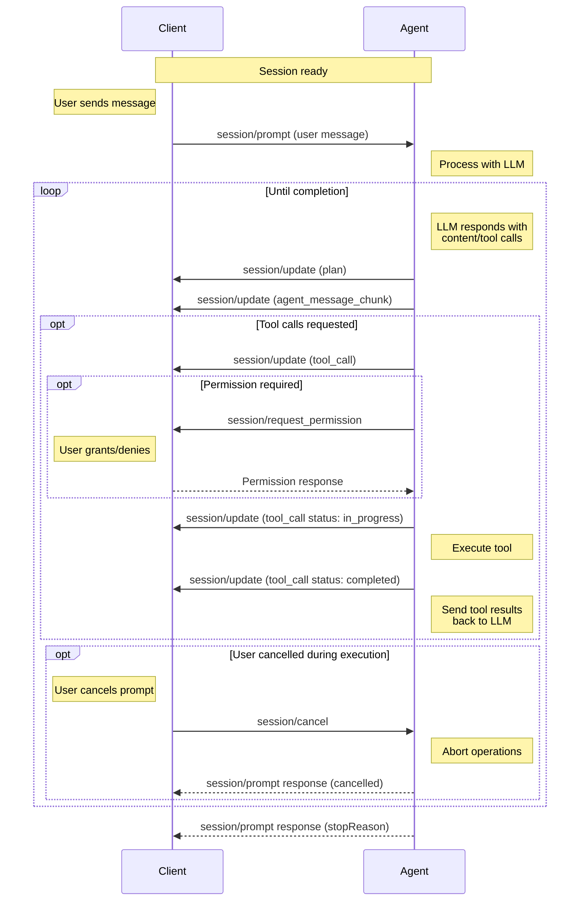

<!-- Minimal local copy of the official ACP docs. Source: https://agentclientprotocol.com/protocol/prompt-turn -->

# Prompt Turn

> Understanding the core conversation flow

A prompt turn represents a complete interaction cycle between the Client and Agent, starting with a user message and continuing until the Agent completes its response. This may involve multiple exchanges with the language model and tool invocations.

Before sending prompts, Clients **MUST** first complete the initialization phase and session setup.

## The Prompt Turn Lifecycle

### 1. User Message

The turn begins when the Client sends a `session/prompt`.

### 2. Agent Processing

Upon receiving the prompt request, the Agent processes the user's message and sends it to the language model, which **MAY** respond with text content, tool calls, or both.

### 3. Agent Reports Output

The Agent reports the model's output to the Client via `session/update` notifications. This may include the Agent's plan for accomplishing the task, text responses from the model, and tool calls.

### 4. Check for Completion

If there are no pending tool calls, the turn ends and the Agent **MUST** respond to the original `session/prompt` request with a `StopReason`.

### 5. Tool Invocation and Status Reporting

Before proceeding with execution, the Agent **MAY** request permission from the Client via the `session/request_permission` method.

Once permission is granted (if required), the Agent **SHOULD** invoke the tool and report a status update marking the tool as `in_progress`.

As the tool runs, the Agent **MAY** send additional updates, providing real-time feedback about tool execution progress.

When the tool completes, the Agent sends another update with the final status and any content.

### 6. Continue Conversation

The Agent sends the tool results back to the language model as another request.

The cycle returns to agent processing, continuing until the language model completes its response without requesting additional tool calls or the turn gets stopped by the Agent or cancelled by the Client.

## Stop Reasons

When an Agent stops a turn, it must specify the corresponding `StopReason`:

- `end_turn`
- `max_tokens`
- `max_turn_requests`
- `refusal`
- `cancelled`

## Cancellation

Clients **MAY** cancel an ongoing prompt turn at any time by sending a `session/cancel` notification.

The Client **SHOULD** preemptively mark all non-finished tool calls pertaining to the current turn as `cancelled` as soon as it sends the `session/cancel` notification.

The Client **MUST** respond to all pending `session/request_permission` requests with the `cancelled` outcome.

When the Agent receives this notification, it **SHOULD** stop all language model requests and all tool call invocations as soon as possible.

After all ongoing operations have been successfully aborted and pending updates have been sent, the Agent **MUST** respond to the original `session/prompt` request with the `cancelled` stop reason.

<Warning>
  API client libraries and tools often throw an exception when their operation is aborted, which may propagate as an error response to `session/prompt`.

  Clients often display unrecognized errors from the Agent to the user, which would be undesirable for cancellations as they aren't considered errors.

  Agents **MUST** catch these errors and return the semantically meaningful `cancelled` stop reason, so that Clients can reliably confirm the cancellation.
</Warning>
