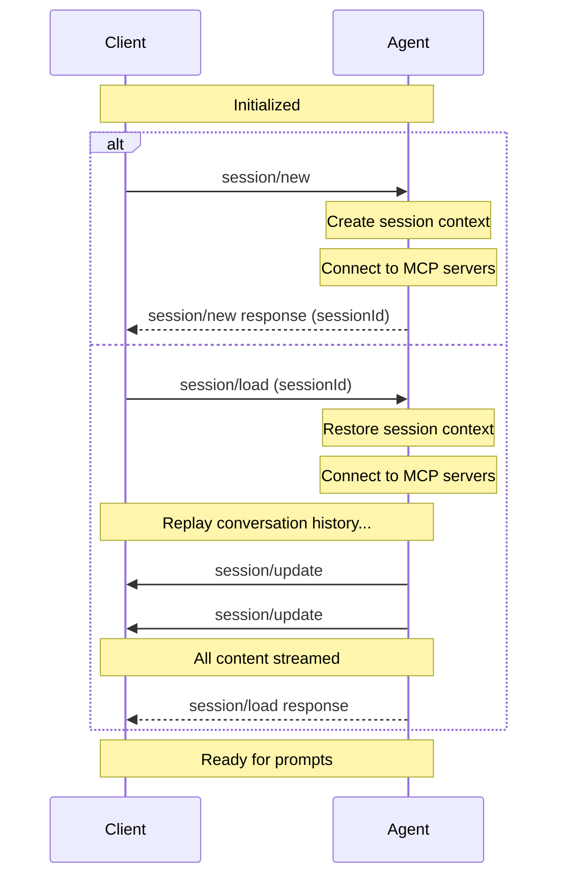

<!-- Minimal local copy of the official ACP docs. Source: https://agentclientprotocol.com/protocol/session-setup -->

# Session Setup

> Creating and loading sessions

Sessions represent a specific conversation or thread between the [Client](./overview.md#client) and [Agent](./overview.md#agent). Each session maintains its own context, conversation history, and state, allowing multiple independent interactions with the same Agent.

Before creating a session, Clients **MUST** first complete the initialization phase to establish protocol compatibility and capabilities.

_Diagram — diagram_ ::
Relationships shown by arrows in the diagram source below — open in a graphical viewer (or the maenifold desktop app / GitHub web UI) to render.

<details><summary>Mermaid source (graphical viewers only)</summary>



</details>

## Creating a Session

Clients create a new session by calling the `session/new` method with:

* The working directory for the session
* A list of MCP servers the Agent should connect to

```json
{
  "jsonrpc": "2.0",
  "id": 1,
  "method": "session/new",
  "params": {
    "cwd": "/home/user/project",
    "mcpServers": [
      {
        "name": "filesystem",
        "command": "/path/to/mcp-server",
        "args": ["--stdio"],
        "env": []
      }
    ]
  }
}
```

The Agent **MUST** respond with a unique Session ID that identifies this conversation:

```json
{
  "jsonrpc": "2.0",
  "id": 1,
  "result": {
    "sessionId": "sess_abc123def456"
  }
}
```

## Loading Sessions

Agents that support the `loadSession` capability allow Clients to resume previous conversations.

Before attempting to load a session, Clients **MUST** verify that the Agent supports this capability by checking the `loadSession` field in the `initialize` response.

If `loadSession` is `false` or not present, the Agent does not support loading sessions and Clients **MUST NOT** attempt to call `session/load`.

To load an existing session, Clients **MUST** call the `session/load` method with:

* The Session ID to resume
* MCP servers to connect to
* The working directory

The Agent **MUST** replay the entire conversation to the Client in the form of `session/update` notifications.

When all the conversation entries have been streamed to the Client, the Agent **MUST** respond to the original `session/load` request.

## Session ID

The session ID returned by `session/new` is a unique identifier for the conversation context.

Clients use this ID to:

* Send prompt requests via `session/prompt`
* Cancel ongoing operations via `session/cancel`
* Load previous sessions via `session/load` (if the Agent supports the `loadSession` capability)

## Working Directory

The `cwd` (current working directory) parameter establishes the file system context for the session. This directory:

* **MUST** be an absolute path
* **MUST** be used for the session regardless of where the Agent subprocess was spawned
* **SHOULD** serve as a boundary for tool operations on the file system

## MCP Servers

The Model Context Protocol (MCP) allows Agents to access external tools and data sources. When creating a session, Clients **MAY** include connection details for MCP servers that the Agent should connect to.

MCP servers can be connected to using different transports. All Agents **MUST** support the stdio transport, while HTTP and SSE transports are optional capabilities that can be checked during initialization.

### Transport Types

#### Stdio Transport

All Agents **MUST** support connecting to MCP servers via stdio. This is the default transport mechanism.

Example stdio transport configuration:

```json
{
  "name": "filesystem",
  "command": "/path/to/mcp-server",
  "args": ["--stdio"],
  "env": [
    {
      "name": "API_KEY",
      "value": "secret123"
    }
  ]
}
```

#### HTTP Transport

When the Agent supports `mcpCapabilities.http`, Clients can specify MCP servers configurations using the HTTP transport.

#### SSE Transport

When the Agent supports `mcpCapabilities.sse`, Clients can specify MCP servers configurations using the SSE transport.

<Warning>This transport was deprecated by the MCP spec.</Warning>

### Checking Transport Support

Before using HTTP or SSE transports, Clients **MUST** verify the Agent's capabilities during initialization.

Agents **SHOULD** connect to all MCP servers specified by the Client.
