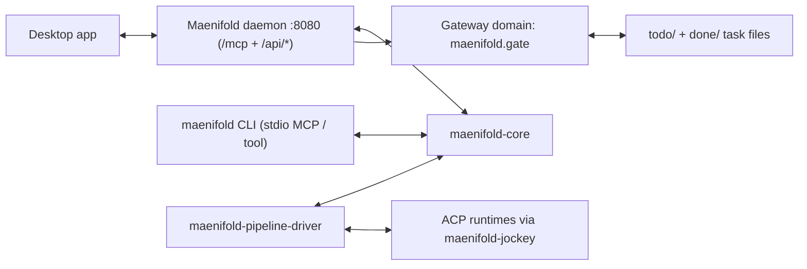

# Architecture Guide (Verified from Source)

This guide documents the runtime architecture as implemented in this repository, using code paths as the source of truth.

## Runtime topology

```
[Desktop app] <-----> [Maenifold daemon :8080]  (HTTP /mcp + /api/*)
                              ^
                              |
[CLI: maenifold (stdio)] <--> [maenifold-core] <--> [Daemon]
                              ^
                              |
[maenifold-pipeline-driver] --+--> [ACP runtimes via maenifold-jockey]
                              |
                              +--> [maenifold.gate Gateway domain] <--> [todo/ + done/ task files]
```

The `maenifold --http` daemon on port 8080 hosts MCP, `/api/*`, and native Gateway domains including `maenifold.gate`. The pipeline driver dispatches ACP runtimes through `maenifold-jockey`.

<details><summary>Same diagram in Mermaid (graphical viewers only)</summary>



</details>

## Crates and responsibilities (5 crates)

1. **`maenifold-core`**  
   Core tool registry, MCP server, memory/graph/search/workflow/pipeline logic.

2. **`maenifold-cli`**  
   Binary entrypoint for `maenifold`; dispatches to core CLI/MCP/HTTP runtime.

3. **`maenifold-gate-core`**
   Shared file-authoritative gate lifecycle library for task progression. Gate operations are accessed through `GatewayExecute` with `domain="maenifold.gate"` on the MCP Gateway surface, where `crates/maenifold-core/src/mcp/gateway_gate.rs` exposes `gate_Status/gate_Append/gate_Pass/gate_Fail/gate_History/gate_TaskBody/gate_Sync`.

4. **`maenifold-jockey`**  
   ACP bridge/runtime integration used by core workflow/pipeline execution.

5. **`maenifold-pipeline-driver`**  
   Detached pipeline executor process; runs pipeline sessions, dispatches nodes, handles cancellation/recovery, and persists pipeline state.

## Three protocols, three roles (do not confuse)

maenifold uses three distinct protocols. Mixing them is a P0 (see
`AGENTS.md` P0 trigger #7).

| Protocol | Direction | Role | Where it lives |
|----------|-----------|------|----------------|
| **MCP** | external client → maenifold daemon | The universal inbound interface for AI callers (VS Code, Copilot CLI, Copilot extension, etc.). Every tool the AI can call is exposed through MCP. | `crates/maenifold-core/src/mcp/` |
| **ACP / Jockey** | maenifold UI → user-visible CLI agent | The product runtime that lets a human in the Maenifold desktop app load and chat with a CLI agent (Codex, Claude CLI, Copilot CLI as a chat partner). It is a UX feature, not gateway infrastructure. | `crates/maenifold-jockey/` |
| **Inferencing** | maenifold daemon → LLM API | Direct LLM API access (Azure OpenAI, OpenAI, Anthropic, etc.) used when an MCP gateway tool needs to do its own model call and the calling MCP client does not advertise `sampling/createMessage`. | inference backends configured in `maenifold.json` |

**`GatewayIntent` resolver paths.** `GatewayIntent` has exactly two resolver
paths, chosen per-request based on the calling MCP client's capabilities:

1. **MCP client sampling** — `peer.create_message(...)` when the client
   advertises `sampling/createMessage`. Path emits `sampling` events to
   `sampling://sessions`.
2. **Direct inferencing** — direct LLM API call when the client does not
   support sampling. Path emits `inferencing` events to
   `sampling://sessions`.

ACP / Jockey / `AcpExec` / `jockey::acp::execute_runtime` / `AgentsConfig` are
**never** part of any `GatewayIntent` resolver path. If a resolver path needs
an `agents` block entry to function, the architecture is wrong — file a P0.

## MCP boundary rule (single capability surface)

**Rule:** operations are exposed as MCP tools, and the same underlying handlers are used by both human-invoked CLI and agent-invoked MCP calls.

- In core, MCP `call_tool` routes to `ToolRegistry::global().try_invoke(...)`.
- CLI `maenifold tool ...` also routes to `ToolRegistry::global().try_invoke(...)`.
- MCP tool discovery in core is generated from canonical registry names (`list_mcp_tools` from `ToolRegistry`), so MCP and CLI share the same operation surface.
- The `maenifold.gate` Gateway domain routes `GatewayExecute` commands to `GateToolService`, which owns the shared gate command behavior.

## Data model and runtime paths (verified)

From `crates/maenifold-core/src/config.rs` (`Config::current()`):

- `maenifold_root` = `MAENIFOLD_ROOT` override, else `~/maenifold`
- `memory_path` = `<maenifold_root>/memory`
- `assets_path` = `<maenifold_root>/assets`
- `database_path` = `MAENIFOLD_DATABASE_PATH` override, else `<maenifold_root>/memory.db`

Important correction:

- Database default is **`memory.db` at root** (`~/maenifold/memory.db`), **not** `.maenifold/graph.db`.

Related persistence:

- Memory markdown URIs (`memory://...`) resolve under `memory_path` via `uri_to_path(..., &config.memory_path)`.
- Gate read model DB path is `<workspace>/.gate/gate.db` (`GateCacheDb::path_for_root`), while authoritative task state remains markdown files in `todo/` and `done/`.

## E2E trace 1: `WriteMemory`

1. Entry (CLI or MCP):
   - CLI: `CliApp::run_tool_inner` → `ToolRegistry::try_invoke("WriteMemory", ...)`
   - MCP: `MaenifoldMcpServer` `call_tool` → `ToolRegistry::global().try_invoke(...)`
2. Registry maps `WriteMemory` to `memory::write_memory`.
3. `memory::write_memory` validates payload/wiki links, builds URI `memory://...`, then calls `write_markdown(...)`.
4. `write_markdown` resolves URI with `uri_to_path(..., &config.memory_path)` and writes markdown file.
5. File is indexed (`index_file_content(...)`) after write.

## E2E trace 2: Pipeline run

1. `Pipeline` tool with `sessionId + run=true` enters `workflow::pipeline::handler_lifecycle::run_pipeline`.
2. Runtime context is persisted (`persist_pipeline_runtime_context`), then core spawns `maenifold-pipeline-driver`.
3. Driver (`maenifold-pipeline-driver/src/main.rs`) calls `execute_pipeline(...)`.
4. Executor loop:
   - `dispatch_pipeline(...)` claims ready nodes (`pending -> active`)
   - Node execution requests are built and scheduled.
5. Node execution:
   - Prompt/workflow/thinking nodes call workflow runner functions (`run_prompt_node`, `run_workflow_with_pool_session_opts`, `run_think_with_pool`)
   - These open ACP-backed sessions and call `jockey::acp::execute_runtime(...)`
   - Tool nodes call either local tools (`ToolRegistry::try_invoke`) or external MCP servers via RMCP HTTP/stdio.
   - This describes the product Pipeline runtime only. PM/Gate coding workers are not launched through ACP, Jockey, or `AcpExec`; they use the host agent/task dispatch process with explicit worktrees.
6. Final status is persisted with `persist_final_pipeline_status`.

## E2E trace 3: Gate progression (`pending -> ... -> done`)

1. Entry via `GatewayExecute` with domain `maenifold.gate` and command `gate_Pass` converges in `GateToolService::pass`.
2. `pass_task`/`apply_outcome`:
   - acquires task lock
   - reads authoritative task markdown from `todo/` or `done/`
   - resolves pipeline definition + current state
   - computes transition via `StateMachine::next_on_pass` / `next_on_fail`
3. Writes canonical stage section to task markdown.
4. If next state is terminal, `TaskRepository::move_to_done(...)` renames task file into `done/`.
5. Read model is refreshed (`sync_gate`) into `<root>/.gate/gate.db`.

## Source anchors

- Core paths/config: `crates/maenifold-core/src/config.rs`
- Core CLI + MCP dispatch:  
  `crates/maenifold-core/src/cli.rs`  
  `crates/maenifold-core/src/cli/handlers.rs`  
  `crates/maenifold-core/src/mcp/mod.rs`  
  `crates/maenifold-core/src/registry.rs`
- Memory write path mapping:  
  `crates/maenifold-core/src/memory/access.rs`  
  `crates/maenifold-core/src/markdown/storage.rs`  
  `crates/maenifold-core/src/markdown/paths.rs`
- Pipeline lifecycle/driver/executor/ACP:  
  `crates/maenifold-core/src/workflow/pipeline/handler_lifecycle.rs`  
  `crates/maenifold-pipeline-driver/src/main.rs`  
  `crates/maenifold-core/src/workflow/pipeline/executor.rs`  
  `crates/maenifold-core/src/workflow/pipeline/executor_run.rs`  
  `crates/maenifold-core/src/workflow/agent_session.rs`  
  `crates/maenifold-core/src/workflow/runner.rs`
- Daemon and desktop endpoints:  
  `crates/maenifold-core/src/mcp/http.rs`  
  `apps/desktop/electron/main.ts`  
  `apps/desktop/src/lib/daemon-url.ts`  
  `apps/desktop/src/lib/constants.ts`
- Gate progression/data model:
  - `crates/maenifold-gate-core/src/lifecycle.rs`
  - `crates/maenifold-gate-core/src/task_repository.rs`
  - `crates/maenifold-gate-core/src/gate_definition.rs`
  - `crates/maenifold-gate-core/src/state_machine.rs`
  - `crates/maenifold-core/src/mcp/gateway_gate.rs`
