# maenifold

**Domain expertise that compounds. Open. Local. Yours.**

**Persistent hierarchical state machines executing across ephemeral agents on a shared cognitive manifold, where each HSM transition produces graph artifacts that reshape the manifold for all future transitions by all threads — human and agent alike.**

Context engineering infrastructure for AI agents. Point it at any domain's literature, and it builds specialized experts that live on your machine, work offline, and get smarter with every use.

---

## Table of Contents

- [Product Overview](#product-overview)
  - [Runtime Surfaces](#runtime-surfaces)
  - [Scriptable UI](#scriptable-ui)
  - [Persistent State](#persistent-state)
  - [Operator Workflows](#operator-workflows)
- [Theoretical Foundations](#theoretical-foundations)
- [How It Works](#how-it-works)
  - [Sequential Thinking](#sequential-thinking)
  - [Orchestrated Workflows](#orchestrated-workflows)
  - [Hybrid RRF Search](#hybrid-rrf-search)
  - [Lazy Graph Construction](#lazy-graph-construction)
  - [Memory Lifecycle](#memory-lifecycle)
- [Quick Start](#quick-start)
  - [For VSCode Users](#for-vscode-users)
  - [For Developers](#for-developers)
- [Desktop UI Reference](#desktop-ui-reference)
  - [Application Shell](#application-shell)
  - [Home](#home)
  - [Agents](#agents)
  - [Pipelines](#pipelines)
  - [Gate](#gate)
  - [Knowledge](#knowledge)
  - [Workflows](#workflows)
  - [Settings](#settings)
  - [Onboarding Permissions and Dialogs](#onboarding-permissions-and-dialogs)
  - [Diagnostics Traffic and Cross-Cutting Behavior](#diagnostics-traffic-and-cross-cutting-behavior)
- [Cognitive Assets](#cognitive-assets)
- [Demo Artifacts](#demo-artifacts)
- [Testing & Validation](#testing--validation)
- [Technical Specifications](#technical-specifications)
- [Technical Principles](#technical-principles)
- [Configuration](#configuration)
- [Skills](#skills)
- [Integrations](#integrations)
- [Project Structure](#project-structure)
- [License & Attribution](#license--attribution)

---

## Product Overview

maenifold is a local-first product composed of a shared markdown memory corpus, a graph-and-vector index, a long-running local daemon, an MCP tool surface for agents, and a packaged Electron desktop console for operators. The same knowledge base, workflows, and local configuration power the CLI, desktop app, and MCP-integrated clients.

### Runtime Surfaces

| Surface | Entry point | What it is for |
|---------|-------------|----------------|
| **Desktop app** | Packaged Electron app or `npm run dev:electron` | Human operator console for agents (with inline MCP Apps), pipelines, gate tasks, knowledge exploration, workflow authoring, and local settings. |
| **MCP server** | `maenifold --mcp` | Native tool surface for Codex, Claude Code, Continue, Cline, and other MCP-capable clients. |
| **HTTP daemon** | `maenifold --http` | Long-running local control plane used by the desktop app and any HTTP-based integrations. |
| **CLI** | `maenifold --tool ... --payload ...` | One-shot automation, scripting, debugging, and reproducible direct tool invocation. |
| **Cognitive assets** | `assets/` plus memory-root assets | Reusable workflows, roles, perspectives, colors, and prompt scaffolds that shape reasoning. |

### Scriptable UI

**Target Architecture:** the desktop app is a first-class MCP client. Every product panel fetches data through MCP tools, using the same tool surface available to agents and other MCP clients. The UI is therefore one frontend among many: scripts, agent clients, and alternate consoles can do the same work by calling the backing tools directly. Some infrastructure endpoints, such as health checks and machine identity, remain REST.

Status: ✅ exists and UI uses it today; 🔜 being added by sprint 229.

| UI Screen | MCP Tools | Status |
|-----------|-----------|--------|
| Home | `RecentActivity`, `MemoryStatus` | ✅ |
| Agents | ACP session via `AcpExec` | ✅ |
| Pipelines | `Pipeline` | ✅ |
| Gate | `gate-sync`, `gate-status`, `gate-history`, `gate-task_body` from the gate MCP server | ✅ |
| Knowledge | `SearchMemories`, `ReadMemory`, `BuildContext`, `Visualize`, `FindSimilarConcepts` | ✅ |
| Workflows | `Workflow`, `ListAssets` | ✅ |
| Settings (read) | `GetConfig` | 🔜 T-229.3 |
| Settings (write) | `UpdateSettings`, `ReloadConfig` | 🔜 T-229.4 |
| Settings (agents) | `AddAgent`, `UpdateAgent`, `DeleteAgent` | 🔜 T-229.5 |
| Settings (MCP servers) | `AddMcpServer`, `UpdateMcpServer`, `DeleteMcpServer` | 🔜 T-229.6 |
| Tool Discovery | `DiscoverMcpTools` | 🔜 T-229.9 |

### Persistent State

| Artifact | Backing store | Notes |
|----------|---------------|-------|
| **Markdown memory corpus** | `memory/` | Source of truth for notes, decisions, research, and thinking traces. |
| **Graph and vector cache** | `memory.db` | SQLite cache for embeddings, graph structure, and search acceleration. Regenerable from memory files. |
| **Workflow and role library** | `assets/` | JSON and markdown assets for orchestration, roles, perspectives, and packaged guidance. |
| **Desktop preferences** | Local application storage | Device-local UI preferences such as text size, telemetry choice, and last working directory. |
| **Daemon-backed configuration** | Local config files plus daemon API | Agent definitions, MCP server definitions, runtime tuning, and embedding model state. |

### Operator Workflows

| Workflow | Primary surface | Outcome |
|----------|-----------------|---------|
| **Start or resume an agent session** | Home, Agents | Create ACP-backed conversations, attach files, inspect tool calls, and continue prior work. |
| **Design and run a pipeline** | Pipelines | Compose prompt, workflow, tool, and sequential-thinking nodes into a DAG and execute it. |
| **Track delivery work** | Gate | Browse task files, filter by process or state, and inspect stage history and progress. |
| **Explore notes and concept structure** | Knowledge | Search the memory corpus, read notes, follow WikiLinks, and inspect concept communities. |
| **Author workflow assets** | Workflows | Create, import, edit, validate, and save reusable workflow definitions. |
| **Configure the local runtime** | Settings | Manage agents, MCP servers, runtime tuning, embedding models, and desktop-local preferences. |
| **Proxy external MCP servers** | MCP Tool Gateway | Expose stdio MCP servers through maenifold's Streamable HTTP endpoint with lifecycle management and crash recovery. |

---

## Theoretical Foundations

### Philosophical Foundations

| Concept | Origin | Application |
|---------|--------|-------------|
| **[Ma (間)](MA_MANIFESTO.md)** | Japanese aesthetics | The space between things as the thing itself ([what we don't do](WHAT_WE_DONT_DO.md)) |

### Research Foundations

| Concept | Origin | Application |
|---------|--------|-------------|
| **[Context Engineering](research/context-engineering.md)** | Anthropic (2025) | Attention budget management: just-in-time retrieval, compaction, decay, structured notes, sub-agents |
| **[ACT-R](research/decay-in-ai-memory-systems.md)** | Anderson (CMU); Wixted & Ebbesen (1991) | Power-law inspired decay ([exponential approximation](research/decay-in-ai-memory-systems.md#54-the-act-r-connection)) |
| **[New Theory of Disuse](research/decay-in-ai-memory-systems.md#23-the-spacing-effect-and-retrieval-strengthening)** | Bjork & Bjork | Storage vs retrieval strength |
| **[Two-Stage Memory](research/decay-in-ai-memory-systems.md#32-sleep-and-memory-consolidation)** | Cognitive neuroscience | Episodic → semantic consolidation |
| **[Linguistic Relativity](https://lera.ucsd.edu/papers/linguistic-relativity.pdf)** | Weak form (Boroditsky, 2003) | Perspectives change the linguistic frame of LLM reasoning |
| **[ConfessionReport](research/confession-reports.md)** | OpenAI (Barak et al., 2025) | Inference-time honesty enforcement via hooks + adversarial audit |

### [Memory System](research/memory-system.md)

| Feature | What It Means | Implementation |
|---------|---------------|----------------|
| **[Two-Stage Model](https://doi.org/10.1152/physrev.00032.2012)** | Fast episodic encoding → slow semantic consolidation | `memory://thinking/` (episodic) vs `memory://research/` (semantic) |
| **[ACT-R Decay](https://doi.org/10.4324/9781315805696)** | Memories fade without access following power-law | `DecayCalculator`: `base × time^(-0.5)` |
| **[Storage vs Retrieval](https://www.researchgate.net/publication/281322665)** | Pointers persist; only accessibility fades | WikiLinks never deleted; decay affects ranking |
| **[Maintenance Cycles](https://doi.org/10.1016/j.neuron.2013.12.025)** | Periodic graph hygiene | 5 workflows in serialized dependency order: repair, hub-detection, consolidation, epistemic, status |
| **[Consolidation](https://doi.org/10.1038/nrn2762)** | Thinking sessions → semantic memory | Replay via `RecentActivity`, distill to `WriteMemory`, link via `FindSimilarConcepts` |

### Symbolic Systems

| Feature | What It Means | Implementation |
|---------|---------------|----------------|
| **[Concept-as-Protocol](context-engineering.md)** | WikiLinks carry context between agents | `PreToolUse` hook extracts `[[concepts]]`, injects graph context |
| **[Lazy Graph](https://en.wikipedia.org/wiki/Zettelkasten)** | No predefined schema; structure emerges | `Sync` extracts WikiLinks; co-occurrence creates edges |
| **[Hybrid Search](https://dl.acm.org/doi/10.1145/1571941.1572114)** | Semantic similarity + exact matching | `SearchMemories` fuses with Reciprocal Rank Fusion (k=60) |
| **Concept Repair** | Normalize WikiLink variants safely | `RepairConcepts` validates similarity ≥0.7 before replacing |
| **WikiLink Filtering** | Write-time concept blocklist | `.wikilink-filter.json` prevents hub concepts from graph pollution |
| **MCP Resources** | Live-queryable graph state via URI scheme | `graph://` URIs for corpus snapshots, communities, concepts, and recent activity with subscribe/notify |

### Reasoning

| Feature | What It Means | Implementation |
|---------|---------------|----------------|
| **[Sequential Thinking](https://github.com/modelcontextprotocol/servers/tree/main/src/sequentialthinking)** | State machine: `active` → `completed`/`cancelled`/`abandoned`. Multi-step reasoning with revision, branching, and concurrent multi-agent branches | Extends MCP server with `sessionId`, `branchId`, `parentWorkflowId`; can be registered as a Workflow submachine |
| **Assumption Ledger** | Track beliefs and their validation status | `AssumptionLedger` with confidence levels, evidence links |
| **Pipeline Execution** | DAG-ordered execution with conditional routing, per-node retry, timeout enforcement, and session resume | `Pipeline` tool with `EdgeType::Conditional`, `backon` retry, `sessionRef` for ACP session reconnection |

### Workflow System

| Feature | What It Means | Implementation |
|---------|---------------|----------------|
| **Workflow Engine** | Structured multi-step methodology execution | `Workflow` tool with JSON steps, `toolHints`, guardrails |
| **Supervisor/Submachine** | Workflows manage SequentialThinking lifecycles | `submachineSessionId` registers child; `phase` gates step advancement |
| **Nested Composition** | Workflows invoke other workflows and tools | Workflows embed `SequentialThinking`; bidirectional linking |
| **Session Persistence** | Resume reasoning across days | State in `memory://workflow/`; session IDs enable continuation |

**Notable Workflows:**

| Workflow | What It Demonstrates | How |
|----------|---------------------|-----|
| **Workflow Dispatch** | Meta-cognitive methodology selection | Analyzes problem characteristics, queries graph for similar past problems, selects optimal workflow |
| **Research Think Tank** | Multi-agent collaborative reasoning | Defines roles (synthesizer, critic, explorer), structures knowledge construction phases |
| **Agentic SLC** | Quality-controlled development | Embeds anti-slop checks, requires RTM traceability, enforces ConfessionReports |
| **Constitutional Roles** | Constitutional AI for persona creation | Uses principles + examples to generate role definitions that constrain agent behavior |
| **Higher-Order Thinking** | Meta-cognitive reflection | Recursive self-analysis steps: examine reasoning, identify biases, refine approach |
| **Six Thinking Hats** | Structured perspective switching | Sequences through DeBono's colors with explicit transitions and synthesis |

*Multi-agent orchestration requires an MCP client with agent dispatch (Claude Code, Codex, aishell) or CLI scripting with subprocess spawning.*

---

## How It Works

### Sequential Thinking

AI agents can engage in multi-hour reasoning sessions with full revision capability:

```markdown
# Thinking Session: Architecture Design
Thought 1: Analyzing requirements...
Thought 2: Wait, I need to reconsider the scaling approach from Thought 1...
Thought 3: Branching to explore microservices vs monolithic...
```

Each session creates a `memory://thinking/session-{id}` file tracking the complete reasoning chain. Sessions support:
- **Revision**: Reconsider and update previous thoughts
- **Branching**: Explore alternative reasoning paths
- **Persistence**: Continue across days or weeks
- **Multi-agent**: Share sessions between agents

### Orchestrated Workflows

Pre-built workflows embed sequential thinking at critical decision points:

- **Discovery Wave**: Parallel agents explore the problem space
- **Validation Wave**: Test assumptions and verify approaches
- **Implementation Wave**: Execute with confidence

**Intelligent Workflow Selection**: The `workflow-dispatch` meta-system analyzes problem characteristics, researches historical context, assesses cognitive requirements, and automatically selects optimal reasoning methodologies.

**The PM Pattern**: A primary agent (usually Sonnet) acts as the blue-hat orchestrator, using sequential thinking to maintain project context. It dispatches ephemeral sub-agents for specific tasks — these agents can burn through their context windows on implementation details while the PM preserves the overall vision. All thinking persists to `memory://` for continuity.

Workflows maintain state across days, enabling true long-running projects.

### Hybrid RRF Search

Combines semantic vectors with full-text search using Reciprocal Rank Fusion:

- **Semantic search** finds conceptually related content
- **Full-text search** ensures exact terms aren't missed
- **RRF fusion** optimally blends both result sets (k=60)
- **Returns context** with relevance scores for transparency

### Lazy Graph Construction

The knowledge graph builds itself through natural use:

```markdown
# API Design Decision
We chose [[REST]] over [[GraphQL]] for our [[public API]] due to
[[caching]] requirements and [[client simplicity]].
```

Every `[[WikiLink]]` becomes a node. Every mention strengthens edges. Patterns emerge without planning.

Concepts can be excluded from the graph via `.wikilink-filter.json` — a blocklist in the memory root checked at write time that prevents hub or ephemeral concepts from polluting the graph structure.

#### `.wikilink-filter.json` Format

The file is a JSON object mapping concept keys to human-readable reasons:

```json
{
  "software-tool": "God node with 7,438 edges — routes to nothing",
  "workflowstep*": "Code symbol prefix — catches WorkflowStepTimeline, WorkflowStepCard, etc."
}
```

**Exact match**: Keys without a trailing `*` are normalized via `normalize_concept` (lowercase, spaces/underscores/slashes → hyphens, deduplicated). `"AgentPool"` normalizes to `agentpool` and blocks `[[AgentPool]]`.

**Prefix match**: Keys ending with `*` use lowercase-only normalization (no hyphen splitting). `"workflowstep*"` matches any concept starting with `workflowstep` — catching `workflowsteptimeline`, `workflowstepinspector`, `workflowstepcard` in one entry. Because CamelCase normalizes to concatenated lowercase (not hyphenated), `"workflowstep*"` won't collide with `[[workflow-step]]`.

The filter is mtime-cached — edits take effect on the next write operation without restarting the server. Symlinked filter files are rejected (policy must be rooted in memory).

### Memory Lifecycle

Knowledge follows a lifecycle grounded in cognitive neuroscience:

**Decay**: Memories fade without access, following ACT-R's power-law of forgetting:
```
retrieval_strength = base_strength × (time_since_access)^(-decay_rate)
```

**Tiered Memory Classes**:

| Tier | Grace Period | Half-Life | Examples |
|------|-------------|-----------|----------|
| Sequential | 7 days | 30 days | `memory://thinking/sequential/` sessions |
| Workflows | 14 days | 30 days | `memory://thinking/workflow/` sessions |
| Semantic | 28 days | 30 days | `memory://research/`, `memory://decisions/` |
| Immortal | ∞ | ∞ | Validated assumptions, core architecture |

**Sleep Cycles**: Periodic maintenance runs five specialist workflows in serialized dependency order:
- **Repair**: Normalizes WikiLink variants, cleans orphaned concepts
- **Hub Detection**: Identifies and filters generic hub concepts from the graph
- **Consolidation**: Replays high-significance episodic memories, promotes to semantic
- **Epistemic**: Reviews assumptions, validates or invalidates based on evidence
- **Status**: Analyzes decay patterns, reports memory health

*Decay affects search ranking only. Files are never deleted.*

---

## Quick Start

### For VSCode Users

1. **Install maenifold**:
```bash
# macOS/Linux
brew install msbrettorg/tap/maenifold

# Windows - download from GitHub Releases
# https://github.com/msbrettorg/maenifold/releases/latest
```

2. **Configure your AI assistant**:

#### Claude Code
```json
{
  "mcpServers": {
    "maenifold": { "command": "maenifold", "args": ["--mcp"], "type": "stdio" }
  }
}
```

#### Continue.dev
Add to `~/.continue/config.json`:
```json
{
  "mcpServers": {
    "maenifold": {
      "command": "maenifold",
      "args": ["--mcp"],
      "env": { "MAENIFOLD_ROOT": "~/maenifold" }
    }
  }
}
```

#### Cline
Add to VSCode settings (`Cmd+,` → Extensions → Cline):
```json
{
  "cline.mcpServers": {
    "maenifold": {
      "command": "maenifold",
      "args": ["--mcp"],
      "env": { "MAENIFOLD_ROOT": "~/maenifold" }
    }
  }
}
```

#### Codex
Add to `~/.codex/config.toml`:
```toml
[mcp_servers.maenifold]
type = "stdio"
command = "maenifold"
args = ["--mcp"]
startup_timeout_sec = 120
tool_timeout_sec = 600
env = { MAENIFOLD_ROOT = "~/maenifold" }
```

**Multi-agent orchestration** requires MCP clients with agent dispatch:
- **Claude Code** — `claude-code` CLI with Task tool
- **Codex** — Purpose-built orchestrator
- **aishell** — Open-source with agent management

3. **Start using it**:
- Single agent: "Write a memory about our project architecture"
- Multi-agent: "Use agentic-dev workflow to implement authentication"
- Graph query: "Show me how our concepts connect"

### For Developers

**CLI** (macOS/Linux):
```bash
maenifold --tool WriteMemory --payload '{"title":"Auth Decision","content":"Using [[OAuth2]] for [[authentication]]"}'
maenifold --tool SearchMemories --payload '{"query":"authentication","mode":"Hybrid"}'
maenifold --tool BuildContext --payload '{"conceptName":"authentication","depth":2}'
maenifold --tool Sync --payload '{}'
```

**CLI** (Windows PowerShell):
```powershell
maenifold --tool WriteMemory --payload '{\"title\":\"Auth Decision\",\"content\":\"Using [[OAuth2]] for [[authentication]]\"}'
```

**MCP vs CLI**:

| Interface | Advantage | Best for |
|-----------|-----------|----------|
| **MCP** | Auto-sync watcher keeps graph current | Interactive sessions, simple queries |
| **CLI** | Filter intermediate results, preserve context ([why this matters](https://www.anthropic.com/engineering/code-execution-with-mcp)) | Complex workflows, scripting, [Graph-RAG patterns](SCRIPTING.md) |

See [SCRIPTING.md](SCRIPTING.md) for advanced patterns and [BOOTSTRAP.md](BOOTSTRAP.md) for the full journey from empty graph to domain expertise.

---

## Desktop UI Reference

The desktop app is the packaged Electron control plane for maenifold. This section documents the shipped top-level tabs plus the conditional controls that appear only when a session, pipeline run, destructive action, or first-launch workflow is active. The acceptance matrix with test-case IDs lives in [UAT-PLAN.md](UAT-PLAN.md); the tables below are the human-oriented operator reference.

All screenshots in this section were captured from the packaged Electron app on 2026-04-23. If your viewer does not render images, open the corresponding PNG in `docs/ui-tour-screenshots/`.

### Application Shell

The shell is shared across every top-level workspace.

#### Primary tabs

| Tab | What it does |
|-----|--------------|
| **Home** | Launch surface with quick navigation and a one-shot prompt composer. |
| **Agents** | ACP sessions, chat transcript, attachments, tool call traces, and session recovery. |
| **Pipelines** | Pipeline list, composer canvas, node inspectors, and live runner. |
| **Gate** | Local task tracker over `.gate` state. |
| **Knowledge** | Notes browser plus concept graph exploration. |
| **Workflows** | Workflow library, metadata editor, draft bar, and step inspector. |
| **Settings** | Agent catalog, MCP server list, maenifold runtime tuning, embeddings, and local preferences. |

#### Shared shell controls

| Control | What it does |
|---------|--------------|
| **Traffic monitor toggle** | Opens or closes the live diagnostic traffic panel. |
| **Sidebar collapse and expand buttons** | Switch the session rail between full and compact modes. |
| **Working directory display** | Shows the folder used for agent and pipeline operations. |
| **Folder select button** | Opens the Electron folder picker so you can change the working directory. |
| **Agent selector** | Chooses which configured ACP agent backs new sessions. |
| **New session button** | Creates a new agent session using the selected agent and working directory. |
| **Session list** | Lists saved sessions with titles and timestamps. |
| **Resume session action** | Reopens a prior session in the main chat surface. |
| **Delete session action** | Removes a saved session after confirmation. |
| **Connection banner** | Surfaces disconnected or reconnecting daemon or agent state and exposes a cancel action when reconnection is in flight. |
| **Resize handle** | Resizes left and right panels; double-click resets default proportions. |
| **Shared empty states** | Every major view uses the same centered empty-state pattern with optional action buttons. |
| **Command palette** | Opens with `Cmd+K` or `Ctrl+K`, filters commands live, and closes on `Escape` or outside click. |
| **Toast notifications** | Shows success, error, warning, and info events with auto-dismiss plus manual close. |

Keyboard conventions: the top tab bar supports Left, Right, Home, and End navigation; `Enter` activates the focused control; `Tab` and `Shift+Tab` move through focusable elements; and `Escape` closes menus and dialogs.

### Home

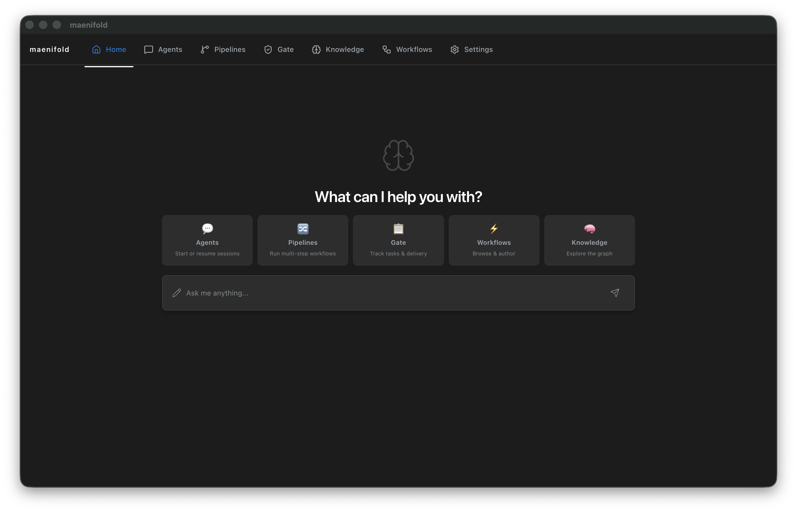

The Home tab is the desktop launch surface. It gives you one-click entry into the major workspaces and a single prompt field for jumping straight into an agent session.

| Control | What it does |
|---------|--------------|
| **Agents tile** | Opens the Agents workspace. |
| **Pipelines tile** | Opens the Pipelines workspace. |
| **Gate tile** | Opens the Gate workspace. |
| **Workflows tile** | Opens the Workflows workspace. |
| **Knowledge tile** | Opens the Knowledge workspace. |
| **Quick prompt input** | Lets you enter a prompt without opening the full Agents tab first. |
| **Send button** | Submits the prompt, opens Agents, and clears the field. |
| **Keyboard submit** | Press `Enter` in the prompt input to send; empty submissions are blocked. |
| **Loading and error states** | The dashboard can surface fetch progress and failure states instead of blank content. |

### Agents

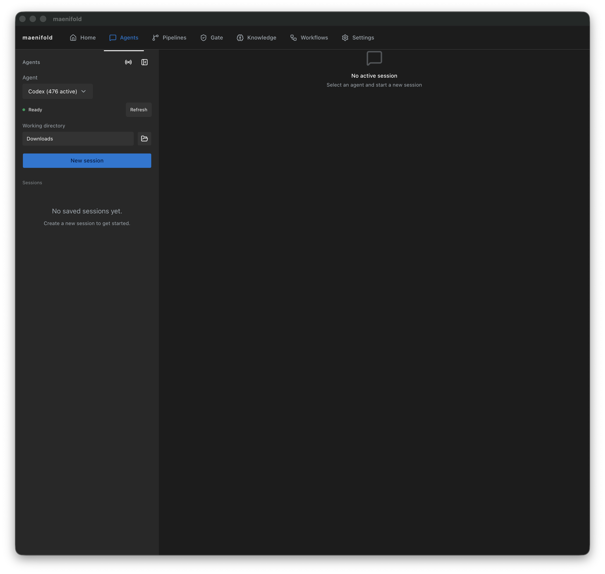

The Agents workspace is the session-centric surface for direct ACP conversations.

#### Session rail

| Control | What it does |
|---------|--------------|
| **Traffic monitor toggle** | Opens the live request or event stream without leaving the chat view. |
| **Collapse or expand button** | Shrinks or restores the left rail. |
| **Agent selector** | Chooses the ACP agent used for new sessions. |
| **Health indicator and refresh action** | Shows whether the selected agent is reachable and lets you re-probe it. |
| **Working directory label** | Displays the root folder used for new sessions. |
| **Select folder button** | Changes the working directory via the folder picker. |
| **New session button** | Starts a new conversation. |
| **Session list** | Shows saved sessions, timestamps, and an empty state when none exist. |
| **Resume action** | Restores a prior session into the main chat view. |
| **Delete action** | Removes a saved session after confirmation. |
| **Resize handle** | Adjusts the width of the session rail. |

#### Chat surface

| Control | What it does |
|---------|--------------|
| **Chat empty state** | Prompts you to select an agent and start a session when nothing is active. |
| **Config option picker** | Opens runtime or model-specific options when exposed by the active agent. |
| **Message textarea** | Main prompt editor for the session. |
| **`Enter` and `Shift+Enter` behavior** | `Enter` sends in single-line mode; `Shift+Enter` inserts a newline. |
| **Send button** | Sends the current message, clears the editor, and shows a sending state while in flight. |
| **Embedded context button** | Opens the context selector for attaching structured context. |
| **Image attachment button** | Opens the file picker for image attachments. |
| **Audio attachment button** | Opens the file picker for audio attachments. |
| **Voice input button** | Opens the Handy companion app for speech-to-text dictation when available. |
| **Attachment remove action** | Removes an attached image or audio item before sending. |
| **Suggestion chips** | Sends precomposed starter prompts from the message list. |
| **Cancel response button** | Stops a streaming response without ending the session. |
| **Thought toggle** | Expands or collapses the model-thinking section on a message. |
| **Tool call toggle** | Expands or collapses tool execution details on a message. |
| **Tool call status indicator** | Shows running, completed, or failed state for each tool execution. |
| **Markdown and code renderer** | Renders headings, lists, links, and syntax-highlighted code blocks inline. |
| **Startup progress card** | Shows multi-step startup state with progress bar, status text, cancel action, and optional details panel. |

### Pipelines

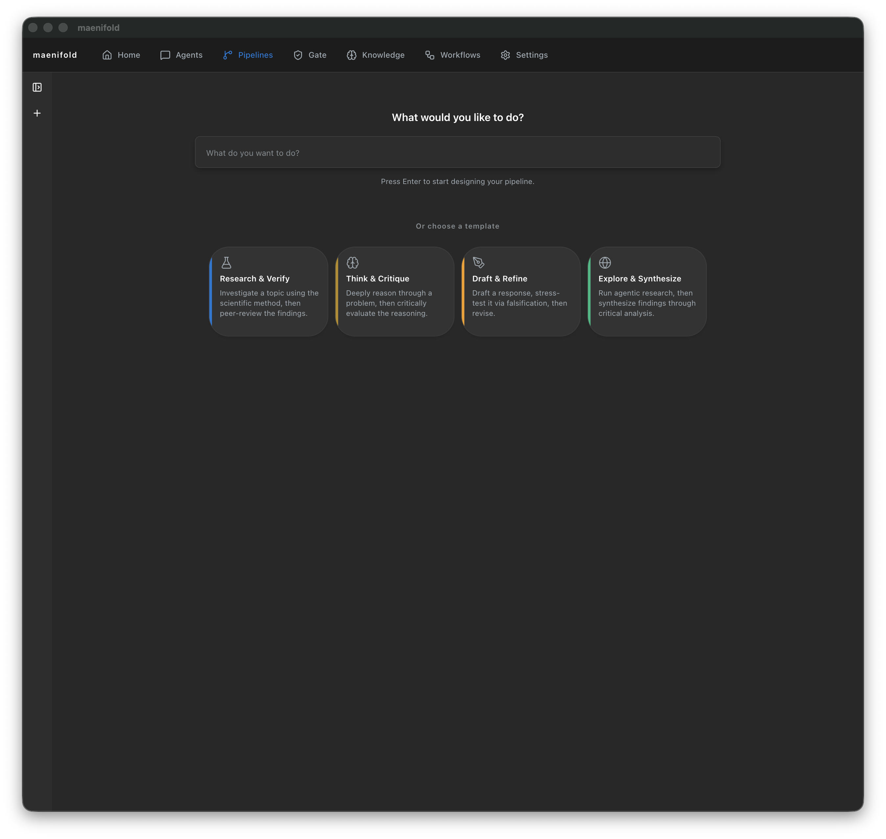

The Pipelines workspace is where you design, inspect, and execute multi-step DAGs built from prompts, workflows, tools, and sequential thinking.

#### Bootstrap, list, and runner controls

| Control | What it does |
|---------|--------------|
| **Prompt input** | Accepts a natural-language goal and starts pipeline design on `Enter`. |
| **Starter chips** | Seeds the composer with starter patterns such as Research & Verify, Think & Critique, Draft & Refine, and Explore & Synthesize. |
| **Flyout toggle** | Opens or closes the pipeline flyout. |
| **New pipeline button** | Creates a new blank pipeline session. |
| **Banner dismiss action** | Hides contextual notices at the top of the workspace. |
| **Mobile sidebar toggle** | Opens or closes the sidebar on narrow layouts. |
| **Graft button** | Opens the Graft Nodes dialog. |
| **Join button** | Opens the Join Pipeline dialog. |
| **Runner toggle** | Shows or hides the live execution runner. |
| **Pipeline sidebar refresh** | Reloads saved pipelines. |
| **Pipeline row selection** | Loads the chosen pipeline into the canvas. |
| **Pipeline delete action** | Removes a pipeline after confirmation. |
| **Flyout search and retry controls** | Filter flyout content and retry failed list operations. |

#### Composer canvas

| Control | What it does |
|---------|--------------|
| **Canvas pan and zoom** | Lets you move around large graphs with drag, scroll, or trackpad gestures. |
| **Node selection and drag** | Selects a node, shows selection state, and repositions it on the canvas. |
| **Node double-click** | Opens the node editor or config panel. |
| **Edge selection and creation** | Lets you draw connections between node ports and remove selected edges. |
| **Multi-select and box select** | Selects multiple nodes for batch operations. |
| **Toolbar layout buttons** | Re-layout nodes left-to-right or top-to-bottom. |
| **Toolbar delete button** | Deletes the current node selection. |
| **Toolbar fit-view button** | Reframes the canvas around all visible nodes. |
| **Toolbar palette toggle** | Opens or closes the node and tool palette. |
| **Node cards** | Render prompt, sequential-thinking, workflow, and tool nodes with icon, label, and hover state. |
| **Status badges** | Reflect pending, running, completed, or failed execution state. |
| **Port handles** | Left and right connection points used to create or accept edges. |
| **Design-mode context menu** | Right-click empty space or a node to Ask agent, Think through, Run workflow, Edit, Duplicate, Delete, or Disconnect edges. |
| **Server-mode context menu** | On executed pipelines, exposes Restart, Rewind, Fork, Abandon, Run Pipeline, Graft, and Promote to Memory actions. |

#### Inspectors and dialogs

| Surface | What it contains |
|---------|------------------|
| **Semantic zoom overlay** | Focused node view with failure disclosure plus Fork, Restart, Rewind, Abandon, Graft, Promote, and reconnect actions. |
| **Graft Nodes dialog** | Node type select, custom ID, connect-from, connect-to, edge-type, type-specific fields, Cancel, and Submit. |
| **Join Pipeline dialog** | Source session ID input plus one or more edge-mapping rows with Add Edge, Remove Edge, Cancel, and Submit. |
| **Promotion preview step** | Search input with Append, Update, Cancel, and Create new actions. |
| **Promotion editor step** | Title, folder, tags, WikiLink-rich body, Back, Cancel, Retry, and Continue controls. |
| **Promotion confirm step** | Back, Edit, Cancel, Retry, and Submit actions before creating or updating memory. |
| **Edge mapping editor** | Parameter input, JSON-path input, Add mapping, and Remove mapping controls. |
| **Design node config panel** | Label, role, color, perspective, CWD, and conditional-edge configuration fields. |
| **Add node form** | Type selector plus per-type fields such as workflow ID, topic, mode, prompt template, total thoughts, and analysis type. |
| **Tool palette** | Refresh, search, pin or unpin, quick-add, clear, and Add Tool controls. |
| **Runner panel** | Real-time execution event log with scrollback and final status visibility. |

### Gate

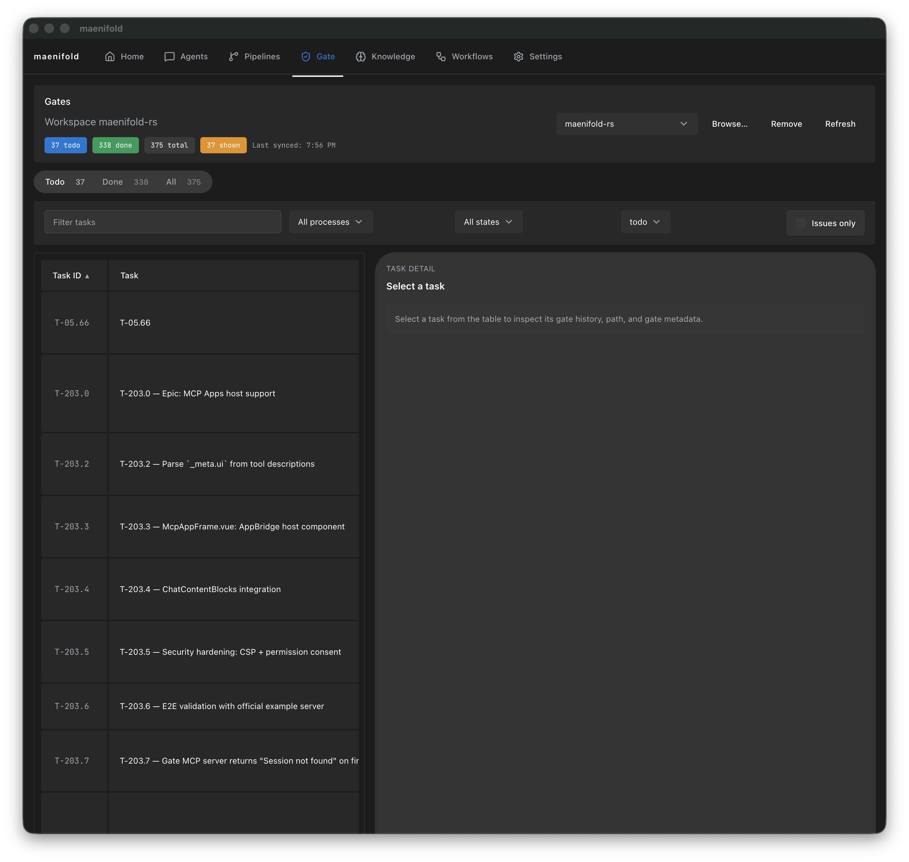

The Gate workspace is the read and inspect surface for local `.gate` task state.

| Control | What it does |
|---------|--------------|
| **Workspace selector** | Chooses which gate root is active. |
| **Browse button** | Opens the folder picker to add or switch a root. |
| **Remove button** | Removes the selected root from the UI. |
| **Refresh button** | Reloads task data from the selected root. |
| **Todo, Done, and All tabs** | Changes which task subset is shown. |
| **Filter tasks input** | Text-filters the task list. |
| **Process selector** | Filters tasks by process. |
| **State selector** | Filters tasks by current state. |
| **Location selector** | Filters tasks by source location such as `todo` or `done`. |
| **Issues-only checkbox** | Restricts the table to issue tasks. |
| **Sortable column headers** | Re-sorts the table by Task ID, Task, Process, or Progress. |
| **Task row selection** | Loads the selected task into the detail pane. |
| **Table keyboard navigation** | Moves selection between rows with Up and Down arrows. |
| **Detail close action** | Clears the selected task and closes the detail pane. |
| **Metadata panel** | Shows the task's core metadata. |
| **Stages panel** | Shows stage progression. |
| **History panel** | Shows stage-change history. |
| **Progress panel** | Shows progress notes and related status detail. |
| **Loading and empty states** | Replace the table with clear feedback when data is still loading or nothing matches. |
| **Cancel command** | Archives a task without completing it — for superseded or abandoned work. |

### Knowledge

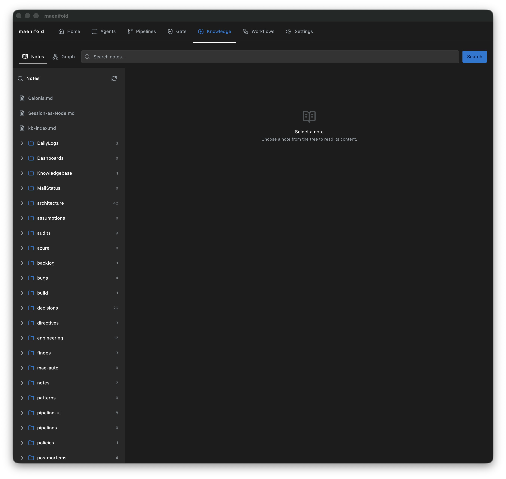

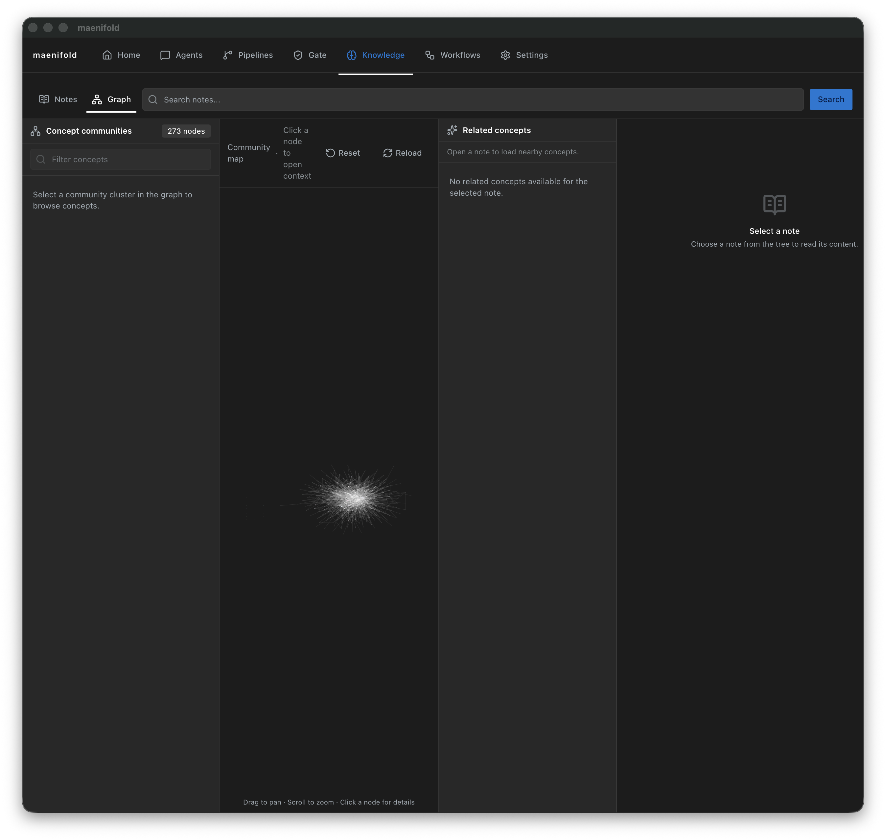

The Knowledge workspace has two modes: note browsing and graph exploration.

#### Notes browser

| Control | What it does |
|---------|--------------|
| **Notes and Graph tabs** | Switch between document browsing and graph exploration. |
| **Search input** | Finds notes by query. |
| **Search button and `Enter` submit** | Executes the search. |
| **Clear search behavior** | Restores the full note tree after a query. |
| **Refresh folders button** | Reloads the memory tree from disk or daemon data. |
| **Folder toggles** | Expand or collapse nested folders in the tree. |
| **File buttons** | Open the selected note in the renderer. |
| **Note renderer** | Shows markdown headings, lists, code blocks, and other note content. |
| **WikiLinks** | Open linked notes and can show preview or tooltip information on hover. |
| **Broken-link handling** | Surfaces missing-note behavior without crashing the reader. |
| **Results and empty states** | Show matching notes or no-results messaging. |

#### Graph view

| Control | What it does |
|---------|--------------|
| **Concept communities list** | Lists graph clusters and node counts for discovery. |
| **Concept filter input** | Narrows visible concepts after a graph or community is loaded. |
| **Concept buttons** | Select and highlight a concept. |
| **Reset button** | Returns to the initial graph state. |
| **Reload button** | Refetches graph data. |
| **Graph canvas** | Supports pan and zoom. |
| **Graph node click** | Opens node details and related concepts. |
| **Related concepts panel** | Shows nearby concepts for the current selection. |

### Workflows

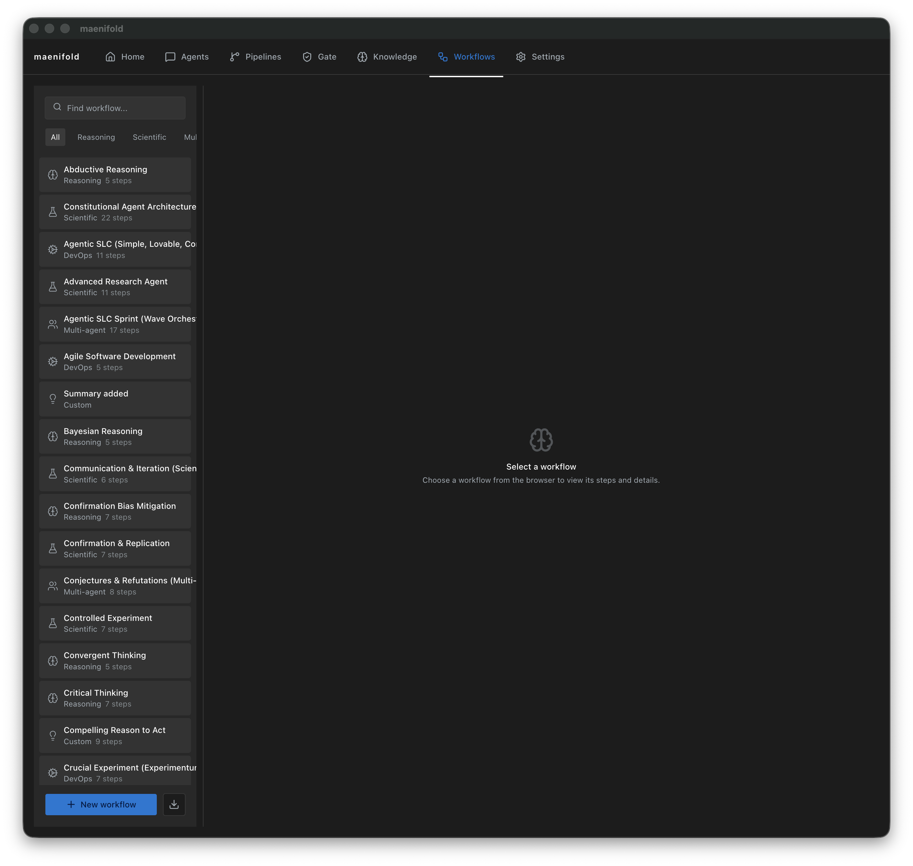

The Workflows workspace is the library and authoring surface for reusable JSON workflow assets.

| Control | What it does |
|---------|--------------|
| **Find workflow input** | Filters the workflow library by text. |
| **Category chips** | Filter the library by All, Reasoning, Scientific, Multi-agent, DevOps, or Memory. |
| **Workflow cards and list** | Select a workflow for inspection or editing. |
| **New workflow button** | Creates a new workflow asset. |
| **Import workflow button** | Opens the JSON import flow; invalid files surface validation. |
| **Draft bar** | Exposes Cancel, Discard, and Save actions; Save disables when there are no edits. |
| **Metadata form** | Edits name, emoji, description, triggers, category, and workflow toggles. |
| **Step timeline controls** | Toggle all, export, save, and add step. |
| **Export actions** | Emit supported export formats from the step timeline. |
| **Step cards** | Expand or collapse, move up or down, remove, and drag to reorder where supported. |
| **Step inspector** | Edits step name, description, sequential-thinking toggle, and low, medium, or high effort. |
| **Conflict-resolution actions** | Resolve import or save conflicts when workflow state diverges. |
| **Empty state** | Prompts selection when nothing is loaded. |

### Settings

The Settings workspace has five section tabs: **Agents**, **MCP servers**, **Maenifold**, **Embeddings**, and **Preferences**.

#### Agents

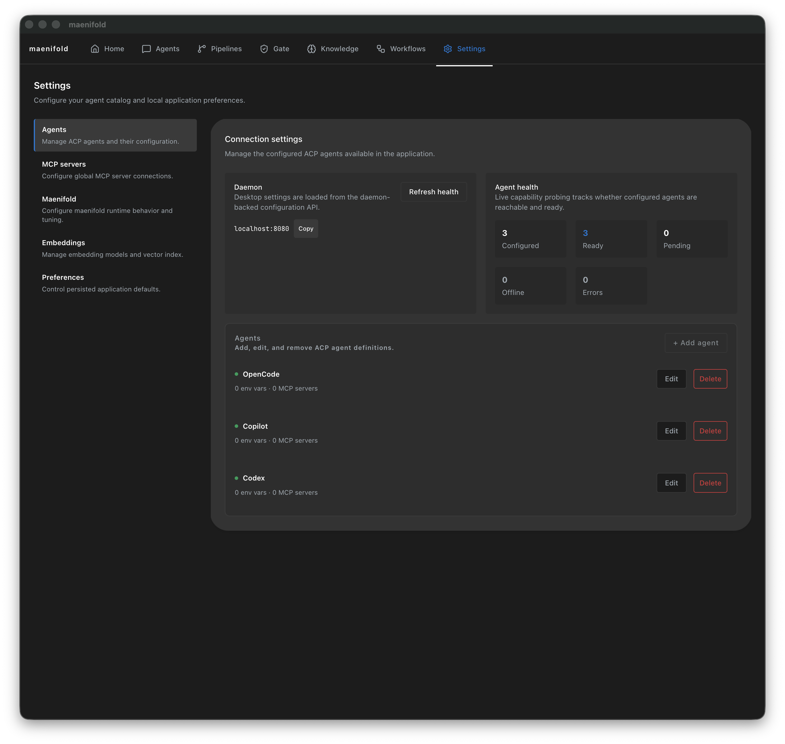

| Control | What it does |
|---------|--------------|
| **Refresh health** | Re-queries daemon status and agent capability health. |
| **Daemon address display** | Shows the daemon endpoint currently backing the desktop settings API. |
| **Copy button** | Copies the daemon address to the clipboard. |
| **Agent health card** | Summarizes configured, ready, pending, offline, and error counts. |
| **Add agent** | Opens the add-agent flow. |
| **Agent rows** | Show agent name plus env-var and MCP-server counts. |
| **Edit action** | Opens the selected agent for editing. |
| **Delete action** | Removes an agent after confirmation. |
| **Add or edit agent form** | Captures agent name, command, env vars, per-agent MCP server bindings, Save, and Cancel actions. |

#### MCP servers

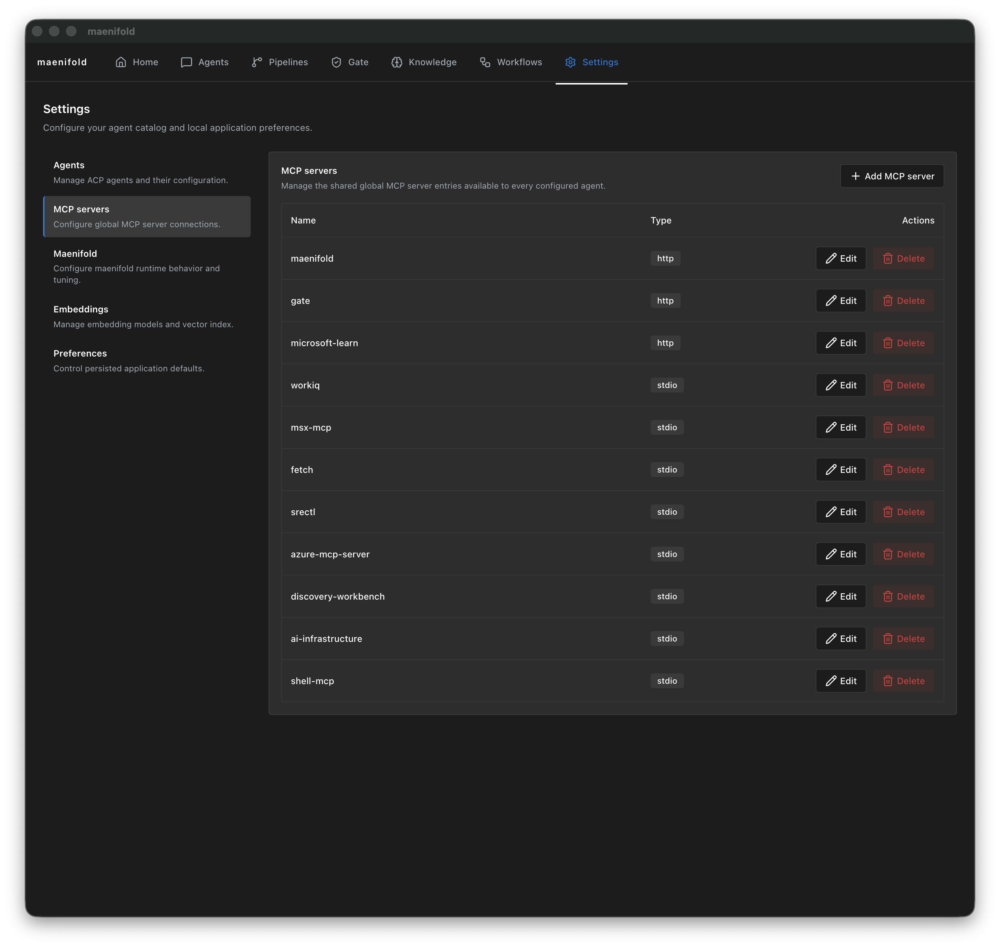

| Control | What it does |
|---------|--------------|
| **Add MCP server** | Opens the server-detail form. |
| **MCP server table** | Lists global server name, transport type, and row actions. |
| **Edit action** | Opens the selected server in the detail form. |
| **Delete action** | Removes the selected server after confirmation. |
| **Server-detail form** | Captures name, type, command, URL, args, Save, and Cancel actions. |

#### Maenifold

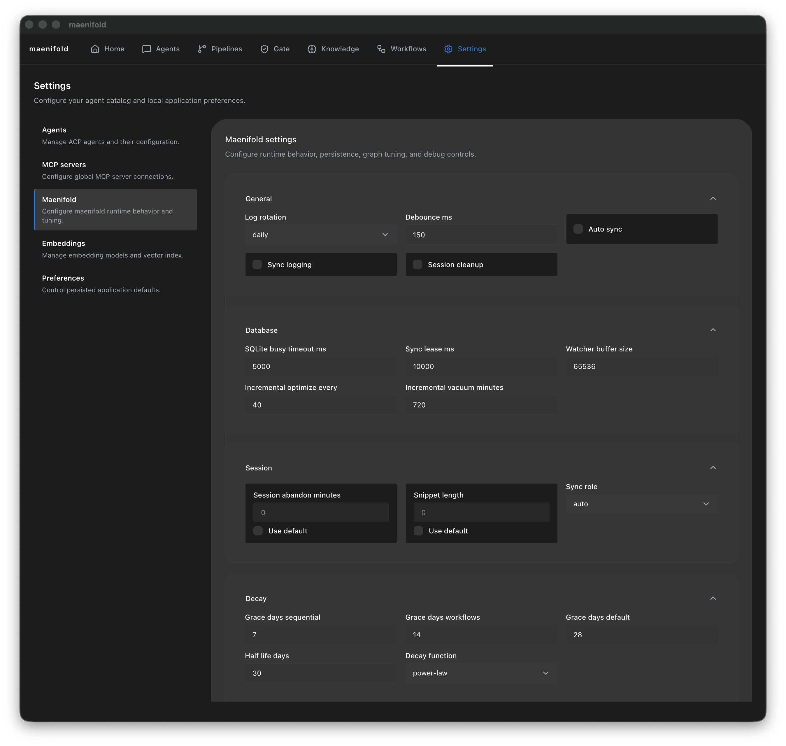

| Control group | What it configures |
|---------------|--------------------|
| **General** | Log rotation, debounce, auto-sync, sync logging, and session-cleanup behavior. |
| **Database** | SQLite busy timeout, sync lease, watcher buffer, optimize cadence, and vacuum cadence. |
| **Session** | Session abandon timeout, snippet length, sync role, and default-inheritance toggles. |
| **Graph** | Decay, community-detection, vector, and embedding-related runtime tuning. |
| **Workflows and Debug** | Trace logging, pipeline driver, and other workflow-runtime controls. |
| **Save** | Persists the current maenifold runtime settings. |
| **Reset to defaults** | Reverts the form to packaged defaults. |
| **Validation on numeric fields** | Prevents invalid numeric values from being saved silently. |

#### Embeddings

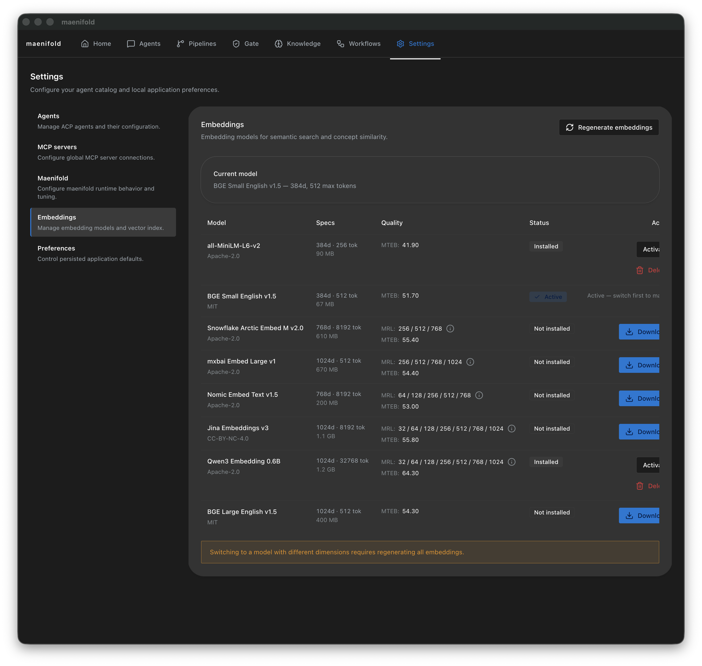

| Control | What it does |
|---------|--------------|
| **Regenerate embeddings** | Starts a corpus-wide rebuild of vectors after confirmation. |
| **Current model display** | Shows the active embedding model name, dimensions, and max token window. |
| **Model rows or cards** | Display model name, size, dimensions, license, quality metrics, and current status. |
| **Download action** | Installs a model that is not yet on disk. |
| **Activate action** | Makes an installed model active. |
| **Delete action** | Removes an installed non-active model. |
| **MRL info action** | Explains Matryoshka Representation Learning where applicable. |
| **Status badges** | Distinguish Active, Installed, and Not installed states. |
| **Dimension-change warning** | Warns when switching to a differently sized model requires re-embedding the corpus. |
| **Progress and error feedback** | Shows in-flight download, activate, delete, or regenerate status and surfaces recoverable errors. |

#### Preferences

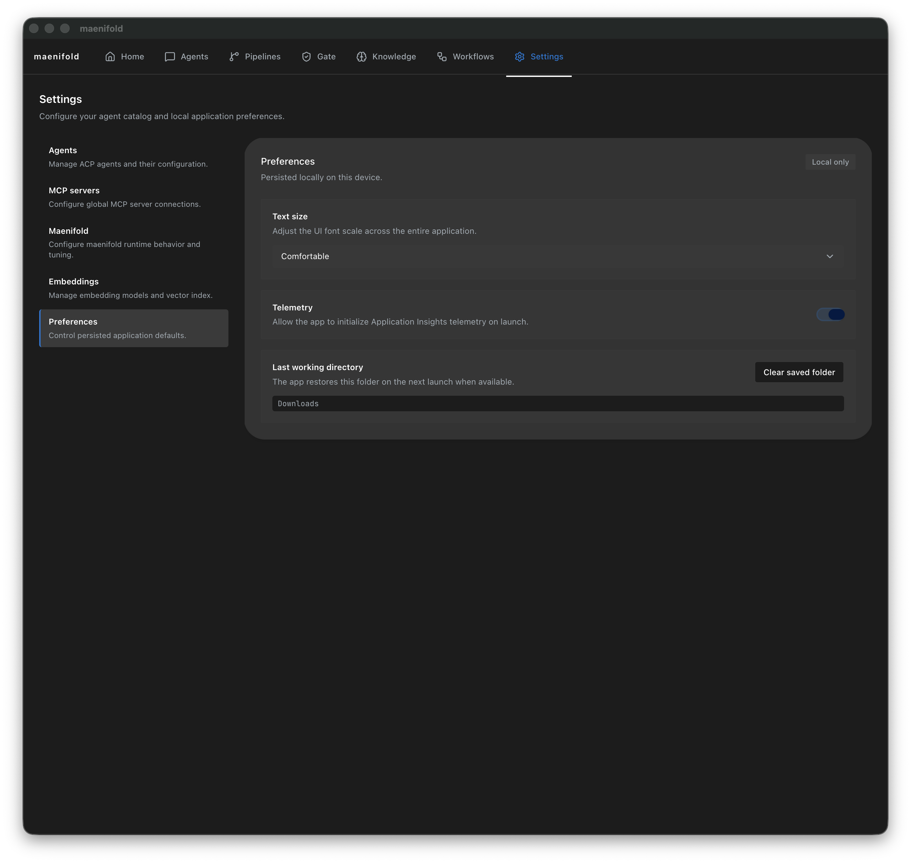

| Control | What it does |
|---------|--------------|
| **Local only badge** | Marks the section as device-local rather than daemon-shared. |
| **Text size selector** | Adjusts the global UI font scale. |
| **Telemetry switch** | Enables or disables Application Insights initialization on launch. |
| **Last working directory display** | Shows the folder that will be restored on the next launch when available. |
| **Clear saved folder** | Removes the remembered working directory. |

### Onboarding Permissions and Dialogs

Not every control in the app is always visible. The following surfaces appear only on first launch or when a flow needs confirmation, authentication, or filesystem access.

#### Onboarding wizard

| Surface | What it does |
|---------|--------------|
| **Wizard lifecycle gate** | Blocks the main app on first launch until onboarding completes; clearing onboarding state re-shows it. |
| **Step rail** | Shows the five onboarding steps: Welcome, Daemon, Agent, Model, and Finish. |
| **Welcome step** | Introductory screen with a Continue button. |
| **Daemon step** | Shows connection status, start command, copy action, re-check connection, Continue, Back, and auto-polling when disconnected. |
| **Agent step** | Captures agent name and full shell command, validates duplicates or empties, supports existing-agent continuation, and provides Back navigation. |
| **Model step** | Lists embedding models, active badge, selection state, Download button, Download later action, retry path, re-embedding warning, and Back navigation. |
| **Finish step** | Shows a summary card, config path, documentation link, Start button, daemon-up check, and Back navigation. |

#### Permission, auth, and filesystem dialogs

| Surface | What it contains |
|---------|------------------|
| **Permission dialog** | Requested-permission list plus per-entry Select actions, Cancel, `Escape`, and backdrop-dismiss behavior. |
| **Permission entry** | Permission name, scope, two option buttons, and per-entry cancel. |
| **Auth method dialog** | Method-selection buttons, close action, Cancel, and keyboard navigation between auth options. |
| **Tool auth setup dialog** | Provider-specific form fields with Confirm, Cancel, validation, and `Escape` close behavior. |
| **Folder picker** | Path input, Use Path, Cancel, validation, and Electron-only filesystem selection semantics. |

### Diagnostics Traffic and Cross-Cutting Behavior

#### Traffic monitor

| Control | What it does |
|---------|--------------|
| **Resize handle** | Changes monitor height or width depending on layout. |
| **Pause and Resume** | Stops or restarts traffic capture. |
| **Clear** | Removes the current traffic log from view. |
| **Filter buttons** | Restrict entries by category. |
| **Direction buttons** | Filter inbound versus outbound traffic. |
| **Search input** | Text-filters the traffic log. |
| **Clear search** | Resets the current traffic query. |
| **Close** | Hides the monitor. |
| **Traffic entry header** | Expands or collapses an individual record. |
| **Copy action** | Copies the selected entry payload to the clipboard. |
| **Entry metadata** | Shows timestamp, method, and direction. |

#### Global interaction rules

| Behavior | Product rule |
|----------|--------------|
| **Keyboard navigation** | Focus order is logical, `Shift+Tab` reverses it, and roving focus is used where lists or tabs need it. |
| **Loading states** | Long-running fetches show visible loading feedback and disable unsafe repeat actions. |
| **Error states** | Network, server, and validation failures surface inline messages plus retry affordances where recovery is possible. |
| **Empty states** | Chat, pipelines, workflows, knowledge, and gate all use explicit empty-state messaging instead of blank panes. |
| **Long-input boundaries** | Long text, large numbers, negative values, and long lists must clamp, scroll, or validate cleanly. |
| **Responsive behavior** | Desktop layouts adapt down to narrower widths with sidebar collapse or overlay behavior. |
| **Clipboard** | Copy buttons plus standard cut, copy, and paste shortcuts are supported across the app. |
| **Undo and redo** | Text inputs support platform undo and redo shortcuts. |
| **Design-system compliance** | Shared primitives, tokenized colors, tokenized radii and shadows, and sentence-case labeling are enforced throughout the UI. |

---

## Cognitive Assets

| Asset | Examples |
|-------|----------|
| **Workflows** | Deductive, design thinking, agentic sprints, game theory, research think tank |
| **Roles** | Architect, PM, red-team, blue-team, researcher, writer, FinOps practitioner |
| **Thinking Colors** | DeBono's Six Hats + Gray and Pink |
| **Perspectives** | Native language modes for culturally-aware reasoning |

---

## Demo Artifacts

Real orchestration sessions demonstrating the system in use:

- **[PM-lite Protocol](demo-artifacts/part1-pm-lite/)** — 12 agents across 4 waves, 85% test success, critical bug found and fixed (28 min)
- **[Agentic-SLC Workflow](demo-artifacts/part2-agentic-slc/)** — 13 agents, 3 issues fixed via TDD pipeline (40 min)
- **[Brand Analysis](demo-artifacts/brand-analysis-workflow.md)** — 6 parallel workflows analyzed maenifold's own brand positioning
- **[Sprint Impact Analysis](demo-artifacts/sprint-knowledge-graph-impact-analysis.md)** — Knowledge graph growth from a real sprint

See the [demo artifacts README](demo-artifacts/README.md) for the full timeline and directory structure.

---

## Testing & Validation

### The Hero Demo

The [comprehensive E2E test](demo-artifacts/part1-pm-lite/E2E_TEST_REPORT.md) orchestrated **12 specialized agents** across 4 waves:

- **Found and fixed a critical bug**: Move operations were losing file extensions — mocks would never catch this
- **Discovered parameter inconsistencies**: minScore filtering wasn't working — only real queries revealed this
- **Validated actual performance**: Real operations against real data, not synthetic benchmarks
- **85% success rate**: Honest assessment, not 100% fake passes

### Test Philosophy

Following the **NO FAKE TESTS** principle:
- Real SQLite, not mocks
- Real file operations, not stubs
- Real vector embeddings, not fixtures
- Real multi-agent coordination, not simulations

---

## Technical Specifications

| Spec | Value |
|------|-------|
| Language | Rust |
| Vectors | 384-dim default (all-MiniLM-L6-v2 via ONNX); switchable via EmbeddingModels catalog |
| Search | Reciprocal Rank Fusion (k=60) |
| Database | SQLite + [sqlite-vec](https://github.com/asg017/sqlite-vec) (bundled) |
| Memory Cycle | Configurable interval; decay params expressed as cycle multiples |
| Decay Model | ACT-R power-law (d=0.5); calibrated to memory cycle |
| Memory Tiers | Sequential (7d grace) / Workflows (14d) / Semantic (28d) / Half-life 30d |
| Maintenance | 5 workflows (repair/hub-detection/consolidation/epistemic/status) in serialized dependency order |

*Decay affects search ranking only. Files are never deleted.*

*Local-only, single-user, no authentication. Memory files (markdown) are the source of truth; the SQLite database is a regenerable cache (`maenifold --tool Sync`). Version control memory with git to track changes alongside code. Set `MAENIFOLD_ROOT` to store memory in your repository for atomic commits of code + reasoning.*

---

## Technical Principles

### Transparency First
Every operation is inspectable — thinking sessions show all revisions, search results include scores, graph relationships are queryable SQL, all content is readable markdown.

### Lazy Evaluation
Nothing is pre-computed or pre-structured — graph builds from WikiLink usage, embeddings generate on demand, relationships emerge from repetition, structure follows function.

### Composable Tools
Each tool does one thing well — `WriteMemory` creates markdown, `SequentialThinking` reasons iteratively, `BuildContext` traverses the graph, `Workflow` orchestrates tool composition.

### Files as Source of Truth
Not a black box — direct file access for debugging, git-compatible for version control, Obsidian-compatible for human editing, standard markdown for portability.

---

## Configuration

**Custom data directory:**
```bash
export MAENIFOLD_ROOT=~/my-knowledge-base
```

**Claude Desktop** — Same MCP config, different location:
- macOS: `~/Library/Application Support/Claude/claude_desktop_config.json`
- Windows: `%APPDATA%\Claude\claude_desktop_config.json`

---

## Skills

| Skill | What You Get |
|-------|--------------|
| **Maenifold** | Knowledge graph, sequential thinking, workflows, and full MCP tool surface |
| **Gate** | File-authoritative task management with staged delivery |
| **ACP** | Agent Client Protocol integration and session management |
| **Pinia** | Vue.js state management patterns and debugging |
| **Workflow Authoring** | Workflow JSON asset creation and validation |
| **Azure SRE** | Azure site reliability engineering patterns |
| **Wiki Research** | Research grounded in knowledge graph context |

---

## Integrations

| Integration | What It Does |
|-------------|-------------|
| **[Copilot Plugin](../assets/integrations/copilot/plugin-maenifold/)** | MCP server, graph-of-thought hooks, skill auto-loading |
| **[Claude Code Plugin](../assets/integrations/claude-code/)** | Claude Code plugin assets |
| **[OpenCode Plugins](../assets/integrations/opencode/)** | WikiLink-aware compaction, session persistence for OpenCode CLI |
| **[Reusable Skills](../assets/integrations/skills/)** | Maenifold, gate, ACP, Pinia, workflow authoring, Azure SRE, and wiki-research |

---

## Project Structure

```
~/maenifold/
├── memory/           # Your markdown memories with WikiLinks
├── memory.db         # Knowledge graph and vector embeddings
├── assets/           # Workflows, roles, colors, perspectives
│   └── integrations/ # Agent and skill integrations
├── crates/           # Rust backend workspace
│   ├── maenifold-core/           # Library — tools, search, graph, ACP, pipeline engine
│   ├── maenifold-cli/            # Binary — CLI + MCP server
│   ├── maenifold-gate/           # Binary — file-authoritative task management
│   ├── maenifold-jockey/         # Binary — desktop integration daemon
│   └── maenifold-pipeline-driver/ # Binary — headless pipeline executor
└── apps/desktop/     # Electron + Vue 3 desktop application
```

---

## License & Attribution

**License**: MIT

Sequential Thinking implementation inspired by [MCP Sequential Thinking](https://github.com/modelcontextprotocol/servers/tree/main/src/sequentialthinking) — enhanced with lazy graph construction and multi-agent collaboration.

---

*Domain expertise that compounds.*
