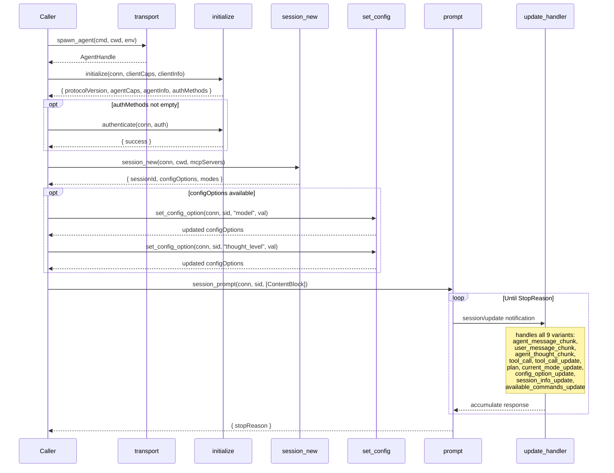

# ACP Client Architecture — As Built

This document describes the code that actually exists in `crates/maenifold-core/src/acp/native/`.
Type authority is the Rust `agent-client-protocol` crate; local code adds orchestration, pooling,
stream accumulation, and a headless ACP client.

## Design Principle

- Use `agent-client-protocol` as the wire/type authority.
- `prompt` is the only primitive operation. `think` and `workflow` are orchestration layers that
  open an `AgentSession` and chain prompt turns through the same session.
- `AgentSession` is the workflow-layer chokepoint (`workflow/agent_session.rs`), not the transport.

## ACP Protocol Methods (from spec — COMPLETE stable catalog)

### Client → Agent (we call these)
| Method | Params (spec wire names) | Result | Stable since |
|---|---|---|---|
| `initialize` | `{ protocolVersion, clientCapabilities, clientInfo }` | `{ protocolVersion, agentCapabilities, agentInfo, authMethods }` | v1 |
| `authenticate` | `{ authMethod, credentials }` | `{ success }` | v1 (baseline) |
| `session/new` | `{ cwd, mcpServers }` | `{ sessionId, configOptions?, modes? }` | v1 |
| `session/load` | `{ sessionId, cwd, mcpServers }` | `{}` (after update replay) | v1 (requires loadSession cap) |
| `session/list` | `{}` | `{ sessions: SessionInfo[] }` | v0.11.1 (requires sessionCapabilities.list) |
| `session/prompt` | `{ sessionId, prompt: ContentBlock[] }` | `{ stopReason }` | v1 |
| `session/cancel` | `{ sessionId }` | _(notification, no response)_ | v1 |
| `session/set_config_option` | `{ sessionId, configOptionId, value }` | `{ configOptions }` | v0.10.8 |
| `session/set_mode` | `{ sessionId, modeId }` | `{}` | v1 (DEPRECATED — use set_config_option) |

### Agent → Client (we handle these)
| Method/Notification | Params (spec wire names) | Spec section |
|---|---|---|
| `session/update` | `{ sessionId, update: SessionUpdate }` | prompt-turn |
| `session/request_permission` | `{ sessionId, toolCall, options: PermissionOption[] }` | tool-calls |
| `fs/read_text_file` | `{ sessionId, path, line?, limit? }` | file-system |
| `fs/write_text_file` | `{ sessionId, path, content }` | file-system |
| `terminal/create` | `{ sessionId, command, args?, cwd?, env?, outputByteLimit? }` | terminals |
| `terminal/output` | `{ sessionId, terminalId }` | terminals |
| `terminal/wait_for_exit` | `{ sessionId, terminalId }` | terminals |
| `terminal/kill` | `{ sessionId, terminalId }` | terminals |
| `terminal/release` | `{ sessionId, terminalId }` | terminals |

## Component Diagram

| File | Lines | Actual public surface |
|---|---:|---|
| `mod.rs` | 278 | `pub use pool::{AcpxDriver, AgentPool, GLOBAL_AGENT_POOL}`; `pub use types::*`; `pub fn spawn_agent(command: String, cwd: PathBuf, env: HashMap<String, String>, auto_grant_permissions: bool) -> AgentHandle`; `pub(super) fn format_stop_reason(stop_reason: acp::StopReason) -> String`; `pub(super) fn usage_to_response(usage: acp::Usage) -> AcpxUsage` |
| `types.rs` | 267 | `pub type Result<T> = std::result::Result<T, AgentError>`; `pub type AcpxError = AgentError`; `pub enum AgentError`; `pub struct SessionOpts`; `pub struct SessionInfo`; `pub struct AcpxSessionInfo`; `pub struct AgentResponse`; `pub type AcpxResponse = AgentResponse`; `pub struct AcpxUsage`; `pub struct ToolCallRecord`; `pub enum AgentCommand`; `pub struct AgentHandle`; `pub fn agent_info(&self) -> Option<acp::Implementation>`; `pub fn capabilities(&self) -> Option<acp::AgentCapabilities>`; `pub fn auth_methods(&self) -> Option<Vec<acp::AuthMethod>>`; `pub fn is_alive(&self) -> bool`; `pub async fn new_session(&self, opts: SessionOpts) -> Result<SessionInfo>`; `pub async fn list_sessions(&self, cwd: Option<PathBuf>) -> Result<Vec<AcpxSessionInfo>>`; `pub async fn load_session(&self, session_id: &str, opts: SessionOpts) -> Result<SessionInfo>`; `pub async fn prompt(&self, session_id: &str, prompt: &str, inject_wikilinks: bool) -> Result<AgentResponse>`; `pub async fn prompt_with_context(&self, session_id: &str, prompt: &str, context_blocks: Vec<acp::ContentBlock>, inject_wikilinks: bool) -> Result<AgentResponse>`; `pub async fn cancel(&self, session_id: &str) -> Result<()>`; `pub async fn close_session(&self, session_id: &str)` |
| `accumulator.rs` | 105 | `pub(super) struct SessionAccumulator`; `pub(super) fn append_text(&mut self, text: &str)`; `pub(super) fn append_thought(&mut self, text: &str)`; `pub(super) fn push_tool_call(&mut self, tool_call: acp::ToolCall)`; `pub(super) fn apply_tool_call_update(&mut self, update: acp::ToolCallUpdate) -> std::result::Result<(), acp::Error>`; `pub(super) fn mark_in_progress_cancelled(&mut self)`; `pub(super) fn into_response(self) -> AgentResponse` |
| `client.rs` | 235 | `pub(super) struct HeadlessClient`; ACP client trait impl for permission, FS, terminal stubs, `session_notification`, `ext_method`, `ext_notification` |
| `initialize.rs` | 65 | `pub(super) async fn initialize(conn: &acp::ClientSideConnection) -> Result<InitInfo>` |
| `pool.rs` | 235 | `pub static GLOBAL_AGENT_POOL: LazyLock<Arc<AgentPool>>`; `pub struct AgentPool`; `pub fn new() -> Self`; `pub async fn get_or_create(&self, agent_name: &str, command: &str, cwd: &Path, env: HashMap<String, String>, auto_grant_permissions: bool) -> Arc<AgentHandle>`; `pub async fn remove_dead(&self)`; `pub async fn close_all(&self)`; `pub struct AcpxDriver`; `pub fn new(agent: String, timeout_seconds: u64, cwd: PathBuf) -> Result<Self>`; `pub async fn create_session(&self, name: &str) -> Result<()>`; `pub async fn prompt(&self, session: &str, prompt: &str) -> Result<AcpxResponse>`; `pub async fn close_session(&self, name: &str) -> Result<()>`; `pub async fn cancel(&self, session: &str) -> Result<()>` |
| `process.rs` | 41 | `pub(super) fn log_io_task_exit<E: std::fmt::Display>(result: std::result::Result<std::result::Result<(), E>, tokio::task::JoinError>)`; `pub(super) fn spawn_stderr_reader(stderr: tokio::process::ChildStderr) -> JoinHandle<()>`; `pub(super) async fn reap_child(child: &mut tokio::process::Child, stderr_task: Option<JoinHandle<()>>, io_task: Option<JoinHandle<acp::Result<()>>>)` |
| `prompt.rs` | 97 | `pub(super) async fn prompt_session(conn: &acp::ClientSideConnection, sessions: &Arc<Mutex<HashMap<String, SessionAccumulator>>>, session_id: String, prompt: String, inject_wikilinks: bool) -> Result<AgentResponse>`; `pub(super) async fn prompt_session_with_blocks(conn: &acp::ClientSideConnection, sessions: &Arc<Mutex<HashMap<String, SessionAccumulator>>>, session_id: String, prompt: String, content_blocks: Vec<acp::ContentBlock>, inject_wikilinks: bool) -> Result<AgentResponse>` |
| `session_list.rs` | 103 | `pub(super) async fn list_sessions(conn: &acp::ClientSideConnection, init_info: &StdMutex<Option<InitInfo>>, cwd: Option<PathBuf>) -> Result<Vec<AcpxSessionInfo>>`; `pub(super) async fn load_session(conn: &acp::ClientSideConnection, init_info: &StdMutex<Option<InitInfo>>, session_id: String, opts: SessionOpts) -> Result<SessionInfo>` |
| `session_new.rs` | 46 | `pub(super) async fn session_new(conn: &acp::ClientSideConnection, opts: SessionOpts) -> Result<SessionInfo>` |
| `set_config_option.rs` | 172 | `pub(super) async fn apply_session_config(conn: &acp::ClientSideConnection, session_id: acp::SessionId, opts: &SessionOpts, is_modern: bool, config_options: &[acp::SessionConfigOption])` |

## Sequence Diagram — ACP Lifecycle

## File Contracts

### `mod.rs` — 278 lines
- Responsibility: module root; re-exports pool/types; owns subprocess + ACP connection lifecycle.
- Signatures: `pub fn spawn_agent(...) -> AgentHandle`; `pub(super) fn format_stop_reason(...) -> String`; `pub(super) fn usage_to_response(...) -> AcpxUsage`.

### `types.rs` — 267 lines
- Responsibility: all native ACP result/error/session handle types and command enum.
- Key signatures: all `AgentHandle` methods listed in the component table above.

### `accumulator.rs` — 105 lines
- Responsibility: rebuild one prompt turn from `session/update` notifications.
- Signatures: `append_text`, `append_thought`, `push_tool_call`, `apply_tool_call_update`, `mark_in_progress_cancelled`, `into_response`.

### `client.rs` — 235 lines
- Responsibility: headless ACP client implementation.
- ACP trait methods implemented: `request_permission`, `write_text_file`, `read_text_file`, `create_terminal`, `terminal_output`, `release_terminal`, `wait_for_terminal_exit`, `kill_terminal`, `session_notification`, `ext_method`, `ext_notification`.
- Notes: file access is jailed to `cwd`; terminal methods currently return `method_not_found`.

### `initialize.rs` — 65 lines
- Responsibility: send `initialize`, advertise capabilities, capture agent info/capabilities/auth methods.
- Signature: `pub(super) async fn initialize(conn: &acp::ClientSideConnection) -> Result<InitInfo>`.

### `pool.rs` — 235 lines
- Responsibility: process reuse and high-level driver API.
- Signatures: `AgentPool::{new,get_or_create,remove_dead,close_all}` and `AcpxDriver::{new,create_session,prompt,close_session,cancel}`.

### `process.rs` — 41 lines
- Responsibility: stderr reader + child cleanup helpers.
- Signatures: `log_io_task_exit`, `spawn_stderr_reader`, `reap_child`.

### `prompt.rs` — 97 lines
- Responsibility: submit `session/prompt`, optionally append WikiLink instructions, accumulate final `AgentResponse`.
- Signatures: `prompt_session`, `prompt_session_with_blocks`.

### `session_list.rs` — 103 lines
- Responsibility: capability-gated `session/list` and `session/load`.
- Signatures: `list_sessions`, `load_session`.

### `session_new.rs` — 46 lines
- Responsibility: create ACP session, map response into `SessionInfo`, then apply config.
- Signature: `session_new`.

### `set_config_option.rs` — 172 lines
- Responsibility: modern vs legacy session configuration dispatch.
- Public surface: `pub(super) async fn apply_session_config(...)`.
- Internal helpers present today: `apply_modern_config`, `apply_legacy_config`, `apply_extra_config_options`, `find_config_id_by_category`, `config_option_value`, `apply_optional`, `set_config_option`.

## Our Types

- `SessionOpts { cwd, auto_grant_permissions, model, mode, thought_level, config_options, allowed_tools, max_turns, timeout_seconds, mcp_servers }`
- `SessionInfo { session_id, modes, models, config_options }`
- `AcpxSessionInfo { session_id, title, updated_at }`
- `AgentResponse { text, tool_calls, thought, stop_reason, error, usage }`
- `AcpxUsage { input_tokens, output_tokens, total_tokens, thought_tokens }`
- `ToolCallRecord { id, name, title, status, arguments, output, content, locations }`
- `AgentCommand::{NewSession,ListSessions,LoadSession,Prompt,PromptWithContext,Cancel,CloseSession,Shutdown}`
- `AgentHandle { cmd_tx, init, alive }`
- Internal support types: `InitInfo` in `types.rs`, `SessionAccumulator` in `accumulator.rs`.
- There is no `ResponseAccumulator`; the actual accumulator type is `SessionAccumulator`.

## Key Invariants

- Prompt is the only primitive; higher-level think/workflow logic chains prompt turns through `workflow::AgentSession`.
- `SessionOpts` has no `Default`; callers must supply policy explicitly.
- `auto_grant_permissions` is required, not defaulted. `tools/acp_exec.rs::session_opts_from` requires `autoGrantPermissions`.
- Streaming agent text chunks are written to `stderr` in `HeadlessClient::session_notification`; the final accumulated result is returned structurally to the caller for final output handling.
- `inject_wikilinks` exists only as a prompt/session flag on `AgentCommand` and `AgentHandle`; there is no transport-layer `inject_wikilinks(...)` helper.
- Desired invariant: one canonical `WIKILINK_CONTEXT` in `workflow/think_runner.rs`. Current code does **not** satisfy this yet because `prompt.rs` also defines its own copy.

## Implementation Status

### Working now
- ACP subprocess spawn over stdio with cleanup and dead-process detection.
- `initialize` with explicit client capabilities: FS read/write enabled, terminal disabled, prompt caps carried in `_meta`.
- `session/new`, `session/load`, `session/list`, prompt execution, cooperative cancel, and `session/close`.
- Session config application for both modern config-option agents and legacy mode/model agents.
- `session/update` accumulation for text, thoughts, tool calls, and tool-call updates.
- File read/write client methods with CWD jail and 1-based line handling.
- Agent pooling and simple named-session driver (`AcpxDriver`).

### Missing / limited
- No `authenticate` helper is implemented in `native/`; auth methods are captured but not used.
- Terminal client support is not implemented: all `terminal/*` trait methods return `method_not_found`, and `initialize` advertises `terminal(false)`.
- `ext_method` is unsupported.
- The documented single-source WikiLink context invariant is currently violated by duplicated constants.

### Practical consequence for OpenCode
- Prompt-only flows can work if the agent stays within ACP prompt + FS + permission calls.
- Anything that requires ACP terminal support will fail today because terminal capability is disabled. In practice, OpenCode needs terminal support for full parity.
