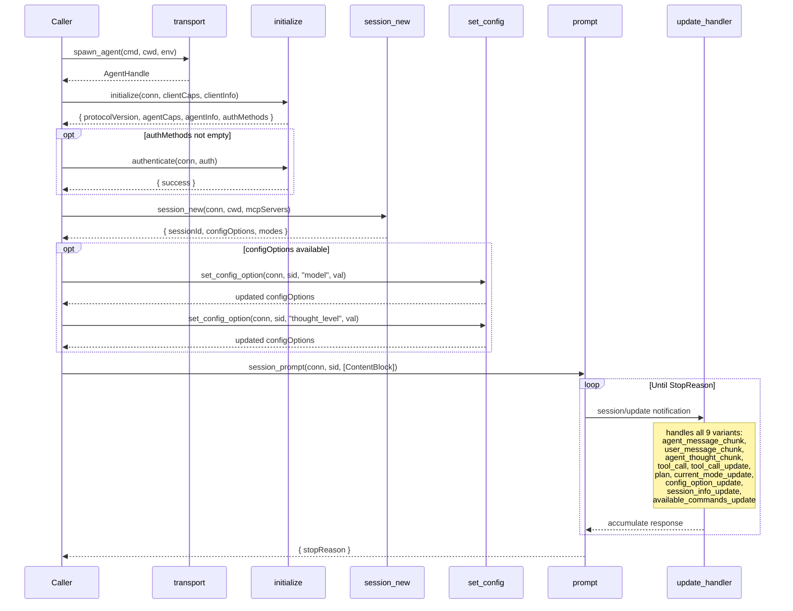

# ACP Client Architecture — Spec-Aligned Greenfield (v2)

Corrected after dual red-team audit (GPT-5.4 + Sonnet-4.6).
All types from `agent-client-protocol` Rust crate. Spec is law.

## Design Principle

Use the `agent-client-protocol` crate (`acp` in Cargo.toml) as the type authority.
Do NOT hand-write wire types. Re-export from the crate. Only add our own
orchestration types (AgentHandle, ResponseAccumulator).

## ACP Protocol Methods (from spec — COMPLETE stable catalog)

### Client → Agent (we call these)
| Method | Params (spec wire names) | Result | Stable since |
|---|---|---|---|
| `initialize` | `{ protocolVersion, clientCapabilities, clientInfo }` | `{ protocolVersion, agentCapabilities, agentInfo, authMethods }` | v1 |
| `authenticate` | `{ authMethod, credentials }` | `{ success }` | v1 (baseline) |
| `session/new` | `{ cwd, mcpServers }` | `{ sessionId, configOptions?, modes? }` | v1 |
| `session/load` | `{ sessionId, cwd, mcpServers }` | `{}` (after update replay) | v1 (requires loadSession cap) |
| `session/list` | `{}` | `{ sessions: SessionInfo[] }` | v0.11.1 (requires sessionCapabilities.list) |
| `session/prompt` | `{ sessionId, prompt: ContentBlock[] }` | `{ stopReason }` | v1 |
| `session/cancel` | `{ sessionId }` | _(notification, no response)_ | v1 |
| `session/set_config_option` | `{ sessionId, configOptionId, value }` | `{ configOptions }` | v0.10.8 |
| `session/set_mode` | `{ sessionId, modeId }` | `{}` | v1 (DEPRECATED — use set_config_option) |

### Agent → Client (we handle these)
| Method/Notification | Params (spec wire names) | Spec section |
|---|---|---|
| `session/update` | `{ sessionId, update: SessionUpdate }` | prompt-turn |
| `session/request_permission` | `{ sessionId, toolCall, options: PermissionOption[] }` | tool-calls |
| `fs/read_text_file` | `{ sessionId, path, line?, limit? }` | file-system |
| `fs/write_text_file` | `{ sessionId, path, content }` | file-system |
| `terminal/create` | `{ sessionId, command, args?, cwd?, env?, outputByteLimit? }` | terminals |
| `terminal/output` | `{ sessionId, terminalId }` | terminals |
| `terminal/wait_for_exit` | `{ sessionId, terminalId }` | terminals |
| `terminal/kill` | `{ sessionId, terminalId }` | terminals |
| `terminal/release` | `{ sessionId, terminalId }` | terminals |

### Unstable (in use, needs capability gate)
| Method | Feature flag | Note |
|---|---|---|
| `session/close` | `unstable_session_close` | Actively used in event_loop. Gate on cap. |

## Types — From `agent-client-protocol` crate

types.rs re-exports from the crate. We do NOT redefine these:

- `ContentBlock` (Text, Image, Audio, EmbeddedResource, ResourceLink)
- `StopReason` (EndTurn, MaxTokens, MaxTurnRequests, Refusal, Cancelled)
- `SessionUpdate` — ALL 9 stable variants:
  - `user_message_chunk` — needed for session/load replay
  - `agent_message_chunk`
  - `agent_thought_chunk`
  - `tool_call`
  - `tool_call_update`
  - `plan` (field: `entries`, not `commands`)
  - `current_mode_update` (field: `currentModeId`, not `mode`)
  - `config_option_update` — agent changed its own config
  - `session_info_update` — session metadata changed
  - `available_commands_update`
- `ClientCapabilities` { fs: { readTextFile, writeTextFile }, terminal }
- `AgentCapabilities` { loadSession, promptCapabilities, mcpCapabilities, sessionCapabilities }
- `McpServerConfig` — stdio + HTTP + SSE transport union
- `ImplementationInfo` { name, title?, version } — title is OPTIONAL per spec
- `SessionConfigOption` — config options declared by agent
- `PermissionOption` { optionId, name, kind } — for request_permission
- `_meta` — built-in on all types, NOT an extension to be banned

Our own types (in types.rs):
- `AgentHandle` { conn, tx, init_info, is_running }
- `ResponseAccumulator` — accumulates session/update stream into response
- `AgentCommand` — internal command enum for event loop

## Component Diagram

```
┌─────────────────────────────────────────────────────────────────┐
│                        acp/native/                              │
│                                                                 │
│  ┌──────────────────────────────────────────────────────────┐   │
│  │                      types.rs                            │   │
│  │  re-export from agent-client-protocol crate              │   │
│  │  + AgentHandle, ResponseAccumulator, AgentCommand        │   │
│  └──────────────────────────────────────────────────────────┘   │
│                                                                 │
│  ┌──────────────────┐  ┌────────────────────────────────────┐   │
│  │  transport.rs    │  │         initialize.rs              │   │
│  │                  │  │                                    │   │
│  │  spawn_agent()   │  │  initialize(conn, caps, info)     │   │
│  │  reap_child()    │  │    → InitializeResponse           │   │
│  │  spawn_stderr()  │  │  authenticate(conn, auth)         │   │
│  └────────┬─────────┘  │    → AuthResponse                 │   │
│           │            └──────────────┬─────────────────────┘   │
│           ▼                           ▼                         │
│  ┌──────────────────────────────────────────────────────────┐   │
│  │                   session_new.rs                         │   │
│  │  session_new(conn, cwd, mcp_servers)                     │   │
│  │    → { sessionId, configOptions, modes }                 │   │
│  └──────────────────────────────────────────────────────────┘   │
│                                                                 │
│  ┌──────────────────────────────────────────────────────────┐   │
│  │                   session_load.rs                        │   │
│  │  session_load(conn, sid, cwd, mcp_servers) → ()          │   │
│  └──────────────────────────────────────────────────────────┘   │
│                                                                 │
│  ┌──────────────────────────────────────────────────────────┐   │
│  │                   session_list.rs                        │   │
│  │  session_list(conn) → Vec<SessionInfo>                   │   │
│  └──────────────────────────────────────────────────────────┘   │
│                                                                 │
│  ┌──────────────────────────────────────────────────────────┐   │
│  │               set_config_option.rs                       │   │
│  │  set_config_option(conn, sid, optionId, value)           │   │
│  │    → Vec<SessionConfigOption>                            │   │
│  │  apply_config_batch(conn, sid, opts, caps) → ()          │   │
│  │    [batch helper: calls set_config_option per field]     │   │
│  └──────────────────────────────────────────────────────────┘   │
│                                                                 │
│  ┌──────────────────────────────────────────────────────────┐   │
│  │                    set_mode.rs                           │   │
│  │  set_mode(conn, sid, modeId) → ()                        │   │
│  │  [DEPRECATED — backwards compat only]                    │   │
│  └──────────────────────────────────────────────────────────┘   │
│                                                                 │
│  ┌──────────────────────────────────────────────────────────┐   │
│  │                     prompt.rs                            │   │
│  │  session_prompt(conn, sid, prompt: Vec<ContentBlock>)    │   │
│  │    → PromptResponse { stopReason }                       │   │
│  └──────────────────────────────────────────────────────────┘   │
│                                                                 │
│  ┌──────────────────────────────────────────────────────────┐   │
│  │                     cancel.rs                            │   │
│  │  session_cancel(conn, sid) → ()                          │   │
│  │  [MUST cancel pending request_permission too]            │   │
│  └──────────────────────────────────────────────────────────┘   │
│                                                                 │
│  ┌──────────────────────────────────────────────────────────┐   │
│  │                  update_handler.rs                       │   │
│  │  handle_session_update(update, acc) → ()                 │   │
│  │  [handles ALL 9 SessionUpdate variants]                  │   │
│  └──────────────────────────────────────────────────────────┘   │
│                                                                 │
│  ┌──────────────────────────────────────────────────────────┐   │
│  │                    event_loop.rs                         │   │
│  │  run_agent(cmd, cwd, env, rx) → orchestrate lifecycle    │   │
│  └──────────────────────────────────────────────────────────┘   │
│                                                                 │
│  ┌──────────────┐                                               │
│  │   mod.rs     │  ← re-exports only, zero logic                │
│  └──────────────┘                                               │
└─────────────────────────────────────────────────────────────────┘
```

## Sequence Diagram — ACP Lifecycle (spec-compliant)



## File Contracts

### types.rs
**Responsibility:** Re-export ACP crate types + our orchestration types.
```rust
// Re-exports from agent-client-protocol crate
pub use acp::{ContentBlock, StopReason, SessionUpdate, ClientCapabilities, AgentCapabilities, ...};

// Our types
pub struct AgentHandle { ... }
pub struct ResponseAccumulator { ... }
pub enum AgentCommand { ... }
```

### transport.rs
**Responsibility:** Spawn stdio subprocess. Reap on exit.
```rust
pub fn spawn_agent(cmd: String, cwd: PathBuf, env: HashMap<String,String>) -> AgentHandle
async fn reap_child(child: &mut Child, stderr_task: JoinHandle<()>, io_task: JoinHandle<Result<()>>)
fn spawn_stderr_reader(stderr: ChildStderr) -> JoinHandle<()>
```

### initialize.rs
**Responsibility:** ACP `initialize` + `authenticate`. Two functions.
```rust
pub(crate) async fn initialize(conn: &ClientSideConnection, caps: ClientCapabilities, info: ImplementationInfo) -> Result<InitializeResponse>
pub(crate) async fn authenticate(conn: &ClientSideConnection, auth: AuthenticateParams) -> Result<AuthenticateResponse>
```

### session_new.rs
**Responsibility:** ACP `session/new`. Returns configOptions + modes.
```rust
pub(crate) async fn session_new(conn: &ClientSideConnection, cwd: &str, mcp_servers: Vec<McpServerConfig>) -> Result<NewSessionResponse>
// NewSessionResponse: { session_id, config_options: Vec<SessionConfigOption>, modes: Vec<Mode> }
```

### session_load.rs
**Responsibility:** ACP `session/load`. One function.
```rust
pub(crate) async fn session_load(conn: &ClientSideConnection, session_id: &str, cwd: &str, mcp_servers: Vec<McpServerConfig>) -> Result<()>
```

### session_list.rs
**Responsibility:** ACP `session/list`. Gated on sessionCapabilities.list.
```rust
pub(crate) async fn session_list(conn: &ClientSideConnection) -> Result<Vec<SessionInfo>>
```

### set_config_option.rs
**Responsibility:** ACP `session/set_config_option` + batch helper.
```rust
pub(crate) async fn set_config_option(conn: &ClientSideConnection, session_id: &str, option_id: &str, value: &str) -> Result<Vec<SessionConfigOption>>
pub(crate) async fn apply_config_batch(conn: &ClientSideConnection, session_id: &str, options: &[(String, String)], caps: &[SessionConfigOption]) -> Result<()>
// apply_config_batch: finds option_id by category, calls set_config_option for each
```

### set_mode.rs
**Responsibility:** ACP `session/set_mode` (DEPRECATED). Backwards compat.
```rust
pub(crate) async fn set_mode(conn: &ClientSideConnection, session_id: &str, mode_id: &str) -> Result<()>
```

### prompt.rs
**Responsibility:** ACP `session/prompt`. Wire field is `prompt`, not `content`.
```rust
pub(crate) async fn session_prompt(conn: &ClientSideConnection, session_id: &str, prompt: Vec<ContentBlock>) -> Result<PromptResponse>
```

### cancel.rs
**Responsibility:** ACP `session/cancel`. MUST also cancel pending permissions.
```rust
pub(crate) fn session_cancel(conn: &ClientSideConnection, session_id: &str)
// Spec requirement: Client MUST respond to all pending session/request_permission with cancelled
// Spec requirement: Client SHOULD still accept tool_call updates after cancel
```

### update_handler.rs
**Responsibility:** Handle ALL 9 `session/update` variants.
```rust
pub(crate) fn handle_session_update(update: SessionUpdate, accumulator: &mut ResponseAccumulator)
// Handles: user_message_chunk, agent_message_chunk, agent_thought_chunk,
//          tool_call, tool_call_update, plan, current_mode_update,
//          config_option_update, session_info_update, available_commands_update
```

### event_loop.rs
**Responsibility:** Orchestrate the lifecycle. The only file with a loop.
```rust
pub(crate) async fn run_agent(cmd: String, cwd: PathBuf, env: HashMap<String,String>, is_running: Arc<AtomicBool>, rx: Receiver<AgentCommand>)
```

## What Gets Deleted (implementation helpers, NOT protocol methods)

| Current code | Why it's deleted | What replaces it |
|---|---|---|
| `SessionOpts` struct | Bundles what should be individual set_config_option calls | Per-field set_config_option calls via apply_config_batch |
| `apply_session_config` | Internal helper, not a protocol method | set_config_option.rs |
| `apply_modern_config` | Internal helper detecting config path | apply_config_batch in set_config_option.rs |
| `apply_legacy_config` | Internal helper for old agents | set_mode.rs for deprecated path |
| `apply_extra_config_options` | Internal helper for custom options | apply_config_batch |
| `find_config_id_by_category` | Internal helper | Absorbed into apply_config_batch |
| `config_option_value` | Internal helper | Absorbed into set_config_option.rs |
| `apply_optional` | Generic helper | Deleted, inline the pattern |
| `format_stop_reason` | Display impl on StopReason | `impl Display for StopReason` |
| `usage_to_response` | Internal concern | Moved to response module, not protocol |

## What Is KEPT (spec methods wrongly deleted in v1 draft)

| Method | Why it was wrongly deleted | Status |
|---|---|---|
| `session/set_config_option` | Confused helper deletion with protocol deletion | STABLE since v0.10.8 |
| `session/list` | Local spec docs were stale | STABLE since v0.11.1 |
| `authenticate` | Simply missed | BASELINE method |
| `config_option_update` variant | Didn't know about it | STABLE SessionUpdate variant |
| `user_message_chunk` variant | Didn't know about it | STABLE, needed for load replay |
| `session_info_update` variant | Didn't know about it | STABLE SessionUpdate variant |

## Config Option Categories (reserved by spec)

| Category | Meaning | Set via |
|---|---|---|
| `mode` | Session mode selector | set_config_option (preferred) or set_mode (deprecated) |
| `model` | Model selector | set_config_option |
| `thought_level` | Reasoning level | set_config_option |

These are NOT "agent-internal concerns." They are first-class ACP protocol concepts
declared by agents in configOptions and set by clients via session/set_config_option.

## Rules

1. **Types from crate, not hand-written** — `agent-client-protocol` crate is the type authority
2. **Every function maps to one ACP spec method** — helpers go in the same file as the method they serve
3. **Wire field names match spec exactly** — `prompt` not `content`, `modeId` not `mode`, `mcpCapabilities` not `mcp`
4. **One file per method** (except types.rs for re-exports + our types)
5. **mod.rs is re-exports only** — zero logic
6. **Every file ≤ 300 lines**
7. **`_meta` is built-in ACP surface** — available on all types, not banned
8. **Unstable methods gated on capability** — check before calling
9. **Cancel MUST cancel pending permissions** — spec requirement on Client

## Implementation Status (Sprint Current)

### Completed
- Module split: mod.rs 740→279 lines, 11 files all ≤300 lines
- WikiLink context injection: every ACP prompt gets ontology instructions as first content block
- Content ordering: WikiLink context → caller context → prompt text (last)
- Accumulator timing fix: entry().or_default() — no more dropped notifications
- Error propagation fix: prompt.rs returns Err on ACP errors
- Default model removed: no more hardcoded gpt-5.4 breaking unstable set_session_model
- Wire tracing: subscribe() + eprintln for all ACP messages

### Verified Working
- prompt: Copilot ✅, Codex ✅, OpenCode ✅ (MemoryStatus tool call)
- think: Copilot ✅ (single session, conclusion + memory artifact)
- workflow: Copilot ✅ step 1 + submachine (memory artifacts for both)
- submachine: workflow→think auto-spawn with parent/related linking

### P0 Bug: Multi-Turn Session Hang
- 2nd prompt on same session gets ZERO notifications, hangs 300s
- Affects: workflow step 2+, think multi-turn (if session reused)
- Root cause: suspected LocalSet single-threaded execution / SDK state
- pipeline-ui works (transparent relay, no SDK)
- Written to memory://bugs/p0-multi-turn-acp-session-prompt-hang

### Files (current state)
| File | Lines | Responsibility |
|---|---|---|
| mod.rs | 279 | Event loop + spawn_agent |
| types.rs | 275 | Public API types |
| client.rs | 227 | HeadlessClient (Client trait impl) |
| pool.rs | 187 | AgentPool + AcpxDriver |
| set_config_option.rs | 179 | Config routing (modern/legacy) |
| session_list.rs | 103 | list_sessions + load_session |
| accumulator.rs | 104 | SessionAccumulator |
| prompt.rs | 107 | prompt_session + prompt_session_with_blocks |
| session_new.rs | 47 | session_new |
| initialize.rs | 44 | initialize |
| process.rs | 41 | spawn_stderr, reap_child |
