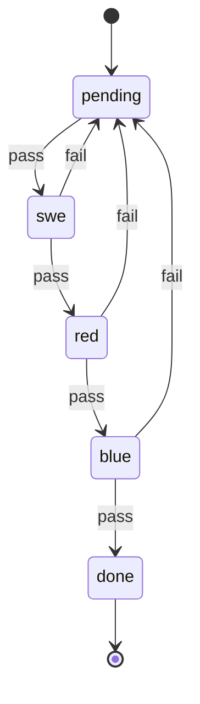
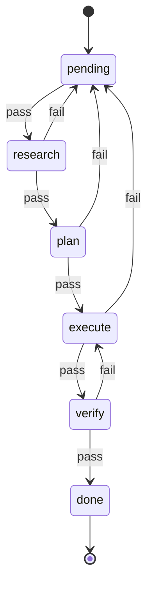
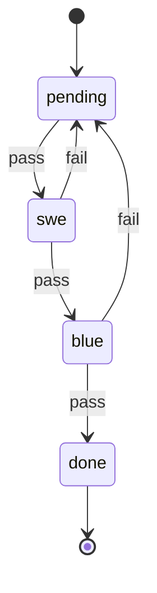

# Gate UML Spec

This document is the authoritative implementation spec for `gate`.

## Authority

- `SPEC = this document + the bundled built-in gate JSON files in crates/maenifold-gate/assets/*.json`
- Runtime authoritative gate JSON lives in `MAENIFOLD_GATE_ASSETS_DIR` when set, otherwise `/Users/brett/maenifold/assets/gates`
- Bundled built-ins must be copied to the runtime gate directory only when missing
- Existing runtime gate JSON files are authoritative and must never be overwritten by bootstrap
- Files under `todo/` and `done/` are authoritative task state
- `gate.db` is a rebuildable cache only
- No source module may exist unless it is named in this spec

## Scope

- Crate: `crates/maenifold-gate`
- Binary: `gate`
- Command surface:
  - `status`
  - `append`
  - `pass`
  - `fail`
  - `sync`
- Service modes:
  - `--mcp` for MCP over stdio
  - `--http` for MCP over streamable HTTP
- Shipped built-in processes:
  - `sdd`
  - `tdd`
  - `gsd`
  - `lightweight`

## Architectural Rules

- `main.rs` is entrypoint and mode dispatch only
- CLI parsing must be isolated from command execution
- Transition logic must exist only in `state_machine.rs`
- Gate JSON validation must exist only in `gate_definition.rs`
- Gate asset resolution and bootstrap must exist only in `gate_catalog.rs`
- File parsing must be isolated from file mutation
- Cache rebuilding must never override file authority
- Command business logic must be reusable by CLI and MCP transports
- MCP tool execution must call the same business logic as CLI commands
- Tray/runtime code must not duplicate gate command logic
- Every task file must bind itself to a specific pipeline name and pipeline digest
- Built-in process definitions use explicit state-machine JSON with `schemaVersion`, `id`, `name`, `initial`, `states`, `on`, and `terminal`
- There is no backward compatibility for legacy built-in process JSON
- The only legal outcomes are `pass` and `fail`
- `pending` is a dispatch state, not a terminal work stage
- Silent fallback to a different pipeline definition is forbidden
- Illegal transitions must fail closed

## Built-in Asset Rules

- Bundled built-ins live in `crates/maenifold-gate/assets/`
- On built-in load, `gate_catalog.rs` must ensure all four bundled assets exist in the runtime directory
- Missing runtime assets are written from the bundled copies
- Existing runtime assets are preserved byte-for-byte
- Built-in names are reserved:
  - `sdd`
  - `tdd`
  - `gsd`
  - `lightweight`

## Service Runtime Rules

- `--mcp` and `--http` are mutually exclusive
- `--port` is only valid with `--http`
- MCP stdio and MCP HTTP must expose exactly five tools:
  - `status`
  - `append`
  - `pass`
  - `fail`
  - `sync`
- HTTP transport must serve MCP at `/mcp`
- HTTP transport must bind localhost only
- Each running MCP instance must create its own tray icon on macOS
- Tray tooltip must identify the instance mode:
  - `gate MCP stdio`
  - `gate MCP :<port>`
- `--mcp` runs MCP over stdio on a background runtime thread while the tray event loop remains on the main thread
- `--http` runs MCP over HTTP on a background runtime thread while the tray event loop remains on the main thread
- On non-macOS platforms, MCP modes may run headless without tray integration
- Open-at-login support is a tray action backed by a macOS LaunchAgent plist
- Open-at-login applies to HTTP mode only
- The LaunchAgent service label must be `com.ma-collective.gate`

## JSON Schema

Every gate definition must have this shape:

```json
{
  "schemaVersion": 1,
  "id": "sdd",
  "name": "Spec Driven Development",
  "initial": "pending",
  "states": {
    "pending": {
      "on": {
        "pass": "swe"
      }
    },
    "swe": {
      "on": {
        "fail": "pending",
        "pass": "red"
      }
    },
    "red": {
      "on": {
        "fail": "pending",
        "pass": "blue"
      }
    },
    "blue": {
      "on": {
        "fail": "pending",
        "pass": "done"
      }
    },
    "done": {
      "terminal": true
    }
  }
}
```

Schema invariants:

- `schemaVersion` must equal `1`
- `initial` must reference an existing state
- A terminal state must not declare `on` transitions
- Every transition target must reference an existing state
- The initial state must declare `on.pass` to the first actionable stage
- The initial state must not dispatch directly to a terminal state

## Module UML

```mermaid
classDiagram
direction TB

class GateCliMain {
  +main() int
}

class GateCliApp {
  +classify(args) CliAction
  +run(args) int
}

class CliParser {
  +parse(argv) CommandRequest
}

class CliAction {
  <<enum>>
  Headless
  Mcp
  Http
}

class CommandRouter {
  +run(request) Result
}

class StatusCommand {
  +execute(args) Result
}

class AppendCommand {
  +execute(args) Result
}

class PassCommand {
  +execute(args) Result
}

class FailCommand {
  +execute(args) Result
}

class SyncCommand {
  +execute(args) Result
}

class GateContext {
  +root: Path
  +requestedPipelineName: Option~String~
  +jsonOutput: bool
}

class GateToolService {
  +status(args) Value
  +append(args) Value
  +pass(args) Value
  +fail(args) Value
  +sync(args) Value
}

class GateMcpServer {
  +serveStdio() Result
  +serveHttp(port) Result
  +listTools() Vec~McpToolDefinition~
}

class GateMcpHandler {
  +listTools() Result
  +callTool(request) Result
}

class GateMcpHttp {
  +service(cancellationToken) HttpService
  +router(service) Router
}

class GateToolSchema {
  +list() Vec~McpToolDefinition~
}

class GateTray {
  +runWithTray(mode) int
}

class GateTrayMenu {
  +buildTrayMenu(mode) TrayMenuState
  +toggleLoginItem(port, item) Result
}

class GateServerMode {
  <<enum>>
  Stdio
  Http
}

class GateDefinitionCatalog {
  +loadBuiltin(name) GateDefinition
  +loadCustom(root) GateDefinition
  +resolve(root, name) GateDefinition
  +resolveBound(root, name, digest) GateDefinition
  +resolveForTask(root, metadata, requestedPipelineName) GateDefinition
}

class GateDefinitionValidator {
  +validate(definition) Result
}

class GateDefinition {
  +id: String
  +name: String
  +digest: String
  +initial: String
  +states: Map~String,GateState~
  +initialState() String
  +findState(id) GateState
}

class GateState {
  +terminal: bool
  +on: Map~String,String~
}

class TransitionResult {
  +actingStage: String
  +outcome: String
  +nextState: String
}

class TaskRepository {
  +findTask(root, taskId) TaskPathSet
  +listTasks(root) Vec~TaskPathSet~
  +moveToDone(task) Result
}

class TaskFileReader {
  +read(path) TaskDocument
}

class TaskFileWriter {
  +appendSection(path, section) Result
}

class TaskDocument {
  +metadata: TaskMetadata
  +records: Vec~TaskStageRecord~
}

class TaskMetadata {
  +title: String
  +pipeline: String
  +pipelineDigest: String
}

class TaskStageRecord {
  +stage: String
  +recordKind: String
  +outcome: Option~String~
  +agent: String
  +model: Option~String~
  +recordedAt: String
}

class EffectiveTaskState {
  +state: String
  +attempts: u32
  +location: String
}

class TaskStatusDeriver {
  +derive(document, definition, location) EffectiveTaskState
}

class StateMachine {
  +actingStageName(state, definition) String
  +nextOnPass(state, definition) TransitionResult
  +nextOnFail(state, definition) TransitionResult
}

class CanonicalSectionFactory {
  +buildAppendSection(stage, agent, notes, model) String
  +buildOutcomeSection(stage, outcome, agent, notes, model) String
}

class GateCacheDb {
  +open(root) Db
  +rebuild(root, definition, tasks) Result
  +upsertTask(task) Result
  +insertWorkLog(entry) Result
}

class JsonRenderer {
  +renderStatus(result) String
  +renderError(error) String
}

class GateError {
  <<error>>
}

GateCliMain --> GateCliApp
GateCliApp --> CliParser
CliParser --> CommandRouter
GateCliApp --> GateTray

CommandRouter --> StatusCommand
CommandRouter --> AppendCommand
CommandRouter --> PassCommand
CommandRouter --> FailCommand
CommandRouter --> SyncCommand

StatusCommand --> GateToolService
AppendCommand --> GateToolService
PassCommand --> GateToolService
FailCommand --> GateToolService
SyncCommand --> GateToolService

GateMcpServer --> GateMcpHandler
GateMcpServer --> GateMcpHttp
GateMcpHandler --> GateToolSchema
GateMcpHandler --> GateToolService

GateTray --> GateTrayMenu
GateTray --> GateMcpServer

GateToolService --> GateDefinitionCatalog
GateToolService --> TaskRepository
GateToolService --> TaskFileReader
GateToolService --> TaskFileWriter
GateToolService --> TaskStatusDeriver
GateToolService --> StateMachine
GateToolService --> CanonicalSectionFactory
GateToolService --> GateCacheDb
GateToolService --> JsonRenderer

GateDefinitionCatalog --> GateDefinitionValidator
GateDefinitionCatalog --> GateDefinition
```



## Allowed Module Inventory

Only these source files are allowed in `crates/maenifold-gate/src`:

- `main.rs`
- `cli.rs`
- `error.rs`
- `gate_definition.rs`
- `gate_catalog.rs`
- `gate_tool_service.rs`
- `json_output.rs`
- `mcp/mod.rs`
- `mcp/http.rs`
- `mcp/schema.rs`
- `tray.rs`
- `tray_menu.rs`
- `task_repository.rs`
- `task_file.rs`
- `task_metadata.rs`
- `task_sections.rs`
- `task_status.rs`
- `state_machine.rs`
- `section_factory.rs`
- `cache_db.rs`
- `status_command.rs`
- `append_command.rs`
- `pass_command.rs`
- `fail_command.rs`
- `sync_command.rs`

If implementation requires a new file, this spec must be updated first.

## Module Responsibilities

### `main.rs`

- Program entrypoint only
- Dispatch tray-enabled modes on the main thread

### `cli.rs`

- `clap` parsing only
- CLI mode classification only
- No business logic

### `error.rs`

- Typed errors only
- No business logic

### `gate_definition.rs`

- Deserialize gate JSON
- Validate schema invariants
- Represent state and transition data
- Expose lookup helpers

### `gate_catalog.rs`

- Embed bundled built-in gate assets
- Bootstrap missing runtime assets only
- Resolve built-in definitions from the runtime gate directory
- Resolve custom `{root}/pipeline.json` only for explicit non-reserved names
- Enforce pipeline precedence and digest checks

### `gate_tool_service.rs`

- Own all reusable gate command business logic
- Return structured results consumable by CLI and MCP
- Never print directly

### `json_output.rs`

- JSON formatting only

### `mcp/mod.rs`

- MCP stdio lifecycle
- MCP tool dispatch
- MCP list-tools surface

### `mcp/http.rs`

- Streamable HTTP MCP service and router
- Localhost-only HTTP server bootstrap

### `mcp/schema.rs`

- MCP tool definitions and input schemas
- No transport logic

### `tray.rs`

- Tray lifecycle
- Main-thread event loop integration
- Background runtime thread for MCP server execution
- Per-instance tooltip rendering

### `tray_menu.rs`

- Tray menu construction
- Open-at-login toggle
- macOS LaunchAgent plist generation and removal

### `task_repository.rs`

- Enumerate `todo/` and `done/`
- Resolve task IDs to file paths
- Detect duplicate task IDs
- Move terminal tasks into `done/`

### `task_file.rs`

- Read one markdown task file
- Append canonical sections

### `task_metadata.rs`

- Parse title
- Parse `Pipeline`
- Parse `Pipeline Digest`

### `task_sections.rs`

- Parse canonical stage event sections
- Parse explicit outcome markers
- Return ordered stage records
- Support repeated sections for the same stage across retries
- Extract explicit recorded timestamps for each event section

### `task_status.rs`

- Derive effective task status from:
  - task file contents
  - directory location
  - active gate definition
- Replay ordered stage event records against the bound gate definition
- Treat `pending` as a dispatch state whose acting stage is the initial `on.pass` target
- Reject non-reconstructible or mismatched task histories

### `state_machine.rs`

- Sole source of legal transitions
- Resolve acting stage from the current effective state
- Compute next state for `pass` and `fail`
- Reject illegal transitions

### `section_factory.rs`

- Produce canonical markdown sections for:
  - `append`
  - `pass`
  - `fail`
- `append` sections are informational work events only and must not encode a stage transition

### `cache_db.rs`

- Create and rebuild `gate.db`
- Cache task pipeline/status snapshots
- Cache work log history entries
- No authority over task truth

### `status_command.rs`

- CLI presentation for `status`

### `append_command.rs`

- CLI presentation for `append`

### `pass_command.rs`

- CLI presentation for `pass`

### `fail_command.rs`

- CLI presentation for `fail`

### `sync_command.rs`

- CLI presentation for `sync`

## State Models

### Shared Dispatch Semantics

- `pending` is the initial dispatch state
- The acting stage for `pending` is the state reached by `pending.on.pass`
- `pass` from `pending` advances into the first actionable stage
- `fail` from `pending` is legal when the first actionable stage itself declares `fail`
- A terminal state has no legal outgoing transition

### SDD



### TDD


### GSD



### Lightweight



## MCP Tool Surface

### `status`

Input:

- `root` optional, default `.`
- `pipeline` optional

Output:

- array of task status objects

### `append`

Input:

- `taskId`
- `agent`
- `notes`
- `root` optional, default `.`
- `pipeline` optional
- `model` optional

Output:

- object describing the task after append

### `pass`

Input:

- `taskId`
- `notes`
- `root` optional, default `.`
- `pipeline` optional
- `model` optional

Output:

- object describing the task after transition

### `fail`

Input:

- `taskId`
- `notes`
- `root` optional, default `.`
- `pipeline` optional
- `model` optional

Output:

- object describing the task after transition

### `sync`

Input:

- `root` optional, default `.`
- `pipeline` optional
- `rebuild` optional, default `false`

Output:

- object describing rebuild mode, pipeline, and task count

## File Authority Rules

- If a task file is in `done/`, effective location is `done`
- If a task file is in `todo/`, effective location is `todo`
- Every task file must include:
  - `**Pipeline**: <name>`
  - `**Pipeline Digest**: <sha256>`
- If a task in `todo/` has no stage sections, effective state is `pending`
- If a task in `done/` is not terminal under the active definition, that is an error
- If a task file has no pipeline binding or digest, it is invalid for active enforcement
- The presence of later-stage prose must not advance state unless the active state machine and canonical recorded outcome permit it

## Reconstructible Event Log Rules

- Every mutating command appends exactly one canonical stage event section
- `append` appends a stage work event with no outcome
- `pass` appends a stage outcome event with `PASS`
- `fail` appends a stage outcome event with `FAIL`
- Multiple sections for the same stage are legal and expected across retries
- Effective task state is derived by replaying ordered stage event records from the beginning of the task history against the bound gate definition
- Replay order is file order, with each event carrying its own explicit `recordedAt` timestamp for audit fidelity

## Canonical Section Rules

### Special Stage-ID Section Names

- `swe` -> `## SWE Remediation`
- `red` -> `## Red-team Audit`
- `blue` -> `## Blue-team Verification`

### Generic Section Rule

- For non-special stages, use capitalized stage IDs as canonical headings

### Canonical Record Fields

Each appended section must include:

- agent identity
- notes
- model when provided
- stage ID
- record kind
- recorded timestamp
- outcome when applicable

## Invariants

- One authoritative gate definition per invocation
- One authoritative gate definition binding per task file
- All legal transitions are derived from `current_state + outcome -> next_state`
- Outcomes not declared by a state are illegal
- `append` must not change stage
- `append` must not call or simulate any transition path
- `pass` and `fail` must be atomic with respect to file mutation
- Terminal `done` has no outgoing transition
- Final-stage `pass` must move the file into `done/`
- `sync` rebuilds cache from files and active definitions
- Cache mismatch must never silently override file truth
- Duplicate task IDs are fatal
- Missing pipeline binding is fatal
- Pipeline digest mismatch is fatal
- Unknown transition targets are fatal
- Duplicate state names are fatal
- Hidden defaults are forbidden

## Required Off-the-Shelf Crates

- `clap`
- `serde`
- `serde_json`
- `rusqlite`
- `walkdir`
- `regex`
- `thiserror`
- `chrono`
- `sha2`
- `tokio`
- `rmcp`
- `axum`
- `tokio-util`
- `tower-http`
- `tray-icon`
- `winit`

Optional:

- `tempfile`
- `assert_cmd`
- `predicates`
- `reqwest`

## Verification Matrix

All implementation must be testable against these required named tests.

### Asset and Definition Tests

- `builtin_sdd_definition_matches_authoritative_asset`
- `builtin_gsd_definition_matches_authoritative_asset`
- `builtin_lightweight_definition_matches_authoritative_asset`
- `builtin_tdd_definition_matches_authoritative_asset`

### End-to-End Process Tests

- `sdd_e2e_bootstraps_assets_retries_from_red_and_completes`
- `tdd_e2e_retries_from_red_and_completes`
- `gsd_e2e_retries_from_verify_and_completes`
- `lightweight_e2e_retries_from_blue_and_completes`

### CLI Flow Tests

- `status_reports_new_todo_task_as_pending`
- `append_records_swe_work_without_advancing_state`
- `fail_returns_sdd_task_from_blue_to_pending_and_increments_attempts`
- `fail_from_pending_dispatch_state_returns_to_pending_and_increments_attempts`
- `task_file_requires_explicit_pipeline_binding`
- `task_file_requires_pipeline_digest`
- `status_errors_when_pipeline_digest_mismatches_authoritative_asset`
- `legacy_task_without_pipeline_binding_is_rejected`
- `classify_mcp_mode_as_tray_enabled`
- `classify_http_mode_as_tray_enabled`
- `reject_port_without_http`

### MCP and Runtime Tests

- `mcp_tool_list_exposes_exactly_five_gate_tools`
- `mcp_status_tool_returns_task_array`
- `mcp_pass_tool_advances_bound_task`
- `http_router_mounts_mcp_endpoint`
- `tray_tooltip_renders_stdio_mode`
- `tray_tooltip_renders_http_port_mode`
- `http_login_item_plist_contains_gate_service_label_and_port`

## Agent Contract

### PM

- Owns this spec
- May revise UML before implementation changes
- Rejects implementation not represented here

### SWE

- Implements only modules present in this spec
- Must not invent new architecture outside this document
- Builds only the assigned crate during implementation waves

### Red-team

- Audits spec conformance
- Audits transition correctness
- Audits silent fallback risk

### Blue-team

- Verifies named tests only
- Issues PASS or FAIL against spec behavior

## Delivery Gate

Implementation is not complete unless:

- the crate exists
- the code matches this spec
- the bundled built-in assets are copied to the runtime gate directory only when missing
- the new state-machine JSON schema is enforced
- each shipped built-in process has an end-to-end completion test
- fail and retry paths are exercised for each shipped process
- MCP stdio mode serves the five gate tools
- MCP HTTP mode serves the same five gate tools at `/mcp`
- each running MCP instance creates a tray icon on macOS
- the tray tooltip reflects `stdio` or the bound HTTP port
- the macOS open-at-login action writes and removes the gate LaunchAgent plist
- named verification passes
- a runnable binary is produced
