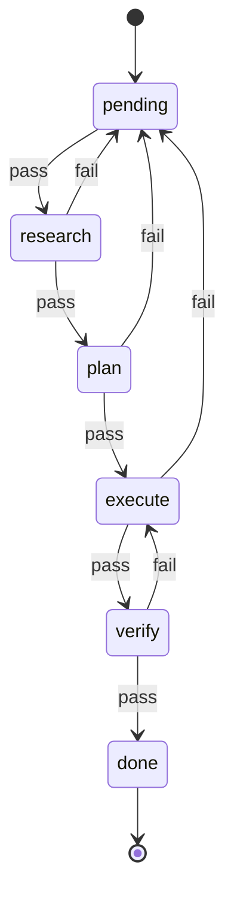

# Gate UML Spec

This document is the authoritative implementation spec for the native `maenifold.gate` Gateway domain.

## Authority

- `SPEC = this document + the bundled built-in gate JSON files in crates/maenifold-gate/assets/*.json`
- Runtime authoritative gate JSON lives in `$MAENIFOLD_ROOT/assets/gates/` (defaults to `~/maenifold/assets/gates/`)
- Bundled built-ins are copied to the gate directory only when missing or stale
- Existing runtime gate JSON files are authoritative and must never be overwritten by bootstrap
- Files under `todo/` and `done/` are authoritative task state
- Live task files in `todo/` must declare canonical frontmatter `sessionId`
  referencing a reasoning session ID beginning with `session-` or `workflow-`
- Completed tasks under `done/legacy/` are treated as legacy archive and are
  skipped by live linkage validation
- `gate.db` is a rebuildable read model derived from authoritative files and has no authority over task truth
- No source module may exist unless it is named in this spec

## Scope

- Crate: `crates/maenifold-gate`
- Host surface: native Gateway domain `maenifold.gate`, served by the existing `maenifold --http` daemon.
- Gateway command surface:
  - `gate_Status`
  - `gate_Append`
  - `gate_History`
  - `gate_Pass`
  - `gate_Fail`
  - `gate_Sync`
  - `gate_TaskBody`
- Access pattern: call `GatewayExecute` with `domain="maenifold.gate"`, one of the command names above, and parameters such as `{root: "/path/to/repo"}`.
- Shipped built-in processes:
  - `sdd`
  - `tdd`
  - `gsd`
  - `lightweight`

## Architectural Rules

- `main.rs` is entrypoint and mode dispatch only
- Gateway request parsing must be isolated from command execution
- Transition logic must exist only in `state_machine.rs`
- Gate JSON validation must exist only in `gate_definition.rs`
- Gate asset resolution and bootstrap must exist only in `gate_catalog.rs`
- File parsing must be isolated from file mutation
- Cache rebuilding must never override file authority
- `status` and UI read paths must consume `gate.db`, not derive status directly from task files
- Every successful mutating command must refresh `gate.db` before returning to the caller
- Long-lived runtimes must reconcile out-of-band file changes through a debounced watcher on `todo/` and `done/`
- Cache refresh must preserve the existing `gate.db` file and SQLite WAL/SHM sidecars; destructive unlink-and-recreate is forbidden
- All reusable command paths must coordinate through `.gate/gate.lock` using OS-level advisory locks:
  - read-only operations (`status`, `history`, `task_body`) take a shared lock
  - mutating/cache-refresh operations (`append`, `pass`, `fail`, `cancel`, `sync`) take an exclusive lock
  - Gateway commands, local UI paths, and file-watcher reconciliation must share the same lock file
- Per-task lock files under `.gate/locks/` may additionally serialize same-task mutators, but they do not replace the project-level lock
- Final archive moves must use same-filesystem `rename` from `todo/` to `done/` and fsync the containing directories after the rename
- `sync --rebuild` must recover a task left in `todo/` with a terminal stage record by moving it to `done/` before rebuilding `gate.db`
- Command business logic must be reusable by the native Gateway domain and UI consumers
- Gateway tool execution must call the same business logic as local UI paths
- Runtime host code must not duplicate gate command logic
- Every task file must bind itself to a specific pipeline name
- Built-in process definitions use explicit state-machine JSON with `schemaVersion`, `id`, `name`, `initial`, `states`, `on`, and `terminal`
- There is no backward compatibility for legacy built-in process JSON
- The only legal outcomes are `pass` and `fail`
- `pending` is a dispatch state, not a terminal work stage
- Silent fallback to a different pipeline definition is forbidden
- Illegal transitions must fail closed

## Built-in Asset Rules

- Bundled built-ins live in `crates/maenifold-gate/assets/`
- On built-in load, `gate_catalog.rs` must ensure all four bundled assets exist in the runtime directory
- Bundled assets are written to the runtime directory only when the runtime copy is missing
- The compiled binary seeds missing built-ins; existing runtime copies remain authoritative
- Built-in names are reserved:
  - `sdd`
  - `tdd`
  - `gsd`
  - `lightweight`

## Gateway Runtime Rules

- Gate is exposed as the native Gateway domain `maenifold.gate`; it is not a standalone MCP server.
- The existing `maenifold --http` daemon hosts Gateway execution over the maenifold HTTP MCP endpoint, normally on port `8080`.
- Gateway access uses `GatewayExecute` with:
  - `domain="maenifold.gate"`
  - `command` set to one of the native command names
  - `parameters` containing the repository `root` and command-specific arguments
- The Gateway domain must expose exactly these commands:
  - `gate_Status`
  - `gate_Sync`
  - `gate_Append`
  - `gate_Pass`
  - `gate_Fail`
  - `gate_History`
  - `gate_TaskBody`
- The Gateway domain runs in-process with maenifold and must not require tray icons, per-instance tooltips, LaunchAgent setup, or an additional service process.
- Long-lived maenifold runtimes host the debounced file watcher that reconciles external file mutations into `gate.db`.
- Native UI surfaces call the same gate command service used by `maenifold.gate`.

## JSON Schema

Every gate definition must have this shape:

```json
{
  "schemaVersion": 1,
  "id": "sdd",
  "name": "Spec Driven Development",
  "initial": "pending",
  "states": {
    "pending": {
      "on": {
        "pass": "swe"
      }
    },
    "swe": {
      "on": {
        "fail": "pending",
        "pass": "red-team"
      }
    },
    "red-team": {
      "on": {
        "fail": "pending",
        "pass": "blue-team"
      }
    },
    "blue-team": {
      "on": {
        "fail": "pending",
        "pass": "done"
      }
    },
    "done": {
      "terminal": true
    }
  }
}
```

Schema invariants:

- `schemaVersion` must equal `1`
- `initial` must reference an existing state
- A terminal state must not declare `on` transitions
- Every transition target must reference an existing state
- The initial state must declare `on.pass` to the first actionable stage
- The initial state must not dispatch directly to a terminal state

## Module UML

_Module UML — diagram_ ::
Relationships shown by arrows in the diagram source below — open in a graphical viewer (or the maenifold desktop app / GitHub web UI) to render.

<details><summary>Mermaid source (graphical viewers only)</summary>



</details>

```mermaid
classDiagram
direction TB

class GateCliMain {
  +main() int
}

class GateCliApp {
  +classify(args) CliAction
  +run(args) int
}

class CliParser {
  +parse(argv) ParsedCli
}

class CliAction {
  <<enum>>
  Headless
  Mcp
  Http
}

class CommandRequest {
  <<enum>>
  Status
  Append
  History
  Pass
  Fail
  Sync
}

class StatusCommand {
  +execute(args) Result
}

class AppendCommand {
  +execute(args) Result
}

class HistoryCommand {
  +execute(args) Result
}

class PassCommand {
  +execute(args) Result
}

class FailCommand {
  +execute(args) Result
}

class SyncCommand {
  +execute(args) Result
}

class GateContext {
  +root: Path
  +requestedPipelineName: Option~String~
  +jsonOutput: bool
}

class GateToolService {
  +status(args) Value
  +append(args) Value
  +pass(args) Value
  +fail(args) Value
  +sync(args) Value
}

class GateMcpServer {
  +serveStdio(root) Result
  +serveHttp(port, root) Result
}

class GateMcpHandler {
  +listTools() Result
  +callTool(request) Result
}

class GateMcpHttp {
  +service(cancellationToken, root) HttpService
  +serveHttpListener(listener, root) Result
}

class GateUiWindow {
  +run(root) int
}

class GateUiApp {
  -tasks: Vec~TaskEntry~
  +new(root, tasks) GateUiApp
  +visible_tasks() Vec~TaskEntry~
}

class GateToolSchema {
  +list() Vec~McpToolDefinition~
}

class GateTray {
  +runWithTray(mode) int
}

class GateTrayMenu {
  +buildTrayMenu(mode) TrayMenuState
  +toggleLoginItem(port, item) Result
}

class GateFileWatcher {
  +start(root) Result
  +handleDebouncedChange(root) Result
}

class GateServerMode {
  <<enum>>
  Stdio
  Http
}

class GateDefinitionCatalog {
  +loadBuiltin(name) GateDefinition
  +loadCustom(root) GateDefinition
  +resolve(root, name) GateDefinition
  +resolveForTask(root, metadata, requestedPipelineName) GateDefinition
  -runtimeGatesDir() Path
  -ensureAllBuiltinAssets() Result
  -builtinAssetText(name) str
}

class GateDefinitionValidator {
  +validate(definition) Result
}

class GateDefinition {
  +initial: String
  +states: Map~String,GateState~
  +initialState() String
  +findState(id) GateState
  +orderedStageIds() Vec~String~
}

class GateState {
  +terminal: bool
  +on: Map~String,String~
}

class TransitionResult {
  +actingStage: String
  +outcome: String
  +nextState: String
}

class TaskRepository {
  +findTask(root, taskId) TaskPathSet
  +listTasks(root) Vec~TaskPathSet~
  +moveToDone(task) Result
}

class TaskFileReader {
  +read(path) TaskDocument
}

class TaskFileWriter {
  +appendSection(path, section) Result
}

class TaskDocument {
  +metadata: TaskMetadata
  +records: Vec~TaskStageRecord~
}

class TaskMetadata {
  +id: Option~String~
  +title: String
  +pipeline: String
  +status: Option~String~
  +sessionId: Option~String~
}

class TaskStageRecord {
  +stage: String
  +recordKind: String
  +outcome: Option~String~
  +agent: String
  +model: Option~String~
  +recordedAt: String
}

class EffectiveTaskState {
  +state: String
  +attempts: u32
  +location: String
}

class TaskStatusDeriver {
  +derive(document, definition, location) EffectiveTaskState
}

class StateMachine {
  +actingStageName(state, definition) String
  +nextOnPass(state, definition) TransitionResult
  +nextOnFail(state, definition) TransitionResult
}

class CanonicalSectionFactory {
  +buildAppendSection(stage, agent, notes, model) String
  +buildOutcomeSection(stage, outcome, agent, notes, model) String
}

class GateCacheDb {
  +open(root) GateCacheDb
  +pathForRoot(root) Path
  +rebuild(root, definition, tasks) Result
  +listTaskStatus(root, pipeline) Vec~Value~
  +insertWorkLog(entry) Result
}

class JsonRenderer {
  +renderStatus(result) String
  +renderError(error) String
}

class GateError {
  <<error>>
}

GateCliMain --> GateCliApp
GateCliMain --> GateTray
GateCliApp --> CliParser
GateCliApp --> CommandRequest
GateCliApp --> GateUiWindow

CommandRequest --> StatusCommand
CommandRequest --> AppendCommand
CommandRequest --> HistoryCommand
CommandRequest --> PassCommand
CommandRequest --> FailCommand
CommandRequest --> SyncCommand

StatusCommand --> GateToolService
AppendCommand --> GateToolService
HistoryCommand --> TaskFileReader
HistoryCommand --> TaskRepository
PassCommand --> GateToolService
FailCommand --> GateToolService
SyncCommand --> GateToolService

GateMcpServer --> GateMcpHandler
GateMcpServer --> GateMcpHttp
GateMcpHandler --> GateToolSchema
GateMcpHandler --> GateToolService

GateTray --> GateTrayMenu
GateTray --> GateMcpServer
GateTray --> GateFileWatcher

GateUiWindow --> GateUiApp
GateUiWindow --> GateToolService

GateFileWatcher --> GateToolService

GateToolService --> GateDefinitionCatalog
GateToolService --> TaskRepository
GateToolService --> TaskFileReader
GateToolService --> TaskFileWriter
GateToolService --> TaskStatusDeriver
GateToolService --> StateMachine
GateToolService --> CanonicalSectionFactory
GateToolService --> GateCacheDb
GateToolService --> JsonRenderer

GateDefinitionCatalog --> GateDefinitionValidator
GateDefinitionCatalog --> GateDefinition
```

## Allowed Module Inventory

Only these source files are allowed in `crates/maenifold-gate/src`:

- `main.rs`
- `cli.rs`
- `error.rs`
- `gate_definition.rs`
- `gate_catalog.rs`
- `gate_tool_service.rs`
- `json_output.rs`
- `mcp/mod.rs`
- `mcp/http.rs`
- `mcp/schema.rs`
- `tray.rs`
- `tray_menu.rs`
- `file_watcher.rs`
- `ui_window.rs`
- `task_repository.rs`
- `task_file.rs`
- `task_metadata.rs`
- `task_sections.rs`
- `task_status.rs`
- `state_machine.rs`
- `section_factory.rs`
- `cache_db.rs`
- `status_command.rs`
- `append_command.rs`
- `pass_command.rs`
- `fail_command.rs`
- `sync_command.rs`

If implementation requires a new file, this spec must be updated first.

## Module Responsibilities

### `main.rs`

- Domain entrypoint/registration only
- No standalone transport or tray lifecycle logic

### `cli.rs`

- Deprecated compatibility parsing only, if present
- No business logic

### `error.rs`

- Typed errors only
- No business logic

### `gate_definition.rs`

- Deserialize gate JSON
- Validate schema invariants
- Represent state and transition data
- Expose lookup helpers

### `gate_catalog.rs`

- Embed bundled built-in gate assets
- Bootstrap missing runtime assets only
- Resolve built-in definitions from the runtime gate directory
- Resolve custom `{root}/pipeline.json` only for explicit non-reserved names
- Enforce reserved-name precedence and pipeline binding checks

### `gate_tool_service.rs`

- Own all reusable gate command business logic
- Return structured results consumable by the native Gateway domain and UI paths
- Never print directly

### `json_output.rs`

- JSON formatting only

### `mcp/mod.rs`

- Native Gateway domain adapter for `maenifold.gate`
- Gateway command dispatch
- Gateway command metadata surface

### `mcp/http.rs`

- No standalone HTTP service
- Gate HTTP access is hosted by the maenifold Gateway runtime

### `mcp/schema.rs`

- Gateway command definitions and input schemas
- No transport logic

### `tray.rs`

- Deprecated/removed standalone tray surface
- Must not host gate command logic

### `tray_menu.rs`

- Deprecated/removed standalone tray menu surface
- Must not create open-at-login configuration for gate

### `file_watcher.rs`

- Debounced watcher over `todo/` and `done/`
- Trigger `sync` reconciliation for out-of-band file mutations
- Never mutate task files directly

### `ui_window.rs`

- Native egui task board window
- Calls `GateToolService::status()` for DB-backed task data
- No direct file parsing or status derivation
- Loads task rows once at window startup; no in-window auto-refresh loop exists
- Table view with filtering, sorting, search
- Task detail panel with markdown rendering
- Launched only by native maenifold UI integration when present

### `task_repository.rs`

- Enumerate `todo/` and `done/`
- Resolve task IDs to file paths
- Detect duplicate task IDs
- Move terminal tasks into `done/`

### `task_file.rs`

- Read one markdown task file
- Append canonical sections

### `task_metadata.rs`

- Parse frontmatter `id`
- Parse frontmatter `title`
- Parse frontmatter `pipeline`
- Parse frontmatter `status`
- Parse canonical frontmatter `sessionId` (with low-cost legacy alias support when present)
- Parse title
- Parse `Pipeline`
- Parse canonical task ID from frontmatter (`parse_task_id`)

### `task_sections.rs`

- Parse canonical stage event sections
- Parse explicit outcome markers
- Return ordered stage records
- Support repeated sections for the same stage across retries
- Extract explicit recorded timestamps for each event section

### `task_status.rs`

- Derive effective task status from:
  - task file contents
  - directory location
  - active gate definition
- Replay ordered stage event records against the bound gate definition
- Treat `pending` as both the initial dispatch state and its own acting stage; legacy histories that omitted the bootstrap `pending` PASS are handled by backward-compat seeding in `maybe_seed_legacy_entry_stage`
- Reject non-reconstructible or mismatched task histories

### `state_machine.rs`

- Sole source of legal transitions
- Resolve acting stage from the current effective state
- Compute next state for `pass` and `fail`
- Reject illegal transitions

### `section_factory.rs`

- Produce canonical markdown sections for:
  - `append`
  - `pass`
  - `fail`
- `append` sections are informational work events only and must not encode a stage transition

### `cache_db.rs`

- Open and maintain the `gate.db` read model
- Rebuild task pipeline/status snapshots in place
- Error on missing/invalid `sessionId` for live `todo/` tasks
- Warn on missing/invalid linkage for completed tasks still sitting in top-level `done/`
- Cache work log history entries
- Preserve the existing DB file and WAL/SHM sidecars during refresh
- Serve task status rows for `status` and UI consumers
- No authority over task truth

### `status_command.rs`

- Presentation adapter for `gate_Status`

### `append_command.rs`

- Presentation adapter for `gate_Append`

### `pass_command.rs`

- Presentation adapter for `gate_Pass`

### `fail_command.rs`

- Presentation adapter for `gate_Fail`

### `sync_command.rs`

- Presentation adapter for `gate_Sync`
- Reconcile `gate.db` from authoritative files without deleting the live DB file or sidecars

## State Models

### Shared Dispatch Semantics

- `pending` is the initial dispatch state and a real acting stage
- `append` while the effective state is `pending` records `Stage ID: pending`
- `pass` from `pending` records a `pending` outcome and advances exactly one edge into `pending.on.pass`
- Replay starts at `pending`; legacy histories that omitted the bootstrap `pending` PASS may be seeded to `pending.on.pass` before validating the first recorded entry-stage outcome
- A terminal state has no legal outgoing transition

### SDD

_SDD — diagram_ ::
Nodes: *.
Relationships shown by arrows in the diagram source below — open in a graphical viewer (or the maenifold desktop app / GitHub web UI) to render.

<details><summary>Mermaid source (graphical viewers only)</summary>

```mermaid
stateDiagram-v2
[*] --> pending

pending --> swe: pass
swe --> red-team: pass
swe --> pending: fail
red-team --> blue-team: pass
red-team --> pending: fail
blue-team --> done: pass
blue-team --> pending: fail

done --> [*]
```

</details>

### TDD

_TDD — diagram_ ::
Nodes: *.
Relationships shown by arrows in the diagram source below — open in a graphical viewer (or the maenifold desktop app / GitHub web UI) to render.

<details><summary>Mermaid source (graphical viewers only)</summary>

```mermaid
stateDiagram-v2
[*] --> pending

pending --> blue-team: pass
blue-team --> swe: pass
blue-team --> pending: fail
swe --> red-team: pass
swe --> pending: fail
red-team --> done: pass
red-team --> pending: fail

done --> [*]
```

</details>

### GSD

_GSD — diagram_ ::
Nodes: *.
Relationships shown by arrows in the diagram source below — open in a graphical viewer (or the maenifold desktop app / GitHub web UI) to render.

<details><summary>Mermaid source (graphical viewers only)</summary>



</details>

### Lightweight

_Lightweight — diagram_ ::
Nodes: *.
Relationships shown by arrows in the diagram source below — open in a graphical viewer (or the maenifold desktop app / GitHub web UI) to render.

<details><summary>Mermaid source (graphical viewers only)</summary>

```mermaid
stateDiagram-v2
[*] --> pending

pending --> swe: pass
swe --> blue-team: pass
swe --> pending: fail
blue-team --> done: pass
blue-team --> pending: fail

done --> [*]
```

</details>

## MCP Tool Surface

### `status`

Input:

- `root` optional, default `.`
- `pipeline` optional

Output:

- array of task status objects

Behavior:

- Read task status from the `gate.db` read model
- Never derive task status directly from task files on the status read path

### `append`

Input:

- `taskId`
- `agent`
- `notes`
- `root` optional, default `.`
- `pipeline` optional
- `model` optional

Output:

- object describing the task after append

Behavior:

- Append the canonical file event first
- Refresh `gate.db` before returning success

### `pass`

Input:

- `taskId`
- `notes`
- `root` optional, default `.`
- `pipeline` optional
- `model` optional

Output:

- object describing the task after transition

Behavior:

- Append the canonical file event first
- Refresh `gate.db` before returning success

### `fail`

Input:

- `taskId`
- `notes`
- `root` optional, default `.`
- `pipeline` optional
- `model` optional

Output:

- object describing the task after transition

Behavior:

- Append the canonical file event first
- Refresh `gate.db` before returning success

### `sync`

Input:

- `root` optional, default `.`
- `pipeline` optional
- `rebuild` optional, default `false`

Output:

- object describing rebuild mode, pipeline, and task count

Behavior:

- Reconcile the `gate.db` read model from authoritative files and active definitions
- Refresh in place under the live database path
- Never delete the existing `gate.db`, `gate.db-wal`, or `gate.db-shm` files as part of normal sync

## File Authority Rules

- If a task file is in `done/`, effective location is `done`
- If a task file is in `todo/`, effective location is `todo`
- Every task file must bind a pipeline via exactly one supported source:
  - frontmatter `pipeline: <name>`
  - markdown `**Pipeline**: <name>`
- Canonical task ID comes from frontmatter `id` when present; otherwise the filename stem is used
- If a task has no stage sections, effective state is:
  - frontmatter `state` when present
  - otherwise frontmatter `status` when present
  - otherwise the active definition's initial state
- If a task in `done/` is not terminal under the active definition, that is an error
- If a task file has no pipeline binding, it is invalid for active enforcement
- The presence of later-stage prose must not advance state unless the active state machine and canonical recorded outcome permit it

## Reconstructible Event Log Rules

- Every mutating command appends exactly one canonical stage event section
- `append` appends a stage work event with no outcome
- `pass` appends a stage outcome event with `PASS`
- `fail` appends a stage outcome event with `FAIL`
- Multiple sections for the same stage are legal and expected across retries
- Effective task state is derived by replaying ordered stage event records from the beginning of the task history against the bound gate definition
- Replay order is file order, with each event carrying its own explicit `recordedAt` timestamp for audit fidelity

## Canonical Section Rules

### Section Heading Rule

- Shipped built-in stage IDs use canonical headings such as `Pending`, `SWE`, `Red-Team`, `Blue-Team`, `Research`, `Plan`, `Execute`, `Verify`, and `Done`
- Unknown stage IDs fall back to title-casing each `-`-separated segment
- Examples: `swe` → `## SWE`, `red-team` → `## Red-Team`, `blue-team` → `## Blue-Team`
- The heading is for human readability only; the parser uses the `- Stage ID:` field inside the section

### Canonical Record Fields

Each appended section must include:

- agent identity
- notes
- model when provided
- stage ID
- record kind
- recorded timestamp
- outcome when applicable

## Invariants

- One authoritative gate definition per invocation
- One authoritative gate definition binding per task file
- All legal transitions are derived from `current_state + outcome -> next_state`
- Outcomes not declared by a state are illegal
- `append` must not change stage
- `append` must not call or simulate any transition path
- `pass` and `fail` must be atomic with respect to file mutation
- Successful `append`, `pass`, and `fail` must leave the `gate.db` read model current before returning
- Terminal `done` has no outgoing transition
- Final-stage `pass` must move the file into `done/`
- `sync` rebuilds the `gate.db` read model from files and active definitions in place
- Cache mismatch must never silently override file truth
- Duplicate task IDs are fatal
- Missing pipeline binding is fatal
- Unknown transition targets are fatal
- Duplicate state names are fatal
- Hidden defaults are forbidden
- Errors are informational — every error that rejects a value must list the valid alternatives

## Required Off-the-Shelf Crates

- `clap`
- `serde`
- `serde_json`
- `serde_yaml`
- `rusqlite`
- `walkdir`
- `regex`
- `thiserror`
- `chrono`
- `indexmap`
- `notify`
- `tokio`
- `rmcp`
- `axum`
- `tokio-util`
- `tower-http`
- `tray-icon`
- `winit`
- `eframe`
- `egui`
- `egui_extras`
- `egui-commonmark`

Optional:

- `objc2-core-foundation` (macOS only)
- `tempfile`
- `assert_cmd`
- `predicates`
- `tower`

## Verification Matrix

All implementation must be testable against these required named tests.

### Asset, Definition, and Cache Tests

- `builtin_assets_are_bootstrapped_only_when_missing`
- `builtin_sdd_definition_matches_authoritative_asset`
- `builtin_gsd_definition_matches_authoritative_asset`
- `builtin_lightweight_definition_matches_authoritative_asset`
- `builtin_tdd_definition_matches_authoritative_asset`
- `ordered_stage_ids_follow_pass_path`
- `gate_cache_connections_enable_wal_mode`

### End-to-End Process Tests

- `sdd_e2e_bootstraps_assets_retries_from_red_and_completes`
- `tdd_e2e_retries_from_red_team_and_completes`
- `gsd_e2e_retries_from_verify_and_completes`
- `lightweight_e2e_retries_from_blue_and_completes`

### Gateway Flow Tests

- `status_reports_new_todo_task_as_pending`
- `append_records_swe_work_without_advancing_state`
- `append_requires_agent_flag`
- `append_on_done_task_fails_with_explicit_message`
- `pass_requires_agent_flag`
- `fail_on_done_task_reopens_it_in_todo_pending`
- `fail_requires_agent_flag`
- `fail_returns_sdd_task_from_blue_to_pending_and_increments_attempts`
- `fail_from_pending_dispatch_state_returns_to_pending_and_increments_attempts`
- `task_file_requires_explicit_pipeline_binding`
- `legacy_task_without_pipeline_binding_is_rejected`
- `sync_rebuild_writes_db_under_dot_gate_and_updates_gitignore_idempotently`
- `gateway_execute_routes_gate_status`
- `gateway_execute_routes_gate_append`
- `gateway_execute_routes_gate_pass`
- `gateway_execute_routes_gate_fail`
- `gateway_execute_routes_gate_sync`
- `gateway_execute_routes_gate_history`
- `gateway_execute_routes_gate_task_body`

### Repository Behavior Tests

- `status_loads_every_shipped_repo_task`
- `status_uses_canonical_frontmatter_id_for_slugged_repo_task`
- `status_respects_frontmatter_done_state_for_repo_tasks`
- `sync_rebuild_succeeds_for_shipped_repo_tasks`

### Gateway and Runtime Tests

- `gateway_domain_lists_gate_commands`
- `gateway_status_command_returns_task_array`
- `gateway_pass_command_advances_bound_task`
- `gateway_history_command_returns_stage_history`
- `gateway_task_body_command_returns_task_markdown`
- `maenifold_http_hosts_gateway_execute`
- `ui_args_target_requested_root`

## Agent Contract

### PM

- Owns this spec
- May revise UML before implementation changes
- Rejects implementation not represented here

### SWE

- Implements only modules present in this spec
- Must not invent new architecture outside this document
- Builds only the assigned crate during implementation waves

### Red-team

- Audits spec conformance
- Audits transition correctness
- Audits silent fallback risk

### Blue-team

- Verifies named tests only
- Issues PASS or FAIL against spec behavior

## Delivery Gate

Implementation is not complete unless:

- the crate exists
- the code matches this spec
- the bundled built-in assets are copied to the runtime gate directory only when missing
- the new state-machine JSON schema is enforced
- each shipped built-in process has an end-to-end completion test
- fail and retry paths are exercised for each shipped process
- `maenifold.gate` serves the seven native Gateway commands through `GatewayExecute`
- `maenifold --http` hosts the Gateway surface without requiring an additional gate service
- named verification passes
- the integrated maenifold Gateway surface is usable
