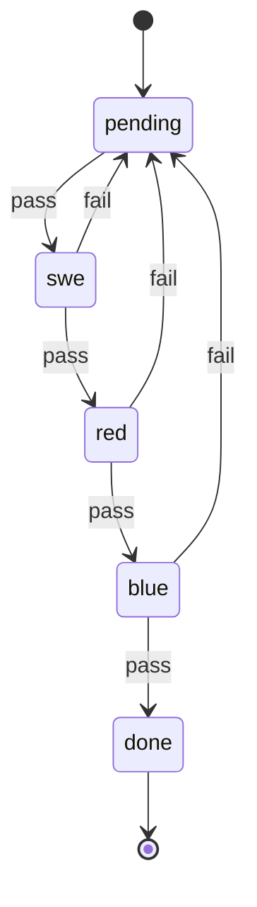
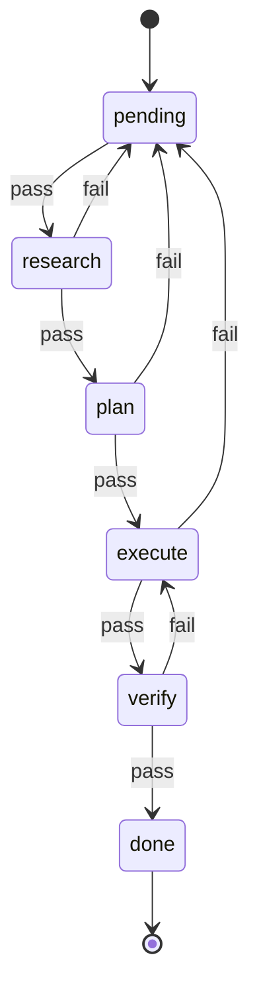
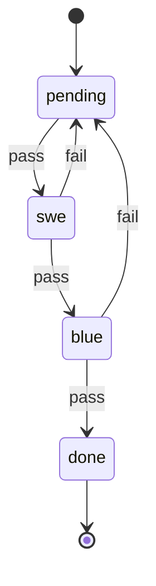
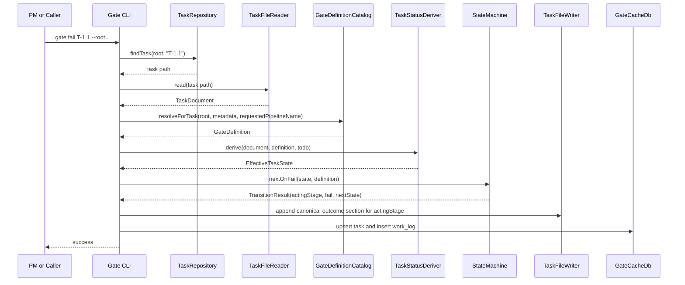

# Gate UML Spec

This document is the authoritative implementation spec for rebuilding and enforcing `gate`.

## Authority

- `SPEC = this document + the bundled built-in gate JSON files in crates/maenifold-gate/assets/*.json`
- On runtime load, bundled built-ins must be copied into the authoritative runtime gate folder only when missing.
- Existing runtime gate JSON files are authoritative and must never be overwritten by bootstrap.
- Files under `todo/` and `done/` are authoritative task state.
- `gate.db` is a rebuildable cache only.

## Scope

- Crate: `crates/maenifold-gate`
- Command surface:
  - `status`
  - `append`
  - `pass`
  - `fail`
  - `sync`
- Shipped built-in processes:
  - `sdd`
  - `tdd`
  - `gsd`
  - `lightweight`

## Architectural Rules

- `main.rs` is entrypoint only.
- CLI parsing must be isolated from command execution.
- Transition logic must exist only in `state_machine.rs`.
- Gate JSON validation must exist only in `gate_definition.rs`.
- Gate asset resolution and bootstrap must exist only in `gate_catalog.rs`.
- File parsing must be isolated from file mutation.
- Cache rebuilding must never override file authority.
- Every task file must bind itself to a specific pipeline name and pipeline digest.
- Built-in process definitions use explicit state-machine JSON with `schemaVersion`, `id`, `name`, `initial`, `states`, `on`, and `terminal`.
- There is no backward compatibility for legacy built-in process JSON.
- The only legal outcomes are `pass` and `fail`.
- `pending` is a dispatch state, not a terminal work stage.
- Silent fallback to a different pipeline definition is forbidden.
- Illegal transitions must fail closed.

## Built-in Asset Rules

- Bundled built-ins live in `crates/maenifold-gate/assets/`.
- Runtime authoritative directory is `MAENIFOLD_GATE_ASSETS_DIR` when set, otherwise `/Users/brett/maenifold/assets/gates`.
- On built-in load, `gate_catalog.rs` must ensure all four bundled assets exist in the runtime directory.
- Missing runtime assets are written from the bundled copies.
- Existing runtime assets are preserved byte-for-byte.
- Built-in names are reserved:
  - `sdd`
  - `tdd`
  - `gsd`
  - `lightweight`

## JSON Schema

Every gate definition must have this shape:

```json
{
  "schemaVersion": 1,
  "id": "sdd",
  "name": "Spec Driven Development",
  "initial": "pending",
  "states": {
    "pending": {
      "on": {
        "pass": "swe"
      }
    },
    "swe": {
      "on": {
        "fail": "pending",
        "pass": "red"
      }
    },
    "red": {
      "on": {
        "fail": "pending",
        "pass": "blue"
      }
    },
    "blue": {
      "on": {
        "fail": "pending",
        "pass": "done"
      }
    },
    "done": {
      "terminal": true
    }
  }
}
```

Schema invariants:

- `schemaVersion` must equal `1`.
- `initial` must reference an existing state.
- A terminal state must not declare `on` transitions.
- Every transition target must reference an existing state.
- The initial state must declare `on.pass` to the first actionable stage.
- The initial state must not dispatch directly to a terminal state.

## Component UML

```mermaid
classDiagram
direction TB

class GateCliMain {
  +main() int
}

class CliParser {
  +parse(argv) CommandRequest
}

class CommandRouter {
  +run(request) Result
}

class StatusCommand {
  +execute(context) Result
}

class AppendCommand {
  +execute(context) Result
}

class PassCommand {
  +execute(context) Result
}

class FailCommand {
  +execute(context) Result
}

class SyncCommand {
  +execute(context) Result
}

class GateContext {
  +root: Path
  +requestedPipelineName: Option~String~
  +jsonOutput: bool
}

class GateDefinitionCatalog {
  +loadBuiltin(name) GateDefinition
  +loadCustom(root) GateDefinition
  +resolve(root, name) GateDefinition
  +resolveBound(root, name, digest) GateDefinition
  +resolveForTask(root, metadata, requestedPipelineName) GateDefinition
}

class GateDefinitionValidator {
  +validate(definition) Result
}

class GateDefinition {
  +id: String
  +name: String
  +digest: String
  +initial: String
  +states: Map~String,GateState~
  +initialState() String
  +findState(id) GateState
}

class GateState {
  +terminal: bool
  +on: Map~String,String~
}

class TransitionResult {
  +actingStage: String
  +outcome: String
  +nextState: String
}

class TaskRepository {
  +findTask(root, taskId) TaskPathSet
  +listTasks(root) Vec~TaskPathSet~
  +moveToDone(task) Result
}

class TaskFileReader {
  +read(path) TaskDocument
}

class TaskFileWriter {
  +appendSection(path, section) Result
}

class TaskDocument {
  +metadata: TaskMetadata
  +records: Vec~TaskStageRecord~
}

class TaskMetadata {
  +title: String
  +requirement: String
  +testCases: Vec~String~
  +component: String
  +pipeline: String
  +pipelineDigest: String
}

class TaskStageRecord {
  +stage: String
  +recordKind: String
  +outcome: Option~String~
  +agent: String
  +model: Option~String~
  +recordedAt: String
}

class TaskStatusDeriver {
  +derive(document, definition, location) EffectiveTaskState
}

class StateMachine {
  +actingStageName(state, definition) String
  +nextOnPass(state, definition) TransitionResult
  +nextOnFail(state, definition) TransitionResult
}

class CanonicalSectionFactory {
  +buildAppendSection(stage, agent, notes, model) String
  +buildOutcomeSection(stage, outcome, agent, notes, model) String
}

class GateCacheDb {
  +open(root) Db
  +rebuild(root, definition, tasks) Result
  +upsertTask(task) Result
  +insertWorkLog(entry) Result
}

class PrdParser {
  +parse(path) Vec~Requirement~
}

class RtmParser {
  +parse(path) Vec~TraceabilityRow~
}

class JsonRenderer {
  +renderStatus(result) String
  +renderError(error) String
}

class GateError {
  <<error>>
}

GateCliMain --> CliParser
CliParser --> CommandRouter

CommandRouter --> StatusCommand
CommandRouter --> AppendCommand
CommandRouter --> PassCommand
CommandRouter --> FailCommand
CommandRouter --> SyncCommand

StatusCommand --> GateContext
AppendCommand --> GateContext
PassCommand --> GateContext
FailCommand --> GateContext
SyncCommand --> GateContext

StatusCommand --> GateDefinitionCatalog
AppendCommand --> GateDefinitionCatalog
PassCommand --> GateDefinitionCatalog
FailCommand --> GateDefinitionCatalog
SyncCommand --> GateDefinitionCatalog

GateDefinitionCatalog --> GateDefinitionValidator
GateDefinitionCatalog --> GateDefinition

StatusCommand --> TaskRepository
AppendCommand --> TaskRepository
PassCommand --> TaskRepository
FailCommand --> TaskRepository
SyncCommand --> TaskRepository

TaskRepository --> TaskFileReader
TaskFileReader --> TaskMetadata
TaskFileReader --> TaskStageRecord

StatusCommand --> TaskStatusDeriver
PassCommand --> StateMachine
FailCommand --> StateMachine

AppendCommand --> CanonicalSectionFactory
PassCommand --> CanonicalSectionFactory
FailCommand --> CanonicalSectionFactory

AppendCommand --> TaskFileWriter
PassCommand --> TaskFileWriter
FailCommand --> TaskFileWriter

SyncCommand --> GateCacheDb
SyncCommand --> PrdParser
SyncCommand --> RtmParser

StatusCommand --> JsonRenderer
AppendCommand --> JsonRenderer
PassCommand --> JsonRenderer
FailCommand --> JsonRenderer
```



## Allowed Module Inventory

Only these source files are allowed in `crates/maenifold-gate/src`:

- `main.rs`
- `cli.rs`
- `error.rs`
- `gate_definition.rs`
- `gate_catalog.rs`
- `task_repository.rs`
- `task_file.rs`
- `task_metadata.rs`
- `task_sections.rs`
- `task_status.rs`
- `state_machine.rs`
- `section_factory.rs`
- `cache_db.rs`
- `prd_parser.rs`
- `rtm_parser.rs`
- `json_output.rs`
- `status_command.rs`
- `append_command.rs`
- `pass_command.rs`
- `fail_command.rs`
- `sync_command.rs`

If implementation requires a new file, this spec must be updated first.

## Module Responsibilities

### `main.rs`

- Program entrypoint only
- Initializes CLI and exits with code

### `cli.rs`

- `clap` command parsing only
- No command execution logic

### `error.rs`

- Typed errors only
- No business logic

### `gate_definition.rs`

- Deserialize gate JSON
- Validate schema invariants
- Represent state and transition data
- Expose lookup helpers

### `gate_catalog.rs`

- Embed bundled built-in gate assets
- Bootstrap missing runtime assets only
- Resolve built-in definitions from the runtime gate directory
- Resolve custom `{root}/pipeline.json` only for explicit non-reserved names
- Enforce pipeline precedence and digest checks

### `task_repository.rs`

- Enumerate `todo/` and `done/`
- Resolve task IDs to file paths
- Detect duplicate task IDs
- Move terminal tasks into `done/`

### `task_file.rs`

- Read one markdown task file
- Return a structured task document

### `task_metadata.rs`

- Parse title
- Parse `Requirement`
- Parse `Test Cases`
- Parse `Component`
- Parse `Pipeline`
- Parse `Pipeline Digest`

### `task_sections.rs`

- Parse canonical stage event sections
- Parse explicit outcome markers
- Return ordered stage records
- Support repeated sections for the same stage across retries
- Extract explicit recorded timestamps for each event section

### `task_status.rs`

- Derive effective task status from:
  - task file contents
  - directory location
  - active gate definition
- Replay ordered stage event records against the bound gate definition
- Treat `pending` as a dispatch state whose acting stage is the initial `on.pass` target
- Error on non-reconstructible or mismatched task histories

### `state_machine.rs`

- Sole source of legal transitions
- Resolve acting stage from the current effective state
- Compute next state for `pass` and `fail`
- Fail closed on illegal transitions

### `section_factory.rs`

- Produce canonical markdown sections for:
  - `append`
  - `pass`
  - `fail`
- `append` sections are informational work events only and must not encode a stage transition

### `cache_db.rs`

- Create and rebuild `gate.db`
- Upsert tasks
- Insert work log entries
- No authority over task truth
- Persist pipeline name and pipeline digest from the task file
- Use non-empty free-text stage and status columns
- Forbid hardcoded SQL stage enums tied to one pipeline family

### `prd_parser.rs`

- Parse `PRD.md` requirements for `sync`

### `rtm_parser.rs`

- Parse `RTM.md` traceability rows for `sync`

### `json_output.rs`

- JSON formatting only

### `status_command.rs`

- `status` command execution only

### `append_command.rs`

- `append` command execution only
- Validate that the task is currently actionable for the specified stage or agent
- Append a non-advancing work event only
- Must not change effective task state, location, or attempts

### `pass_command.rs`

- `pass` command execution only

### `fail_command.rs`

- `fail` command execution only

### `sync_command.rs`

- `sync` command execution only

## State Models

### Shared Dispatch Semantics

- `pending` is the initial dispatch state.
- The acting stage for `pending` is the state reached by `pending.on.pass`.
- `pass` from `pending` advances into the first actionable stage.
- `fail` from `pending` is legal when the first actionable stage itself declares `fail`.
- A terminal state has no legal outgoing transition.

### SDD



### TDD


### GSD



### Lightweight



## Command Sequence UML



## Precedence Rules

These rules are mandatory.

1. If a custom pipeline is explicitly requested and `{root}/pipeline.json` exists, load it only when the requested name is not reserved.
2. If a built-in pipeline name is requested, load it from the runtime gate directory after bundled-asset bootstrap.
3. Built-in names are reserved.
4. A local custom `pipeline.json` must not silently override a reserved built-in.
5. For task-bound commands, the task file pipeline binding is authoritative.
6. A CLI-requested pipeline name may filter or validate, but it must not override the task-bound pipeline.
7. A task whose bound pipeline digest does not match the authoritative definition digest is invalid until migrated.
8. Missing or malformed authoritative gate JSON is an error.

## File Authority Rules

- If a task file is in `done/`, effective location is `done`.
- If a task file is in `todo/`, effective location is `todo`.
- Every task file must include:
  - `**Pipeline**: <name>`
  - `**Pipeline Digest**: <sha256>`
- If a task in `todo/` has no stage sections, effective state is `pending`.
- If a task in `done/` is not terminal under the active definition, that is an error.
- If a task file has no pipeline binding or digest, it is invalid for active enforcement.
- The presence of later-stage prose must not advance state unless the active state machine and canonical recorded outcome permit it.

## Reconstructible Event Log Rules

- Every mutating command appends exactly one canonical stage event section.
- `append` appends a stage work event with no outcome.
- `pass` appends a stage outcome event with `PASS`.
- `fail` appends a stage outcome event with `FAIL`.
- Multiple sections for the same stage are legal and expected across retries.
- Effective task state is derived by replaying ordered stage event records from the beginning of the task history against the bound gate definition.
- Replay order is file order, with each event carrying its own explicit `recordedAt` timestamp for audit fidelity.

## Canonical Section Rules

### Special Stage-ID Section Names

- `swe` -> `## SWE Remediation`
- `red` -> `## Red-team Audit`
- `blue` -> `## Blue-team Verification`

### Generic Section Rule

- For non-special stages, use capitalized stage IDs as canonical headings.

### Canonical Data Requirements

Each appended section must include:

- agent identity
- notes
- model when provided
- stage ID
- record kind
- recorded timestamp
- outcome when applicable

## Invariants

- One authoritative gate definition per command invocation.
- One authoritative gate definition binding per task file.
- All legal transitions are derived from `current_state + outcome -> next_state`.
- Outcomes not declared by a state are illegal.
- `append` must not change stage.
- `append` must not call or simulate any transition path.
- `pass` and `fail` must be atomic with respect to file mutation.
- Terminal `done` has no outgoing transition.
- Final-stage `pass` must move the file into `done/`.
- `sync` rebuilds cache from files and active definitions.
- Cache mismatch must never silently override file truth.
- Duplicate task IDs are fatal.
- Missing pipeline binding is fatal.
- Pipeline digest mismatch is fatal.
- Unknown transition targets are fatal.
- Duplicate state names are fatal.
- Hidden defaults are forbidden.

## Required Off-the-Shelf Crates

- `clap`
- `serde`
- `serde_json`
- `rusqlite`
- `walkdir`
- `regex`
- `thiserror`
- `chrono`
- `sha2`

Optional:

- `tempfile`
- `assert_cmd`
- `predicates`

Not required for enforcement:

- markdown AST parsing
- heuristic heading inference
- backward-compatibility shims for legacy gate JSON

## Verification Requirements

All implementation must be testable against these required named tests.

### Asset and Definition Tests

- `builtin_sdd_definition_matches_authoritative_asset`
- `builtin_gsd_definition_matches_authoritative_asset`
- `builtin_lightweight_definition_matches_authoritative_asset`
- `builtin_tdd_definition_matches_authoritative_asset`

### End-to-End Process Tests

- `sdd_e2e_bootstraps_assets_retries_from_red_and_completes`
- `tdd_e2e_retries_from_red_and_completes`
- `gsd_e2e_retries_from_verify_and_completes`
- `lightweight_e2e_retries_from_blue_and_completes`

### CLI Flow Tests

- `status_reports_new_todo_task_as_pending`
- `append_records_swe_work_without_advancing_state`
- `fail_returns_sdd_task_from_blue_to_pending_and_increments_attempts`
- `fail_from_pending_dispatch_state_returns_to_pending_and_increments_attempts`
- `task_file_requires_explicit_pipeline_binding`
- `task_file_requires_pipeline_digest`
- `status_errors_when_pipeline_digest_mismatches_authoritative_asset`
- `legacy_task_without_pipeline_binding_is_rejected`

## Agent Contract

### PM

- Owns this spec
- May revise UML before implementation changes
- Rejects implementation not represented here
- Runs the sprint-close crate test

### SWE

- Implements only modules present in this spec
- Must not invent new architecture outside this document
- Builds only the assigned crate during implementation waves

### Red-team

- Audits spec conformance
- Audits transition correctness
- Audits silent fallback risk

### Blue-team

- Verifies named tests only
- Issues PASS or FAIL against spec behavior

## Delivery Gate

Implementation is not complete unless:

- the crate exists
- the code matches this spec
- the bundled built-in assets are copied to the runtime gate directory only when missing
- the new state-machine JSON schema is enforced
- each shipped built-in process has an end-to-end completion test
- fail and retry paths are exercised for each shipped process
- named verification passes
- a runnable binary is produced
