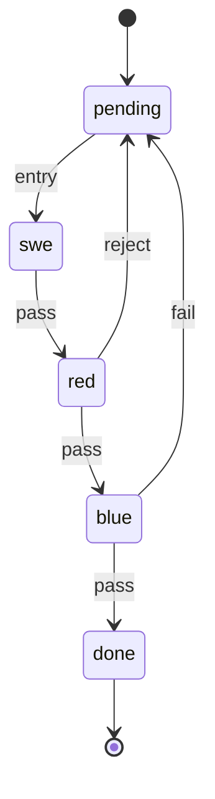
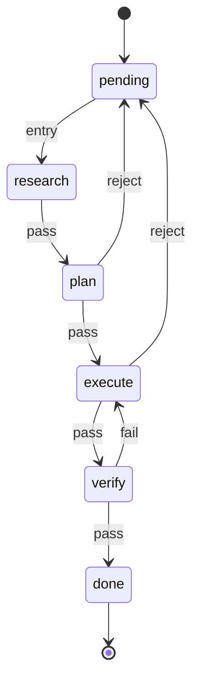
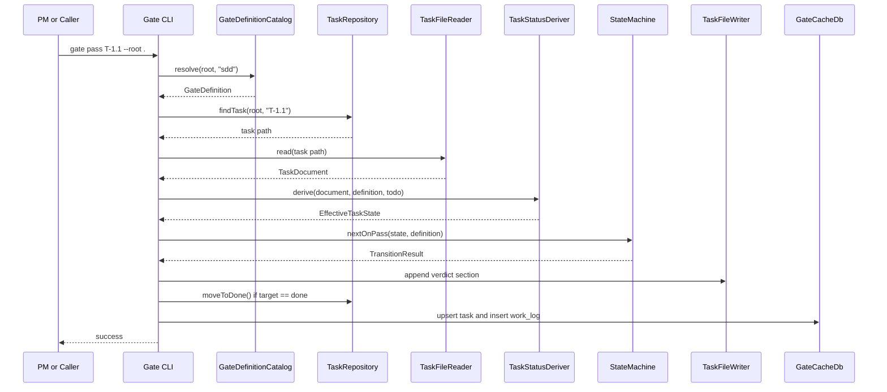

# Gate UML Spec

This document is the authoritative implementation spec for rebuilding `gate`.

## Authority

- `SPEC = this UML document + /Users/brett/maenifold/assets/gates/*.json`
- No code module may exist unless it is named in this spec.
- No module may take on responsibilities not assigned in this spec.
- Built-in gate definitions come from `/Users/brett/maenifold/assets/gates`.
- In-repo `assets/pipelines/*.json` are not authoritative for gate enforcement.
- Files under `todo/` and `done/` are authoritative task state.
- `gate.db` is a rebuildable cache only.

## Scope

- New crate: `crates/maenifold-gate`
- Command surface:
  - `status`
  - `append`
  - `pass`
  - `reject`
  - `sync`
- First required enforced process: `sdd`
- Required built-in process support:
  - `sdd`
  - `tdd`
  - `gsd`
  - `lightweight`

## Architectural Rules

- `main.rs` is entrypoint only.
- CLI parsing must be isolated from command execution.
- Transition logic must exist only in `state_machine.rs`.
- File parsing must be isolated from file mutation.
- Cache rebuilding must never override file authority.
- Section heading prose must not be used as a substitute for legal transition state.
- Illegal transitions must fail closed.
- Silent fallback to a different pipeline definition is forbidden.

## Component UML

```mermaid
classDiagram
direction TB

class GateCliMain {
  +main() int
}

class CliParser {
  +parse(argv) CommandRequest
}

class CommandRouter {
  +run(request) Result
}

class StatusCommand {
  +execute(context) Result
}

class AppendCommand {
  +execute(context) Result
}

class PassCommand {
  +execute(context) Result
}

class RejectCommand {
  +execute(context) Result
}

class SyncCommand {
  +execute(context) Result
}

class GateContext {
  +root: Path
  +pipelineName: String
  +jsonOutput: bool
}

class GateDefinitionCatalog {
  +loadBuiltin(name) GateDefinition
  +loadCustom(root) GateDefinition
  +resolve(root, name) GateDefinition
}

class GateDefinitionValidator {
  +validate(definition) Result
}

class GateDefinition {
  +name: String
  +stages: Vec~GateStage~
  +entryStage() String
  +findStage(name) GateStage
}

class GateStage {
  +name: String
  +verdicts: Vec~String~
  +transitions: Map~String,String~
}

class TaskRepository {
  +findTask(root, taskId) TaskPathSet
  +listTasks(root) Vec~TaskPathSet~
  +moveToDone(task) Result
}

class TaskFileReader {
  +read(path) TaskDocument
}

class TaskFileWriter {
  +appendSection(path, section) Result
}

class TaskMetadataParser {
  +parse(lines) TaskMetadata
}

class TaskSectionParser {
  +parse(lines) Vec~TaskStageRecord~
}

class TaskStatusDeriver {
  +derive(document, definition, location) EffectiveTaskState
}

class StateMachine {
  +nextOnPass(state, definition) TransitionResult
  +nextOnReject(state, definition) TransitionResult
  +nextOnFail(state, definition) TransitionResult
  +validateVerdict(state, verdict, definition) Result
}

class CanonicalSectionFactory {
  +buildAppendSection(stage, agent, notes, model) String
  +buildVerdictSection(stage, verdict, notes, model) String
}

class GateCacheDb {
  +open(root) Db
  +rebuild(root, definition, tasks) Result
  +upsertTask(task) Result
  +insertWorkLog(entry) Result
}

class PrdParser {
  +parse(path) Vec~Requirement~
}

class RtmParser {
  +parse(path) Vec~TraceabilityRow~
}

class JsonRenderer {
  +renderStatus(result) String
  +renderError(error) String
}

class GateError {
  <<error>>
}

GateCliMain --> CliParser
CliParser --> CommandRouter

CommandRouter --> StatusCommand
CommandRouter --> AppendCommand
CommandRouter --> PassCommand
CommandRouter --> RejectCommand
CommandRouter --> SyncCommand

StatusCommand --> GateContext
AppendCommand --> GateContext
PassCommand --> GateContext
RejectCommand --> GateContext
SyncCommand --> GateContext

StatusCommand --> GateDefinitionCatalog
AppendCommand --> GateDefinitionCatalog
PassCommand --> GateDefinitionCatalog
RejectCommand --> GateDefinitionCatalog
SyncCommand --> GateDefinitionCatalog

GateDefinitionCatalog --> GateDefinitionValidator
GateDefinitionCatalog --> GateDefinition

StatusCommand --> TaskRepository
AppendCommand --> TaskRepository
PassCommand --> TaskRepository
RejectCommand --> TaskRepository
SyncCommand --> TaskRepository

TaskRepository --> TaskFileReader
TaskFileReader --> TaskMetadataParser
TaskFileReader --> TaskSectionParser

StatusCommand --> TaskStatusDeriver
AppendCommand --> StateMachine
PassCommand --> StateMachine
RejectCommand --> StateMachine

AppendCommand --> CanonicalSectionFactory
PassCommand --> CanonicalSectionFactory
RejectCommand --> CanonicalSectionFactory

AppendCommand --> TaskFileWriter
PassCommand --> TaskFileWriter
RejectCommand --> TaskFileWriter

SyncCommand --> GateCacheDb
SyncCommand --> PrdParser
SyncCommand --> RtmParser

StatusCommand --> JsonRenderer
AppendCommand --> JsonRenderer
PassCommand --> JsonRenderer
RejectCommand --> JsonRenderer
SyncCommand --> JsonRenderer
```

## Allowed Module Inventory

Only these source files are allowed in `crates/maenifold-gate/src`:

- `main.rs`
- `cli.rs`
- `error.rs`
- `gate_definition.rs`
- `gate_catalog.rs`
- `task_repository.rs`
- `task_file.rs`
- `task_metadata.rs`
- `task_sections.rs`
- `task_status.rs`
- `state_machine.rs`
- `section_factory.rs`
- `cache_db.rs`
- `prd_parser.rs`
- `rtm_parser.rs`
- `json_output.rs`
- `status_command.rs`
- `append_command.rs`
- `pass_command.rs`
- `reject_command.rs`
- `sync_command.rs`

If implementation requires a new file, the UML must be updated first.

## Module Responsibilities

### `main.rs`

- Program entrypoint only
- Initializes CLI and exits with code

### `cli.rs`

- `clap` command parsing only
- No command execution logic

### `error.rs`

- Typed errors only
- No business logic

### `gate_definition.rs`

- Deserialize gate JSON
- Represent stage and transition data
- Expose lookup helpers

### `gate_catalog.rs`

- Resolve built-in definitions from `/Users/brett/maenifold/assets/gates`
- Resolve custom `{root}/pipeline.json` only for explicit custom pipelines
- Enforce precedence rules

### `task_repository.rs`

- Enumerate `todo/` and `done/`
- Resolve task IDs to file paths
- Detect duplicate task IDs
- Move terminal tasks into `done/`

### `task_file.rs`

- Read one markdown task file
- Return structured document object

### `task_metadata.rs`

- Parse title
- Parse `Requirement`
- Parse `Test Cases`
- Parse `Component`

### `task_sections.rs`

- Parse canonical stage sections
- Parse canonical verdict markers
- Return ordered stage records

### `task_status.rs`

- Derive effective task status from:
  - task file contents
  - directory location
  - active gate definition

### `state_machine.rs`

- Sole source of legal transitions
- Interpret verdict legality from active gate definition
- Compute next state
- Reject illegal transitions

### `section_factory.rs`

- Produce canonical markdown sections for:
  - `append`
  - `pass`
  - `reject`
  - `fail`

### `cache_db.rs`

- Create and rebuild `gate.db`
- Upsert tasks
- Insert work log entries
- No authority over task truth

### `prd_parser.rs`

- Parse `PRD.md` requirements for `sync`

### `rtm_parser.rs`

- Parse `RTM.md` traceability rows for `sync`

### `json_output.rs`

- JSON formatting only

### `status_command.rs`

- `status` command execution only

### `append_command.rs`

- `append` command execution only

### `pass_command.rs`

- `pass` command execution only

### `reject_command.rs`

- `reject` command execution only

### `sync_command.rs`

- `sync` command execution only

## State Model

### SDD State Machine

### GSD State Machine

## Command Sequence UML

## Precedence Rules

These rules are mandatory.

1. If a custom pipeline is explicitly requested and `{root}/pipeline.json` exists, load it.
2. If a built-in pipeline name is requested, load it from `/Users/brett/maenifold/assets/gates/<name>.json`.
3. Built-in names are reserved.
4. A local custom `pipeline.json` must not silently override a reserved built-in.
5. In-repo `assets/pipelines/*.json` must not be used for gate enforcement.
6. Missing or malformed authoritative gate JSON is an error.

## File Authority Rules

- If a task file is in `done/`, effective location is `done`.
- If a task file is in `todo/`, effective location is `todo`.
- If a task in `todo/` has no stage sections, effective state is `pending`.
- If a task in `done/` is not terminal under the active definition, this is an error condition.
- The presence of later-stage prose must not advance state unless the active state machine and canonical recorded verdict permit it.

## Canonical Section Rules

### Special SDD Section Names

- `swe` -> `## SWE Remediation`
- `red` -> `## Red-team Audit`
- `blue` -> `## Blue-team Verification`

### Generic Section Rule

- For non-special stages, use title-cased stage names as canonical headings.

### Canonical Data Requirements

Each appended section must include:

- agent identity
- date
- notes
- verdict when applicable
- model if provided

## Invariants

- One authoritative gate definition per command invocation.
- All legal transitions are derived from `current_stage + verdict -> next_stage`.
- Verdicts not declared by a stage are illegal.
- `append` must not change stage.
- `pass`, `reject`, and `fail` must be atomic with respect to file mutation.
- Terminal `done` has no outgoing transition.
- Final-stage `pass` must move the file into `done/`.
- `sync` rebuilds cache from files and active definitions.
- Cache mismatch must never silently override file truth.
- Duplicate task IDs are fatal.
- Unknown transition targets are fatal.
- Duplicate stage names are fatal.
- Hidden defaults are forbidden.

## Required Off-the-Shelf Crates

- `clap`
- `serde`
- `serde_json`
- `rusqlite`
- `walkdir`
- `regex`
- `thiserror`
- `chrono`

Optional:

- `tempfile`
- `assert_cmd`
- `predicates`

Not required for enforcement:

- markdown AST parsing
- heuristic heading inference

## Verification Requirements

All implementation must be testable against these required named tests.

### Unit Tests

- `builtin_sdd_definition_matches_authoritative_asset`
- `builtin_gsd_definition_matches_authoritative_asset`
- `builtin_lightweight_definition_matches_authoritative_asset`
- `builtin_tdd_definition_matches_authoritative_asset`
- `authoritative_tdd_shape_is_currently_swe_red_blue`
- `stage_order_for_sdd_is_swe_then_red_then_blue`
- `sdd_pass_from_swe_transitions_to_red`
- `sdd_pass_from_red_transitions_to_blue`
- `sdd_reject_from_red_transitions_to_pending`
- `sdd_pass_from_blue_transitions_to_done`
- `sdd_fail_from_blue_transitions_to_pending`
- `sdd_reject_is_illegal_from_swe`
- `sdd_fail_is_illegal_from_red`
- `pass_is_illegal_when_task_is_already_done`
- `append_does_not_change_effective_stage`
- `gsd_fail_from_verify_retries_execute`
- `lightweight_pass_from_swe_skips_to_blue`
- `pipeline_definition_rejects_unknown_transition_target`
- `pipeline_definition_rejects_duplicate_stage_names`
- `status_derivation_prefers_done_location_over_partial_audit_trail`

### Integration Tests

- `status_reports_new_todo_task_as_pending`
- `append_records_swe_work_without_advancing_state`
- `pass_advances_sdd_task_from_swe_to_red`
- `pass_advances_sdd_task_from_red_to_blue`
- `reject_returns_sdd_task_from_red_to_pending_and_increments_attempts`
- `fail_returns_sdd_task_from_blue_to_pending_and_increments_attempts`
- `final_pass_moves_sdd_task_from_todo_to_done`
- `status_json_reflects_sdd_stage_progression`
- `sync_rebuild_recovers_cache_from_authoritative_markdown_files`
- `sync_rebuild_recovers_done_location_from_done_directory`
- `status_ignores_stale_cache_when_files_disagree`
- `external_authoritative_gate_asset_wins_over_stale_workspace_pipeline_asset`
- `illegal_reject_from_swe_returns_error_and_leaves_files_unchanged`
- `illegal_fail_from_red_returns_error_and_leaves_files_unchanged`
- `illegal_pass_from_done_returns_error_and_leaves_files_unchanged`
- `append_pass_reject_sequence_preserves_audit_trail_sections`
- `status_for_completed_task_remains_done_after_rebuild`

## Agent Contract

### PM

- Owns this spec
- May revise UML before implementation changes
- Rejects implementation not represented here

### SWE

- Implements only modules present in this spec
- Must not invent new architecture outside this document
- Builds only the assigned crate during implementation waves

### Red-team

- Audits spec conformance
- Audits transition correctness
- Audits silent fallback risk

### Blue-team

- Verifies named tests only
- Issues PASS or FAIL against spec behavior

## Delivery Gate

Implementation is not complete unless:

- the crate exists
- the code matches this UML
- the SDD state machine is enforced from the authoritative JSON
- named verification passes
- a runnable binary is produced
