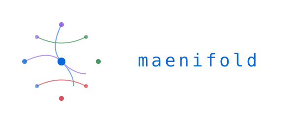

<p align="center">
  
</p>

<p align="center">
  <strong>The reasoning console.</strong> Knowledge graph · pipeline orchestration · multi-agent coordination.
</p>

<p align="center">
  <a href="https://github.com/msbrettorg/maenifold-rs"></a>
</p>

**Status:** Pre-1.0 developer preview. Build from source. Desktop and pipeline features are experimental.

**Product thesis:** First solve the intelligence problem. Work is a byproduct.

# maenifold

maenifold is a local-first Rust backend plus a Tauri desktop app for working with persistent agent memory, ACP sessions, reusable workflow assets, visual pipelines, and gated delivery. The desktop app, the CLI, and external AI clients all talk to the same MCP-native tool surface. The goal is simple: one place to reason, orchestrate, execute against the world, and keep context alive across sessions.

Pipelines can execute MCP tools directly against real systems before any model is invoked. That means you can pull structured context from anything that speaks MCP, including local shell-backed servers and external services, then spend tokens only on the downstream steps that actually require reasoning, synthesis, or generation. A single pipeline can mix ACP-backed agents and harnesses, per-node model and reasoning settings, zero-token tool calls, reusable workflow nodes, and graph-backed context in one executable graph.

The knowledge graph starts with ordinary markdown and `[[WikiLinks]]`. Each WikiLink becomes a concept node; co-occurrence becomes edges; sync turns the corpus into a graph you can search, visualize, and use to prime new sessions. Community detection clusters related concepts, and graph context can be pulled back into workflows or chat when needed. The source of truth stays readable because the memory layer is still just files plus a local database. You can inspect the graph and the underlying notes side by side.

Those pieces are meant to work as one system rather than five disconnected features. Memory, workflows, pipelines, gate records, and retained artifacts all meet in the same local substrate, so context, execution, and provenance can stay connected.

The backend centers on `crates/maenifold-core` and exposes 29 MCP tools. The desktop app has five surfaces: Agents for ACP chat, Pipelines for DAG orchestration, Gates for staged task flow, Workflows for the 69-workflow asset library, and Graph for community-level concept exploration. Current repo configuration targets `Copilot`, `Goose`, `OpenCode`, `Codex`, and `claude-code` agents. The backend and all persistent state run locally. MIT licensed.

## The Five Surfaces

### Agents

- ACP chat sessions against external agents from one desktop shell.
- Choose the ACP harness, mode, model, and reasoning effort per session, with permission prompts and traffic inspection built into the UI.
- Designed for multi-agent work without changing the backend protocol.

### Pipelines

- Visual DAG editor with runtime status, logs, and inspector panels.
- Four node types: `workflow`, `prompt`, `sequentialThinking`, and `tool`.
- A single pipeline can mix different ACP harnesses, modes, models, and reasoning settings across nodes.
- Tool nodes can execute MCP calls directly, so structured retrieval and system actions do not require model-token spend.
- Workflow nodes and graph-backed context let pipelines reuse codified reasoning methods instead of rebuilding cognition from scratch on every run.
- Supports pipeline surgery: `fork`, `graft`, `join`, and `rewind`.
- North star: self-evolving pipelines that learn from execution traces and improve how they gather context, route reasoning, and shape the graph over time.

### Gates

- `gate` is a separate binary for file-authoritative task management.
- Gates provide the local work ledger for staged delivery, review, and rework inside the larger intelligence system.
- Supports staged delivery flows through `status`, `append`, `pass`, `fail`, `history`, and `sync`.
- The same task system can be driven from CLI, MCP, or the desktop UI.

### Workflows

- Browse and filter 69 bundled workflows from the asset library.
- Workflows are reusable cognitive methods, not just saved prompts or sample JSON.
- Author and inspect workflow JSON in the desktop workflow editor.
- Import external workflow JSON and save it back into the local library.

### Graph

- Community view for the whole graph, then concept drill-down inside a selected cluster.
- Built from local WikiLinks, not a hidden hosted service.
- The Graph tab is an inspection surface for the same shared context layer that feeds sessions, workflows, pipelines, and retained knowledge.
- The same graph can feed sessions, workflows, and pipelines with reusable context instead of acting as a passive note map.
- Useful for spotting domain neighborhoods before opening the underlying memory files.

## Architecture

maenifold is MCP-native by design. The desktop app, the CLI, and external agent clients all use the same protocol and meet at the same constitutional boundary: domain state lives behind MCP instead of being reimplemented in each frontend. The server speaks stdio MCP and streamable HTTP; the pipeline runtime can call external MCP servers over stdio or streamable HTTP/HTTPS. The repo is a monorepo: the Rust workspace owns the backend crates, while `apps/desktop/` lives alongside it as a Tauri + Vue app and is excluded from the Rust workspace itself.

The long-term shape is a no-code intelligence environment: workflows codify reusable reasoning methods, pipelines ground those methods in real systems through direct MCP execution, and the graph ties memory, execution, and outputs together as an executable substrate rather than a passive visualization. Work outputs emerge as artifacts of the intelligence layer instead of the product's sole purpose.

## Example Flow

One concrete path through the system can look like this:

1. Call MCP tools against a CRM, shell-backed server, or operations system to pull structured context without invoking a model.
2. Route that context through workflow, prompt, or sequential thinking nodes, choosing the ACP harness, model, and reasoning settings per node as needed.
3. Inspect the run in the pipeline UI, then `fork`, `rewind`, `graft`, or `join` if the execution path needs correction.
4. Keep staged follow-up work in `gate` and promote only the durable knowledge worth retaining back into memory and the graph.

```text
maenifold-rs/
├── crates/
│   ├── maenifold-core/              # Library — tools, search, graph, ACP, pipeline engine
│   ├── maenifold-cli/               # Binary — CLI + MCP server
│   ├── maenifold-gate/              # Binary — file-authoritative task management
│   └── maenifold-pipeline-driver/   # Binary — headless pipeline executor
├── apps/desktop/                    # Tauri + Vue 3 desktop application
├── assets/                          # Workflows, roles, colors, perspectives, integrations
└── docs/                            # Architecture, guides, research
```

## Quick Start

Build the CLI from source:

```bash
cargo build --release -p maenifold-cli
```

If the binary is not on your `PATH`, invoke it as `./target/release/maenifold`.

Minimal MCP client config:

```json
{
  "mcpServers": {
    "maenifold": { "command": "maenifold", "args": ["--mcp"], "type": "stdio" }
  }
}
```

CLI examples using the current direct-tool syntax:

```bash
maenifold tool WriteMemory '{"title":"Auth Decision","content":"Using [[OAuth2]] for [[authentication]]"}'
maenifold tool SearchMemories '{"query":"authentication","mode":"Hybrid"}'
maenifold tool BuildContext '{"conceptName":"authentication","depth":2}'
```

Desktop app:

```bash
cd apps/desktop
npm install && npm run tauri dev
```

For HTTP mode, the backend also supports `maenifold --http` and exposes streamable MCP at `/mcp`.

## Tools

maenifold exposes 29 MCP tools across eight categories:

- **Memory** — `WriteMemory`, `ReadMemory`, `EditMemory`, `DeleteMemory`, `MoveMemory`, `ListMemories`
- **Search** — `SearchMemories`, `ExtractConceptsFromFile`, `FindSimilarConcepts`
- **Graph** — `Sync`, `BuildContext`, `Visualize`
- **Repair** — `RepairConcepts`, `AnalyzeConceptCorruption`
- **Reasoning** — `SequentialThinking`, `Workflow`, `AssumptionLedger`
- **Pipeline / ACP** — `Pipeline`, `ListAgents`, `AcpExec`
- **Assets** — `Adopt`, `ListAssets`, `UpdateAssets`, `ReadMcpResource`
- **System** — `GetConfig`, `GetHelp`, `RecentActivity`, `MemoryStatus`, `RunFullBenchmark`

Tool reference docs live under [`assets/usage/tools/`](assets/usage/tools/). The canonical registry is [`crates/maenifold-core/src/registry.rs`](crates/maenifold-core/src/registry.rs).

## Assets

The repo ships with a sizable local asset library:

- **69 workflows** in `assets/workflows/`
- **16 roles** in `assets/roles/`
- **7 colors** in `assets/colors/`
- **12 perspectives** in `assets/perspectives/`

These assets are consumed by the workflow engine, desktop authoring tools, and MCP-facing adoption flows. They are part of the product surface: reusable cognitive assets that let you compose methods of thought, not just connector configuration.

## Integrations

Bundled integration assets live under [`assets/integrations/`](assets/integrations/):

- [`assets/integrations/claude-code/`](assets/integrations/claude-code/) — Claude Code plugin assets
- [`assets/integrations/copilot/`](assets/integrations/copilot/) — Copilot plugin assets
- [`assets/integrations/opencode/`](assets/integrations/opencode/) — OpenCode agent and plugin assets
- [`assets/integrations/skills/`](assets/integrations/skills/) — reusable skills, including maenifold, gate, ACP, and Pinia support

## Development

The Rust backend and the desktop app evolve together, but they build separately. Start with the narrowest relevant target:

```bash
cargo build --workspace
make quality-lint
cargo test -p maenifold-core
MAENIFOLD_FULL_SUITE=1 cargo test
```

Desktop work happens under `apps/desktop/` with its own Node/Tauri toolchain. See [`docs/DEVELOPMENT.md`](docs/DEVELOPMENT.md) for the full build, test, and quality workflow.

Release automation currently packages three targets only: macOS ARM64, Linux x64, and Windows x64. There are no release tags in this repository today, so treat source builds as the supported path.

## Documentation

- [`docs/README.md`](docs/README.md)
- [`docs/BOOTSTRAP.md`](docs/BOOTSTRAP.md)
- [`docs/SCRIPTING.md`](docs/SCRIPTING.md)
- [`docs/acp-client-architecture.md`](docs/acp-client-architecture.md)
- [`docs/SECURITY_MODEL.md`](docs/SECURITY_MODEL.md)
- [`docs/TESTING_PHILOSOPHY.md`](docs/TESTING_PHILOSOPHY.md)
- [`docs/DEVELOPMENT.md`](docs/DEVELOPMENT.md)

## License

MIT. Repository: [msbrettorg/maenifold-rs](https://github.com/msbrettorg/maenifold-rs)
