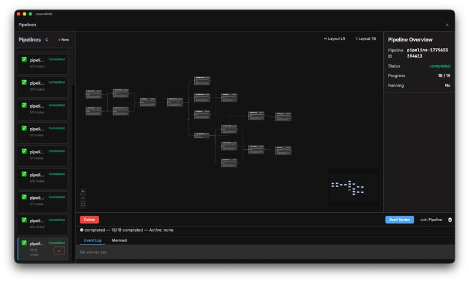

<p align="center">
  
</p>

<p align="center">
  <strong>The reasoning console.</strong> Knowledge graph · pipeline orchestration · multi-agent coordination.
</p>

<p align="center">
  <a href="https://github.com/msbrettorg/maenifold-rs"></a>
</p>

<p align="center">
  
</p>

**Status:** Pre-1.0 developer preview. Build from source. Desktop and pipeline features are experimental.

For anyone who spends more time gathering context and re-doing analysis than doing the actual work.

## Core Concepts

- **MCP** (Model Context Protocol) — the protocol maenifold uses to expose tools. Any MCP-compatible client can connect.
- **ACP** (Agent Client Protocol) — the protocol for multi-turn agent sessions. The Agents tab speaks ACP.
- **WikiLinks** — double-bracket links like `[[concept]]` in markdown files. These become nodes in the knowledge graph.
- **Pipeline** — a directed acyclic graph (DAG) of nodes that execute in dependency order.
- **Gate** — file-authoritative task management. Tasks live as markdown files and progress through stages.
- **Workflow** — a reusable JSON template that defines a structured reasoning process.

**Product thesis:** Build the reasoning layer first. Useful work follows.

# maenifold

maenifold is a local-first Rust backend plus a Tauri desktop app for working with persistent agent memory, ACP sessions, reusable workflow assets, visual pipelines, and gated delivery. The desktop app, the CLI, and external AI clients all talk to the same MCP-native tool surface — agents can do anything humans can and vice versa. The goal is simple: one place to reason, orchestrate, execute against the world, and keep context alive across sessions.

Pipelines can mix tool calls, agent sessions, and workflow nodes in a single executable DAG.

The knowledge graph starts with ordinary markdown and `[[WikiLinks]]`. Each WikiLink becomes a concept node; co-occurrence becomes edges; sync turns the corpus into a graph you can search, visualize, and use to prime new sessions. Community detection clusters related concepts, and graph context can be pulled back into workflows or chat when needed. The source of truth stays readable because the memory layer is still just files plus a local database. You can inspect the graph and the underlying notes side by side.

These pieces connect through shared local state — memory, workflows, pipelines, gate records, and the graph all reference each other.

The backend centers on `crates/maenifold-core` and exposes MCP tools across eight categories. The desktop app includes dedicated surfaces for Agents, Pipelines, Gates, Workflows, and Graph. Current repo configuration targets `Copilot`, `Goose`, `OpenCode`, `Codex`, and `claude-code` agents. The backend and all persistent state run locally. MIT licensed.

## Main Surfaces

### Agents

- ACP chat sessions against external agents from one desktop shell.
- Choose the ACP harness, mode, model, and reasoning effort per session, with permission prompts and traffic inspection built into the UI.
- Designed for multi-agent work without changing the backend protocol.

### Pipelines

- Visual DAG editor with runtime status, logs, and inspector panels.
- Node types include `workflow`, `prompt`, `sequentialThinking`, and `tool`.
- A single pipeline can mix different ACP harnesses, modes, models, and reasoning settings across nodes.
- Tool nodes can execute MCP calls directly, so structured retrieval and system actions do not require model-token spend.
- Workflow nodes and graph-backed context let pipelines reuse structured reasoning playbooks instead of rebuilding the same process on every run.
- Supports pipeline surgery: `fork`, `graft`, `join`, and `rewind`.

### Gates

- `gate` is a separate binary for file-authoritative task management.
- Gates provide the local work ledger for staged delivery, review, and rework inside maenifold.
- Think of it as a local issue tracker that agents and humans can both drive.
- Supports staged delivery flows through `status`, `append`, `pass`, `fail`, `history`, and `sync`.
- The same task system can be driven from CLI, MCP, or the desktop UI.

### Workflows

- Browse and filter dozens of bundled workflows from the asset library.
- Each workflow is a structured reasoning template — more than a prompt, less than a full application.
- Author and inspect workflow JSON in the desktop workflow editor.
- Import external workflow JSON and save it back into the local library.

### Graph

- Community view for the whole graph, then concept drill-down inside a selected cluster.
- Built from local WikiLinks, not a hidden hosted service.
- The graph feeds sessions, workflows, and pipelines with reusable context — it's an active part of the system, not a passive note map.
- Useful for spotting domain neighborhoods before opening the underlying memory files.

## Architecture

maenifold is MCP-native by design. The server speaks stdio MCP and streamable HTTP, and the pipeline runtime can call external MCP servers over stdio or streamable HTTP/HTTPS. All domain state lives behind MCP instead of being reimplemented in each frontend. The repo is a monorepo: the Rust workspace owns the backend crates, while `apps/desktop/` lives alongside it as a Tauri + Vue app and is excluded from the Rust workspace itself.

Because MCP is the only domain interface, there is no capability gap between human and agent. An agent can write memories, create pipelines, dispatch other agents, and pass or fail gate tasks — the same operations a human performs through the desktop app. Pipelines are not static: an agent running inside a pipeline can fork the pipeline it's executing in, and completed upstream work is preserved. Mutation of a live run (graft, rewind, join) is intentionally guarded — cancel or complete first, then reshape.

## Example Flow

Write a note, build a graph, search it, run a pipeline:

1. **Create a memory:** `maenifold tool WriteMemory '{"title":"Auth Decision","content":"Using [[OAuth2]] for [[authentication]] because [[SAML]] was too heavy for our use case."}'`
2. **Sync the graph:** `maenifold tool Sync '{}'` — WikiLinks become concept nodes with edges.
3. **Search it:** `maenifold tool SearchMemories '{"query":"authentication","mode":"Hybrid"}'` — returns the note ranked by relevance.
4. **Explore in the desktop app:** Open the Graph tab to see `OAuth2`, `authentication`, and `SAML` clustered together.
5. **Run a pipeline:** Create a DAG in the Pipelines tab with a tool node that calls SearchMemories, feeding results into a prompt node for synthesis.

The graph accumulates context over time. Pipelines and workflows can pull from it automatically, so reasoning improves as the corpus grows.

### In Practice

A `deal-prep` pipeline pulls account data from a CRM, deployment status from workplace intelligence, and licensing docs — six tool nodes in parallel, zero model tokens on the data gathering. It routes results through a structured analysis workflow, synthesizes findings in a persistent thinking session, and generates a slide deck. The output is a deliverable for a customer meeting, not code.

A research pipeline works differently: start with a hypothesis, run experiment nodes, then graft new experiments onto the living DAG as results suggest new directions. An 18-node memory subsystem benchmark grew this way — each graft extending the investigation without rerunning completed upstream work.

The same pipeline structure serves any domain where the work is: gather context, apply a method, produce an output, and optionally evolve the process as you learn.

```text
maenifold-rs/
├── crates/
│   ├── maenifold-core/              # Library — tools, search, graph, ACP, pipeline engine
│   ├── maenifold-cli/               # Binary — CLI + MCP server
│   ├── maenifold-gate/              # Binary — file-authoritative task management
│   └── maenifold-pipeline-driver/   # Binary — headless pipeline executor
├── apps/desktop/                    # Tauri + Vue 3 desktop application
├── assets/                          # Workflows, roles, colors, perspectives, integrations
└── docs/                            # Architecture, guides, research
```

## Prerequisites

- Rust 1.75+ (stable toolchain)
- Node 18+ and npm (for the desktop app)
- Tauri system dependencies — see the [Tauri v2 prerequisites](https://v2.tauri.app/start/prerequisites/)
- macOS ARM64, Linux x64, or Windows x64

## Quick Start

Build the CLI from source:

```bash
cargo build --release -p maenifold-cli
```

The binary lands at `./target/release/maenifold`. Add it to your PATH or invoke it directly.

Minimal MCP client config:

```json
{
  "mcpServers": {
    "maenifold": { "command": "maenifold", "args": ["--mcp"], "type": "stdio" }
  }
}
```

This JSON goes in whatever MCP client config your agent host expects (e.g., `.copilot/config.json`, `claude_desktop_config.json`).

CLI examples using the current direct-tool syntax:

```bash
maenifold tool WriteMemory '{"title":"Auth Decision","content":"Using [[OAuth2]] for [[authentication]]"}'
maenifold tool SearchMemories '{"query":"authentication","mode":"Hybrid"}'
maenifold tool BuildContext '{"conceptName":"authentication","depth":2}'
```

On a fresh install with no memory files, SearchMemories returns an empty result set — that's expected.

Desktop app:

```bash
cd apps/desktop
npm install && npm run tauri dev
```

For HTTP mode, the backend also supports `maenifold --http` and exposes streamable MCP at `/mcp`.

## Tools

maenifold exposes roughly 30 MCP tools across eight categories:

- **Memory** — `WriteMemory`, `ReadMemory`, `EditMemory`, `DeleteMemory`, `MoveMemory`, `ListMemories`
- **Search** — `SearchMemories`, `ExtractConceptsFromFile`, `FindSimilarConcepts`
- **Graph** — `Sync`, `BuildContext`, `Visualize`
- **Repair** — `RepairConcepts`, `AnalyzeConceptCorruption`
- **Reasoning** — `SequentialThinking`, `Workflow`, `AssumptionLedger`
- **Pipeline / ACP** — `Pipeline`, `ListAgents`, `AcpExec`
- **Assets** — `Adopt`, `ListAssets`, `UpdateAssets`, `ReadMcpResource`
- **System** — `GetConfig`, `GetHelp`, `RecentActivity`, `MemoryStatus`, `RunFullBenchmark`

Tool reference docs live under [`assets/usage/tools/`](assets/usage/tools/). The canonical registry is [`crates/maenifold-core/src/registry.rs`](crates/maenifold-core/src/registry.rs).

## Assets

The repo ships with dozens of bundled workflows, roles, colors, and perspectives:

- **Workflows** in `assets/workflows/`
- **Roles** in `assets/roles/`
- **Colors** in `assets/colors/`
- **Perspectives** in `assets/perspectives/`

These assets are consumed by the workflow engine, desktop authoring tools, and MCP-facing adoption flows. They are reusable templates for structured reasoning, not just connector configuration.

## Integrations

Bundled integration assets live under [`assets/integrations/`](assets/integrations/):

- [`assets/integrations/claude-code/`](assets/integrations/claude-code/) — Claude Code plugin assets
- [`assets/integrations/copilot/`](assets/integrations/copilot/) — Copilot plugin assets
- [`assets/integrations/opencode/`](assets/integrations/opencode/) — OpenCode agent and plugin assets
- [`assets/integrations/skills/`](assets/integrations/skills/) — reusable skills, including maenifold, gate, ACP, and Pinia support

## What's Next

- **Future direction:** self-evolving pipelines that learn from execution traces and improve how they gather context, route reasoning, and shape the graph over time.
- **Future direction:** move maenifold closer to a no-code environment for agent orchestration, with workflows, pipelines, and the graph working together through shared local state.

## Development

The Rust backend and the desktop app evolve together, but they build separately. Start with the narrowest relevant target:

```bash
cargo build --workspace
make quality-lint
cargo test -p maenifold-core
MAENIFOLD_FULL_SUITE=1 cargo test
```

Desktop work happens under `apps/desktop/` with its own Node/Tauri toolchain. See [`docs/DEVELOPMENT.md`](docs/DEVELOPMENT.md) for the full build, test, and quality workflow.

Release automation currently packages macOS ARM64, Linux x64, and Windows x64. There are no release tags in this repository today, so treat source builds as the supported path.

## Documentation

- [`docs/README.md`](docs/README.md)
- [`docs/BOOTSTRAP.md`](docs/BOOTSTRAP.md)
- [`docs/SCRIPTING.md`](docs/SCRIPTING.md)
- [`docs/acp-client-architecture.md`](docs/acp-client-architecture.md)
- [`docs/SECURITY_MODEL.md`](docs/SECURITY_MODEL.md)
- [`docs/TESTING_PHILOSOPHY.md`](docs/TESTING_PHILOSOPHY.md)
- [`docs/DEVELOPMENT.md`](docs/DEVELOPMENT.md)

## License

MIT. Repository: [msbrettorg/maenifold-rs](https://github.com/msbrettorg/maenifold-rs)
